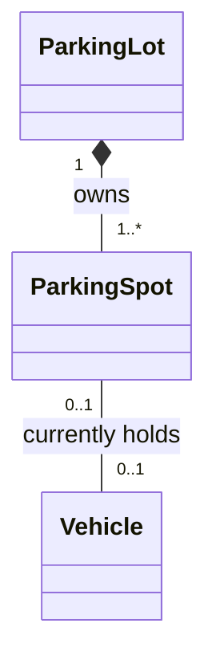
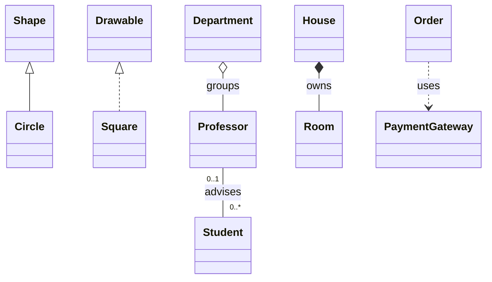
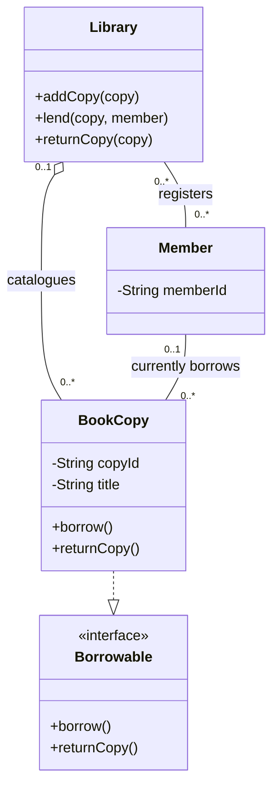
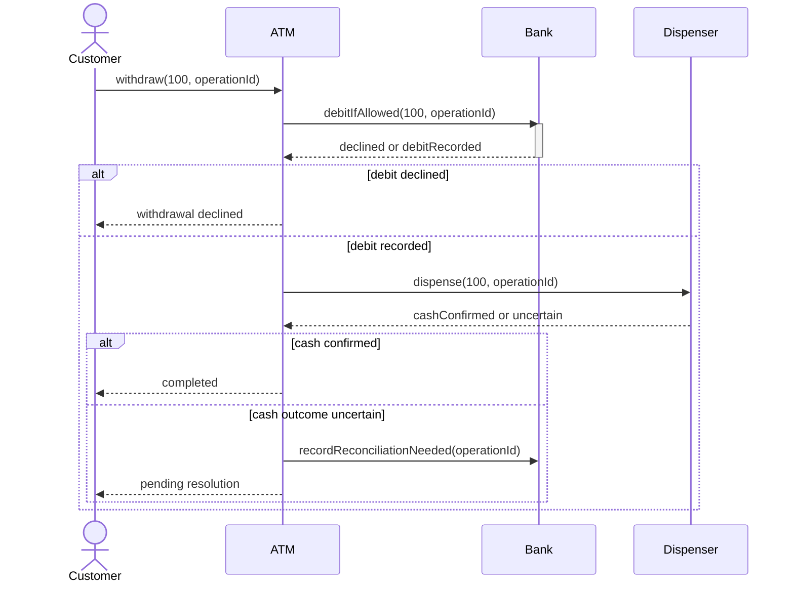
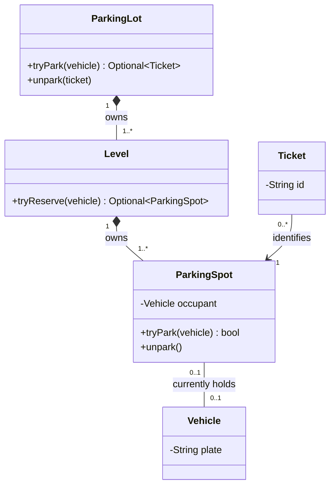
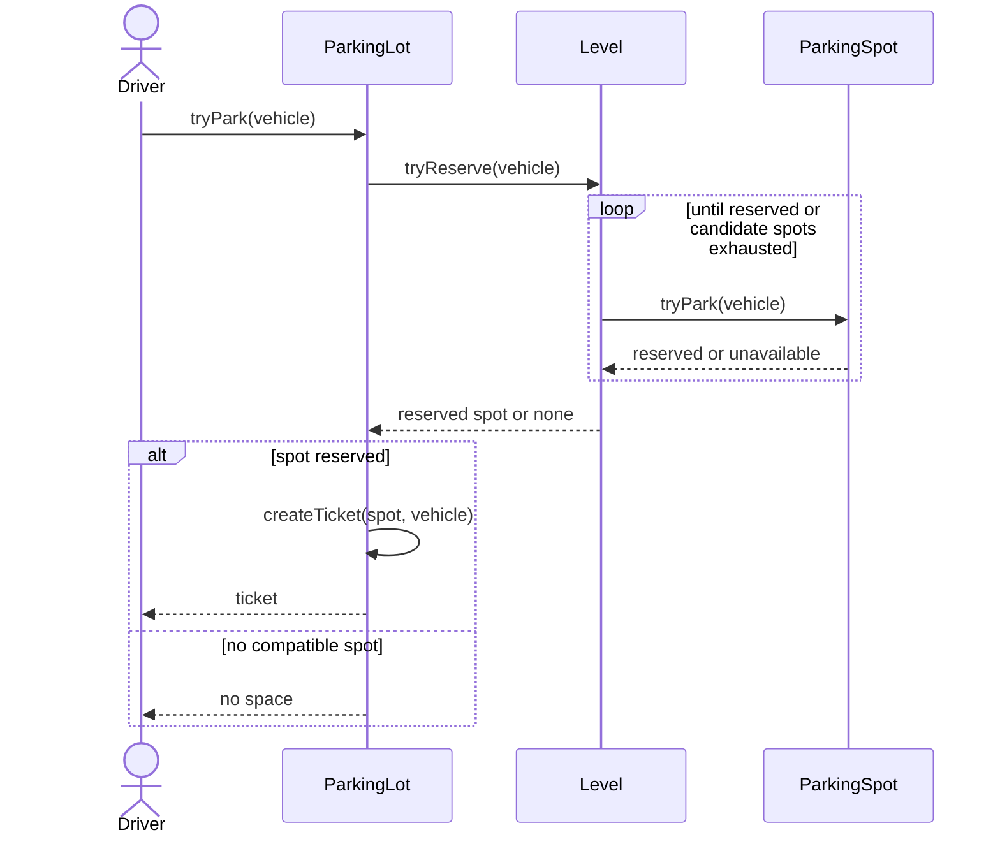

<!-- section: Design Patterns | category: Architecture | tags: concept, lld, uml, theory | role-priority: important | general-importance: specialized -->
[](#)
[](#)
[](#)
[](#)
[](../../../docs/topic-importance.md)
[](../../../docs/topic-importance.md)

# UML Basics — Class & Sequence Diagrams

A box labeled `ParkingSpot` does not say whether it owns a vehicle or merely refers to one. A list of classes does not say whether two drivers can reserve the same spot. A useful diagram makes those relationships and operations explicit:



## Definition

**UML**, the Unified Modeling Language, is a standard **notation** for describing a system's structure, behavior, and interactions. A **class diagram** describes types and relationships; a **sequence diagram** follows messages among particular participants in a use case.

> **Textbook Definition:** UML is a standardized visual modeling language for specifying the structure, behavior, and interactions of software systems through defined diagram elements and relationships.

UML defines 14 diagram types. This chapter starts with class and sequence diagrams because together they answer "what relates to what?" and "what happens next?" Mermaid diagrams below use UML vocabulary, but Mermaid is a rendering syntax, not the UML specification: its tokens do not encode every semantic distinction, so each diagram also states its meaning in prose.

## First Principles

A design review must distinguish three different claims: a type can hold a reference to another type, an object can own another object's lifecycle, and one operation can invoke another. Treating all three as an unlabelled arrow hides the rules code must enforce.

Static relationships also cannot prove execution order — the right components can still check too early or publish success before a write commits. A separate interaction view makes those orderings visible. Neither view implements the rules: the diagram states the model, and code plus tests must establish that the implementation follows it. So agree on structure with a class diagram, then trace one success and one failure in a sequence diagram; if the trace needs an operation or state the class diagram lacks, revise the structure.

## 1. Read a class box and its relationships

```text
┌────────────────────────────┐
│ BankAccount                │  name
├────────────────────────────┤
│ - balance: number          │  attribute: name and type
├────────────────────────────┤
│ + deposit(amount): void    │  operation: input and return type
│ + getBalance(): number     │
└────────────────────────────┘
```

`+` means public, `-` private, `#` protected, `~` package visibility — an omitted marker establishes no universal default. Abstract names or operations may be italicized or marked `{abstract}`; bold alone does not indicate abstraction, and an interface may be marked `«interface»`. A private balance with public `deposit` communicates where mutation is meant to happen; it proves neither amount validation nor concurrent-update safety ([OOP concepts](30.1.1.03-oop-concepts.md) traces the invariant behind this interface).

Choose the relationship by the promise it makes:

| Relationship | Notation and direction | What the reader may infer |
| -------------- | --------------------------------------------- | ------------------------------------------------------------------------------------------------------ |
| Generalization | Solid line, hollow triangle at the parent | Child specializes parent; substitution still needs a behavioral contract |
| Realization | Dashed line, hollow triangle at the interface | Implementation conforms to the interface specification |
| Association | Solid line; optional navigability arrow | Structural relationship; labelled ends state roles and multiplicities |
| Aggregation | Hollow diamond at the whole | Shared whole-part grouping; no exclusive ownership or automatic deletion |
| Composition | Filled diamond at the whole | A part belongs to at most one composite; the whole has lifecycle responsibility in the model |
| Dependency | Dashed arrow toward the supplier | Client relies on the supplier, e.g. as an operation parameter or temporary collaborator |

An association arrow describes navigation to a related instance — not a call trace, and not every association needs one. A dependency arrow points from dependent client to supplier; triangles point toward the generalized type or realized interface; diamonds sit at the whole, never the part.



These are independent examples. `Professor`–`Student` says a professor advises zero or more students and a student has zero or one advisor **in this model**. `House`–`Room` models ownership — it instructs neither JavaScript to destroy objects nor a database to cascade rows. Shared aggregation has deliberately weak semantics, so never infer precise lifetime rules from a hollow diamond.

A **multiplicity** beside an endpoint counts how many instances at **that end** relate to one instance at the opposite end: `1` exactly one, `0..1` optional single, `0..*` or `*` zero or more, `1..*` at least one, `n..m` an inclusive range. Above, a new professor may have no students; relabelling the student end `1..*` would forbid that state. A list-valued field alone cannot express that minimum.

## 2. Model one library: copies, members, and borrowing



`BookCopy` is a physical copy, not a shared title. A copy can sit outside this library's catalog (`0..1`); a member can register at several libraries. The current-borrowing association lets one member hold several copies while a copy has at most one current borrower — loan history needs a separate loan record, since one current association cannot preserve past borrowers or dates.

`BookCopy` realizes `Borrowable`; neither `Library` nor `Member` inherits from it. The library coordinates lending while the copy's operations enforce its availability rule. The diagram specifies no concurrency control or overdue policy — add those only when requirements demand them.

## 3. Follow one interaction down its lifelines

A **lifeline** represents a participant instance or role over the interaction, with messages in order down the lifeline. A sent message precedes its receipt; independent lifelines imply no universal physical clock just because events share a horizontal row.

An **activation bar** marks an execution interval. In UML, a synchronous call is a solid line with filled arrowhead, an asynchronous message a solid line with open arrowhead, and a reply a dashed line with open arrowhead. Mermaid tokens `->>`, `-)`, `-->>`, `--)` render solid arrowhead, solid open arrow, dotted arrowhead, and dotted open arrow; Mermaid calls the open-arrow forms asynchronous and does not label every UML message kind separately. The examples use Mermaid's dotted arrowhead for returned outcomes, with the call and message text making the reply role clear — for strict symbol fidelity, use a dedicated UML tool. A self-call returns to the same lifeline.

A **combined fragment** surrounds related messages: `alt` holds guarded alternatives, `opt` one conditional branch, `loop` repeated messages. Always state the guard or repetition condition — a box labeled "loop" alone never says when it ends.

Trace an ATM withdrawal's consequential failure (card and PIN authorization already succeeded; the bank enforces account rules internally rather than exposing a balance-check/write pair):



Follow the success branch: request → debit reply → dispense reply → completion. If dispensing is uncertain after a debit, returning "completed" claims something the ATM does not know, and blindly repeating the debit can duplicate it. The operation identifier ties the messages to one attempt; the implementation must define duplicate handling and reconciliation. A diagram that merely debits then dispenses omits this failure boundary — and proves nothing about atomicity across bank and cash dispenser. A self-call can show `ATM` invoking an internal receipt formatter, wrapped in `opt [receipt requested]`; a `loop [remaining bills > 0]` frame describes dispensing each bill. Use those views only when those steps matter to the question.

## 4. Combine both views on a parking lot

State the ownership and occupancy rules first:



Every level and spot has one owning whole; each spot holds at most one vehicle and each vehicle occupies at most one spot in this model. Several historical tickets may refer to one spot, but ticket validity and active occupancy are additional rules, not implied by that history multiplicity.

`Optional~Ticket~` and `Optional~ParkingSpot~` are Mermaid-tilde generic return types denoting zero-or-one results — not UML multiplicities. `tryPark` may yield no ticket when full; if callers must distinguish a full lot from a reservation conflict or operational failure, return an explicit result with those cases.

Deleting the lot needs an explicit policy for active tickets and vehicle records: composition is a modelled responsibility, not permission to discard real occupants. Vehicle variants need inheritance only if a substitutable behavior differs — a `VehicleType` size field can suffice; `Car`/`Truck` classes for nouns alone add no mechanism.

Then keep check and reservation under one owner in the interaction:



Driver A must not call `isAvailable()`, wait, then call `park()` after Driver B takes the spot — `tryPark` owns that decision and transition together. A single-process implementation might serialize access; several application instances need a shared concurrency mechanism, and putting the operation in one box provides none automatically. If ticket creation fails after reservation, the contract must release the reservation or persist enough state to recover and return the same ticket on retry. See the [parking-lot case study](../../30.2-system-design/02-case-studies/30.2.2.28-parking-lot.md) for the broader design.

## 5. Choose another view when the question changes

| Diagram | Question it helps answer |
| -------------------- | ------------------------------------------------------------ |
| Class | What types, contracts, and relationships exist? |
| Sequence | Which messages accomplish this use case, and in what order? |
| Use case | Which goals do actors pursue through the system? |
| Activity | How does a workflow branch, join, or iterate? |
| State machine | Which states and transitions may this object have? |
| Component | Which software components expose or require interfaces? |
| Deployment | Where do artifacts run across execution nodes? |
| Package | How are model elements grouped and dependent? |
| Object | Which instances and links exist in this snapshot? |
| Communication | Which connected participants exchange the numbered messages? |
| Timing | Which state changes have timing constraints? |
| Interaction overview | How do interactions fit into a larger control flow? |
| Composite structure | Which internal parts and connectors realize this structure? |
| Profile | Which stereotypes and constraints extend UML for a domain? |

An occupancy state machine clarifies reserved → occupied → released transitions more directly than another class diagram. Use the view resolving the current uncertainty.

## 6. Draw to decide in reviews and interviews

Start with names and the few relationships the main use case needs. Add multiplicities and operation contracts, then walk the success and failure trace — refine when the trace contradicts the structure. Sketch on a whiteboard, in [Excalidraw](https://excalidraw.com/), or versioned as Mermaid or PlantUML text.

For a 60-minute low-level design discussion, an illustrative budget is: 5 requirements, 5 entities/use cases, 10 class diagram, 5 key interaction, 5 behavior variation, 10 failures, 10 extension/scaling boundaries, 5 follow-up discussion, 5 critical code. Adjust to the interview; never treat it as mandatory script. Common mistakes are unlabeled arrows, misplaced triangles or diamonds, missing minimum/maximum counts, and success-only sequences. Too much detail also obscures the decision: keep the operation proving the behavior, leave unrelated fields and helper calls out.

## Summary

Class diagrams describe allowed structure; sequence diagrams trace messages in one interaction. Read arrowheads, diamonds, and multiplicities as distinct promises. Trace a changed condition such as an unavailable spot or uncertain dispensing result to find missing operations and failure policies. A diagram communicates ownership and ordering, while the implementation must enforce lifecycle, concurrency, and retry contracts.

## See Also

- [Foundations revision](REVISION.md) — read diagrams and change one condition
- [SOLID principles](30.1.1.01-solid-principles.md) — evaluate the boundaries
- [OOP concepts](30.1.1.03-oop-concepts.md) — state ownership and behavioral contracts
- [DRY, KISS, YAGNI](30.1.1.02-dry-kiss-yagni.md) — decide which detail is justified
- [Singleton](../02-creational/30.1.2.01-singleton.md) through [State pattern](../04-behavioral/30.1.4.04-state.md) — mechanisms for variation

## References & Learn More

- [OMG — UML 2.5.1 specification](https://www.omg.org/spec/UML/2.5.1/) — standard notation and semantics
- [Martin Fowler — UML Distilled](https://martinfowler.com/books/uml.html) — practical modeling
- [Mermaid sequence diagrams](https://mermaid.js.org/syntax/sequenceDiagram) — supported message line and arrow tokens
- [Mermaid class diagrams](https://mermaid.js.org/syntax/classDiagram) — relationship, multiplicity, and return-type syntax
- [PlantUML](https://plantuml.com/) — diagrams as text
- [Excalidraw](https://excalidraw.com/) — whiteboard sketches

---

[← Previous: OOP Concepts](30.1.1.03-oop-concepts.md) · [Back to Index](INDEX.md)
