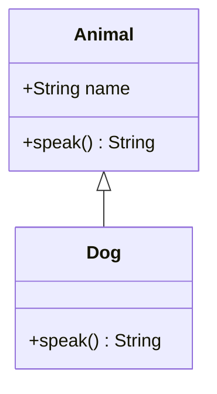

<!-- section: Design Patterns | category: Architecture | tags: concept, lld, uml, theory -->
[](#)
[](#)
[](#)

# UML Basics — Class & Sequence Diagrams

> **The visual language of software design.** You don't need to be a UML expert for interviews, but you should be able to sketch a class diagram and a sequence diagram on a whiteboard. This is the difference between "I can describe" and "I can show."

## TL;DR

- **Class diagram** — static structure. Classes, fields, methods, relationships.
- **Sequence diagram** — dynamic behavior. Objects, messages, time.
- **14 UML diagram types** total, but for LLD interviews, you only need 2.
- **In interviews: sketch a class diagram in 5 minutes, sketch a sequence diagram for the main use case in 3 minutes.**

---

## First Principles

UML exists because design communication needs a shared visual grammar:

1. **Diagrams compress review.** A class diagram shows coupling at a glance that code shows only by reading everything — the value is *seeing structure*, especially the accidental coupling.
2. **Precision trades convenience**: full UML is a specification language; sketches are communication. The practical skill is matching fidelity to the decision at hand — box-and-line for architecture, precise class diagrams for API contracts.
3. **Diagrams rot unless generated** — which is why diagrams-as-code (Mermaid, PlantUML) in the repo beat whiteboard photos: versioned, diffable, reviewable.

## Why it matters

LLD interviews often say "design X" and expect you to:

1. **Identify classes** (nouns: Car, ParkingSpot, Ticket)
2. **Show their relationships** (Car HAS-A Engine, ParkingSpot IS-A Spot)
3. **Walk through a use case** (Car enters, gets a ticket, parks, pays, exits)

A class diagram does step 1+2. A sequence diagram does step 3. Together, they tell the story of the design.

**Senior signal:** draw the diagrams during the interview, not just describe them verbally.

---

## Definition

**UML** is a notation for describing a system's structure and interactions precisely enough to reason about them before (or instead of) code. It defines 14 diagram types, but low-level design interviews use **two**, chosen because they answer the two questions a design review asks:

```text
Class diagram      — what exists and how it relates   (static)
  □ Class        name, fields, methods
  △──△ inheritance      ──▶ association      ◆── composition      ◇── aggregation
  ┈▶ implements         numbers: 1, 0..1, 1..*, 0..*

Sequence diagram   — what happens in what order       (dynamic)
  Participant:  ──────▶ message        ┈┈┈▶ return
  lifeline (vertical time) · activation bar (executing) · alt/opt/loop frames
```

Reading them is the skill, and three notations carry most of the meaning: **multiplicity** (`0..1`, `1..*`) states the cardinality contract; **composition vs aggregation** separates lifecycle ownership (`◆` the part cannot outlive the whole) from sharing (`◇` it can); and an **arrow direction** states dependency direction, which is the thing a reviewer is checking for cycles. In an interview the diagrams are a communication device with a time budget — a class diagram in ~5 minutes that names the core entities, their relationships, and the key methods conveys a design faster than prose, and a sequence diagram for the single most important use case exposes ordering bugs that the class diagram hides.

---

## Class Diagram

The most common UML diagram. Shows the static structure of a system.

### Basic class notation

```
┌──────────────────────────┐
│ ClassName                │ ← class name (bold or italic for abstract)
├──────────────────────────┤
│ - privateField: Type     │ ← fields (private, with -)
│ # protectedField: Type   │ ← protected, with #
│ + publicField: Type      │ ← public, with +
├──────────────────────────┤
│ + publicMethod(): Type   │ ← methods
│ # protectedMethod(): Type│
│ - privateMethod(): Type  │
└──────────────────────────┘
```

**Visibility markers:**
- `+` = public
- `-` = private
- `#` = protected
- `~` = package (UML default if no marker)

### Example: Bank account

```
┌────────────────────────────────────┐
│ BankAccount                        │
├────────────────────────────────────┤
│ - balance: number                  │
│ - owner: Customer                  │
│ - transactions: Transaction[]      │
├────────────────────────────────────┤
│ + deposit(amount: number): void    │
│ + withdraw(amount: number): boolean│
│ + getBalance(): number             │
│ + getTransactions(): Transaction[] │
└────────────────────────────────────┘
```

### Relationships

#### 1. Inheritance (is-a, generalization)

```
   ┌──────────┐
   │ Shape    │ ← parent
   └──────────┘
        △ ← hollow triangle (inheritance)
        │
   ┌──────────┐
   │ Circle   │ ← child
   └──────────┘
```

UML: hollow triangle arrow pointing to parent.

**Example:** Circle IS-A Shape.

#### 2. Interface implementation (realization)

```
   ┌──────────┐
   │ Drawable │ ← interface (italic name)
   └──────────┘
        △ ← hollow triangle (realization, dashed line in strict UML)
        │
   ┌──────────┐
   │ Square   │ ← implements Drawable
   └──────────┘
```

**Example:** Square implements Drawable.

#### 3. Association (uses-a, knows-about)

```
   ┌──────────────────────────────┐ ┌──────────┐
   │ Professor │--------│ Student │
   └──────────────────────────────┘ 1..* └──────────┘
```

UML: solid line between classes, often with role names and multiplicities.

**Example:** Professor advises 0..* Students.

#### 4. Aggregation (has-a, weak)

```
   ┌────────────────────────────────────┐ ◇ ┌──────────┐
   │ Department │-----------│ Professor │
   └────────────────────────────────────┘ └──────────┘
```

UML: solid line with hollow diamond on the "whole" side.

**Example:** Department HAS-A Professor (but Professor can exist without Department).

#### 5. Composition (owns-a, strong)

```
   ┌──────────────────────────┐ ◆ ┌──────┐
   │ House │-----------│ Room │
   └──────────────────────────┘ └──────┘
```

UML: solid line with filled diamond on the "whole" side.

**Example:** House OWNS-A Room (Room can't exist without House).

#### 6. Dependency (depends-on)

```
   ┌────────────────────────────┐ ┌──────────┐
   │ Order │ - - - -> │ Payment │
   └────────────────────────────┘ └──────────┘
```

UML: dashed line with arrow.

**Example:** Order depends on Payment (uses it temporarily).

### Multiplicities

```
   1 — exactly one
   0..1 — zero or one
   * — zero or more
   1..* — one or more
   n — exactly n
   n..m — between n and m
```

### Full example: Library

```
┌──────────────────┐ ┌──────────────────┐
│ Library                                 │1 * │ Book │
├──────────────────┤◇--------├──────────────────┤
│ - books: Book[] │ │ - title: string     │
│ - members: Member│* 1            │ - author: Author │
├─────────────────────────────────────────┤ │ - isbn: string   │
│ + addBook(b: Book)                      │ │ + getTitle(): string│
│ + removeBook(...)                       │ └──────────────────┘
│ + lendBook(...)                         │ △
└─────────────────────────────────────────┘                    │
         △ │ implements
         │ │
┌──────────────────┐ ┌──────┴────────┐
│ Member │ │ <<interface>>                │
├─────────────────────────────────────────┤ │ Borrowable       │
│ - name: string                          │ ├───────────────┤
│ - id: string │ │ +borrow():void         │
├─────────────────────────────────────────┤ │ +return():void   │
│ + borrow(b: Book)│ └──────────────────┘
│ + return(b: Book)│
└──────────────────┘
```

**In an interview:** draw this in 5 minutes, explain as you go.

---

## Sequence Diagram

Shows the dynamic behavior — how objects interact over time to accomplish a task.

### Basic notation

```
Object1 Object2
   │ │
   │ message1() │
   │ ──────────────────> │
   │ │
   │ (process)
   │ │
   │ returnValue │
   │ <────────────────── │
   │ │
```

**Time flows top to bottom.** Each arrow is a method call.

### Example: ATM withdrawal

```
Customer ATM Bank Account
   │ │ │ │
   │ insertCard() │ │ │
   │ ───────────────> │ │ │
   │ │ validateCard() │ │
   │ │ ─────────────> │ │
   │ │ │ getAccount() │
   │ │ │ ───────────────> │
   │ │ │ <─────────────── │
   │ │ <───────────── │ │
   │ enterPin() │ │ │
   │ ───────────────> │ │ │
   │ │ validatePin() │ │
   │ │ ─────────────> │ │
   │ │ │ getBalance() │
   │ │ │ ───────────────> │
   │ │ │ <─────────────── │
   │ │ <───────────── │ │
   │ enterAmount(100) │ │ │
   │ ───────────────> │ │ │
   │ │ withdraw(100) │ │
   │ │ ─────────────> │ │
   │ │ │ updateBalance() │
   │ │ │ ───────────────> │
   │ │ │ <─────────────── │
   │ │ <───────────── │ │
   │ dispenseCash() │ │ │
   │ <─────────────── │ │ │
   │ │ │ │
```

### Sequence diagram elements

- **Actor (or Participant):** the user or external system. Drawn as a stick figure or rectangle.
- **Object / Lifeline:** the object instance. Drawn as a rectangle with a vertical dashed line (the lifeline) extending down.
- **Activation bar:** a thin rectangle on the lifeline, showing when the object is "active" (executing a method).
- **Message:** an arrow between lifelines. Solid arrow = method call. Dashed arrow = return.
- **Self-call:** an arrow that loops back to the same lifeline (the object calling its own method).
- **Async message:** open arrowhead (for async calls).
- **Return:** dashed arrow with open arrowhead.
- **Note:** a rectangle with a folded corner, used for annotations.
- **Alt / Opt / Loop:** combined fragments for conditional / optional / looping logic.

### Example: Self-call

```
Object
  │
  │ doSomething()
  │
  │ (within doSomething)
  │ ── self.helper1() ──┐
  │ │
  │ (within helper1)
  │ <─ return ──────────┤
  │ │
  │ (continues doSomething)
  │ <─ return ──────────┘
```

### Example: Loop combined fragment

```
ATM
 │
 │ for each bill:
 │ ┌─────────────────┐
 │ │ dispense(bill)  │
 │ └─────────────────┘
 │
```

---

## Drawing UML in an interview

### Tools

- **Whiteboard:** the classic. Most LLD interviews use this.
- **Excalidraw:** a digital whiteboard with a sketchy style. [excalidraw.com](https://excalidraw.com)
- **Mermaid:** a markdown-like syntax that renders to diagrams. Good for code.

### Mermaid (for markdown)



Renders to a class diagram. Good for documentation in markdown files.

### Tips for whiteboard interviews

1. **Start with the entities** (boxes with names). Don't worry about details yet.
2. **Add the relationships** (lines between boxes, with arrows).
3. **Label the relationships** (is-a, has-a, uses, with multiplicities).
4. **Add fields and methods** inside each box.
5. **Iterate.** First draft is messy. Refine as you talk.

### Tips for sequence diagrams

1. **Identify the actors** (User, external system).
2. **Identify the objects** involved in the use case.
3. **Walk through the use case step by step.** Each step is an arrow.
4. **Label arrows with method names** and parameters.
5. **Note any conditions** (alt, opt, loop) at the right point.

---

## Example: LLD interview — "Design a parking lot"

### Class diagram

```
┌────────────────────────────────────────┐
│ ParkingLot                             │ 1 *
├────────────────────────────────────────┤◇──────────────┐
│ - name: string │                       │
│ - address: string │                      │
│ - levels: Level[] │                      │
│ - feeStrategy: Fee │                   │
├────────────────────────────────────────┤                        │
│ + park(vehicle): │                     │
│ Ticket │                               │
│ + unpark(ticket): │                      │
│ void │                                 │
└────────────────────────────────────────┘                        │
        △ │
        │ contains │
        │ ▼
┌──────────────────────┐ ┌──────────────────────┐
│ Level │ 1 * │ ParkingSpot              │
├────────────────────────────────────────┤◆──────┤ │
│ - floor: number                        │ ├──────────────────────┤
│ - spots: │ │ - number: number          │
│ ParkingSpot[] │ │ - type: SpotType     │
├────────────────────────────────────────┤ │ - vehicle: Vehicle?  │
│ + availableSpots():                    │ ├──────────────────────┤
│ ParkingSpot[] │ │ + isAvailable(): bool│
└────────────────────────────────────────┘ │ + park(v: Vehicle)   │
                              │ + unpark(): Vehicle  │
                              └──────────────────────┘
                                       △
                                       │ has-a
                              ┌──────────────────────┐
                              │ Vehicle              │
                              ├──────────────────────┤
                              │ - plate: string      │
                              │ - type: VehicleType  │
                              └──────────────────────┘
```

**Add Vehicle subtypes (Motorcycle, Car, Truck) — see inheritance in action.**

### Sequence diagram: "Car parks"

```
Driver ParkingLot Level ParkingSpot Vehicle Ticket
  │ │ │ │ │ │
  │ enter() │ │ │ │ │
  │ ─────────> │ │ │ │ │
  │ │ availableSpots() │ │ │
  │ │ ─────────> │ │ │ │
  │ │ │ for each spot: │ │
  │ │ │ isAvailable() │ │
  │ │ │ ──────────> │ │ │
  │ │ │ <────────── │ │ │
  │ │ <───────── │ │ │ │
  │ │ (returns first available spot) │ │
  │ │ park(vehicle) │ │ │
  │ │ ────────────────────────────────────> │ │
  │ │ (vehicle assigned) │ │ │
  │ │ generateTicket() │ │ │
  │ │ ───────────────────────────────────────────────> │
  │ <───────────────── ticket │ │ │ │
```

---

## Other UML diagrams (you don't need these for LLD)

| Diagram | What it shows | When used |
| ------------------------ | --------------------------------------- | ------------------------------ |
| **Class** | Static structure | LLD interviews (you need this) |
| **Sequence** | Time-ordered interactions | LLD interviews (you need this) |
| **Use case** | User-system interactions | Requirements analysis |
| **Activity** | Workflow with decisions | Process modeling |
| **State** | Object lifecycle states | State machines |
| **Component** | Software components and dependencies | Architecture |
| **Deployment** | Hardware and software deployment | Infrastructure |
| **Package** | Logical grouping of classes | Code organization |
| **Object** | Instance snapshot at a moment in time | Debugging |
| **Communication** | Similar to sequence, but layout-focused | Alternative to sequence |
| **Timing** | Time and duration constraints | Real-time systems |
| **Interaction overview** | Combines activity + sequence | Complex flows |
| **Composite structure** | Internal structure of a class | Advanced |

**For LLD interviews: class diagram + sequence diagram. Period.**

---

## Common mistakes

- **Too much detail in class diagram.** Showing every field and method. Just the key ones.
- **Too little detail in sequence diagram.** No method names, no parameters.
- **Wrong relationship types.** Using inheritance when composition is right. Using association when dependency is right.
- **Forgetting multiplicities.** "A Customer has Orders" — how many? 0..*? 1..*?
- **Not iterating.** The first draft should be 70% right, then refine as you talk.
- **Not labeling.** Arrows without names. "?" — what's happening here?

---

## In the LLD interview

**When asked "design X":**

1. **5-10 min: class diagram.** Identify entities, relationships, key methods. Sketch on whiteboard.
2. **3-5 min: sequence diagram for the main use case.** Pick the most important flow (e.g., "user places an order"). Walk through.
3. **Discuss trade-offs.** SOLID compliance, alternative designs, scaling concerns.

**Time budget for a 60-min LLD interview:**
- 5 min: clarify requirements
- 5 min: identify entities + use cases
- 10 min: class diagram
- 5 min: walk through key use case
- 5 min: identify patterns (Strategy, State, etc.)
- 10 min: handle edge cases, error handling
- 10 min: extend / scale
- 5 min: follow-up questions
- 5 min: code a critical part

---

## Summary

UML provides a visual language for software design. For LLD interviews, you only need 2 diagrams: class diagrams (static structure — classes, attributes, methods, relationships) and sequence diagrams (dynamic behavior — objects, lifelines, messages over time). Class diagrams show the architecture; sequence diagrams show how a use case flows. Practice drawing these quickly on a whiteboard or Excalidraw.

## Cheat Sheet
```text
UML BASICS CHEAT SHEET
═══════════════════════════════════════════════════════════════

CLASS DIAGRAM (structure):
  ┌──────────────────┐
  │ ClassName        │
  ├──────────────────┤
  │ - privateField   │
  │ + publicField    │
  │ # protectedField │
  ├──────────────────┤
  │ + method(): Type │
  │ - helper(): void │
  └──────────────────┘

RELATIONSHIPS:
  ──────── Association (knows about)
  ──◇──── Aggregation (has-a, weak)
  ──◆──── Composition (owns-a, strong)
  ──▷──── Inheritance (is-a)
  ──▷- - Realization (implements interface)
  ── ··> Dependency (uses temporarily)

MULTIPLICITY:
  1 exactly one
  0..1 zero or one
  * many
  1..* one or many
  0..* zero or many

SEQUENCE DIAGRAM (behavior):
  Object A Object B Object C
     │ │ │
     │──method()──▶ │
     │ │──call()───▶│
     │ │◀─result───│
     │◀─return───│ │

IN INTERVIEWS:
  1. Start with class diagram (5-10 min)
  2. Draw boxes for main entities
  3. Add relationships with multiplicities
  4. Show key methods (not all)
  5. Refine as you discuss
  6. Switch to sequence for key flows (3-5 min)
```

---

## See Also

- [Solid Principles](30.1.1.01-solid-principles.md) — apply to your UML design
- [Oop Concepts](30.1.1.03-oop-concepts.md) — what the UML is showing
- [Dry Kiss Yagni](30.1.1.02-dry-kiss-yagni.md) — when to add complexity
- [Singleton](../02-creational/30.1.2.01-singleton.md) through [State Pattern](../04-behavioral/30.1.4.04-state.md) — GoF patterns

---

## References & Learn More

- [Martin Fowler — UML Distilled](https://martinfowler.com/books/uml.html)
- [PlantUML — Quick Start](https://plantuml.com/)
- [Excalidwhiteboard for interviews](https://excalidraw.com/)

**Rapid-fire recap:**

- **Class diagram** = static structure. Boxes for classes, lines for relationships.
- **Sequence diagram** = dynamic behavior. Vertical lifelines, horizontal messages.
- **14 UML diagrams total. You only need 2 for LLD: class + sequence.**
- **In interviews: sketch on whiteboard or in Excalidraw, refine as you talk.**
- **5-10 min for class diagram, 3-5 min for sequence diagram, total ~15 min of drawing.**

For the design patterns, see the 15 GoF pattern files in this section.

---

[← Previous: Oop Concepts](30.1.1.03-oop-concepts.md) · [ Back to Index](INDEX.md)
