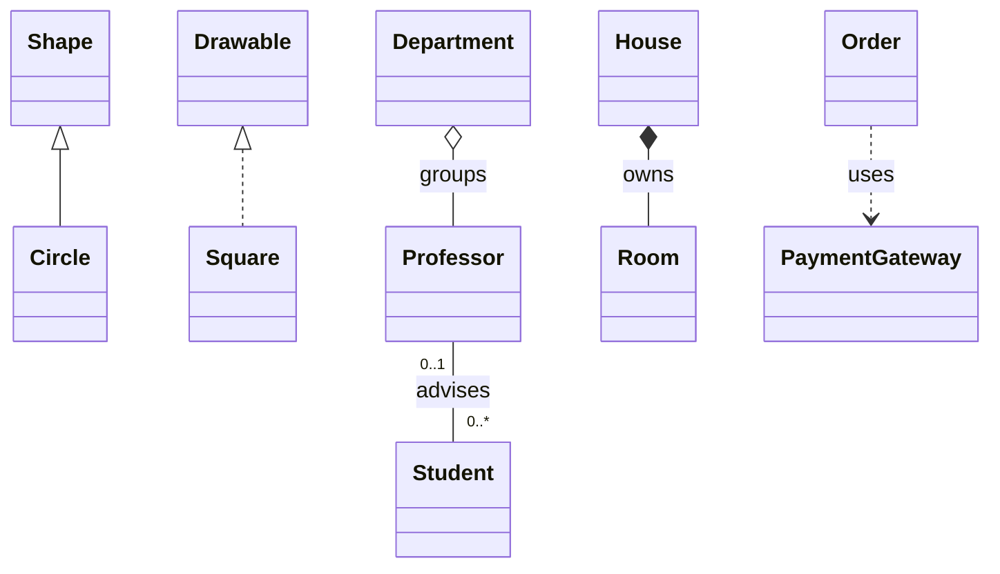
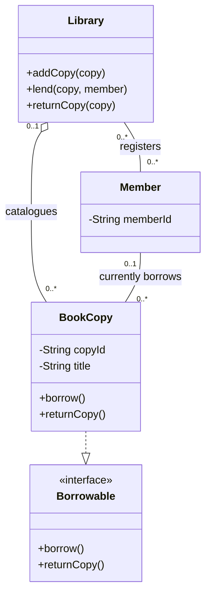
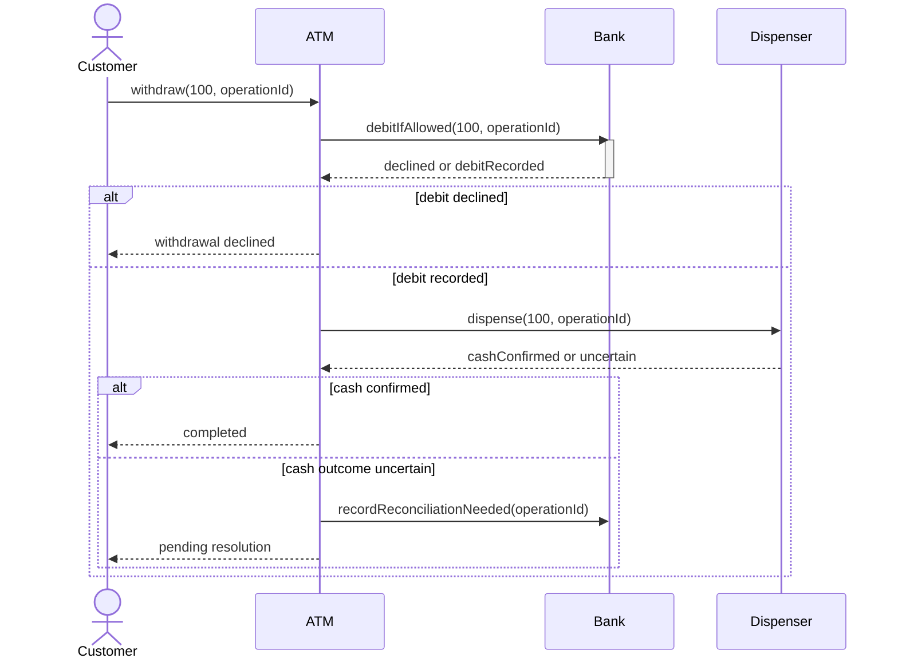
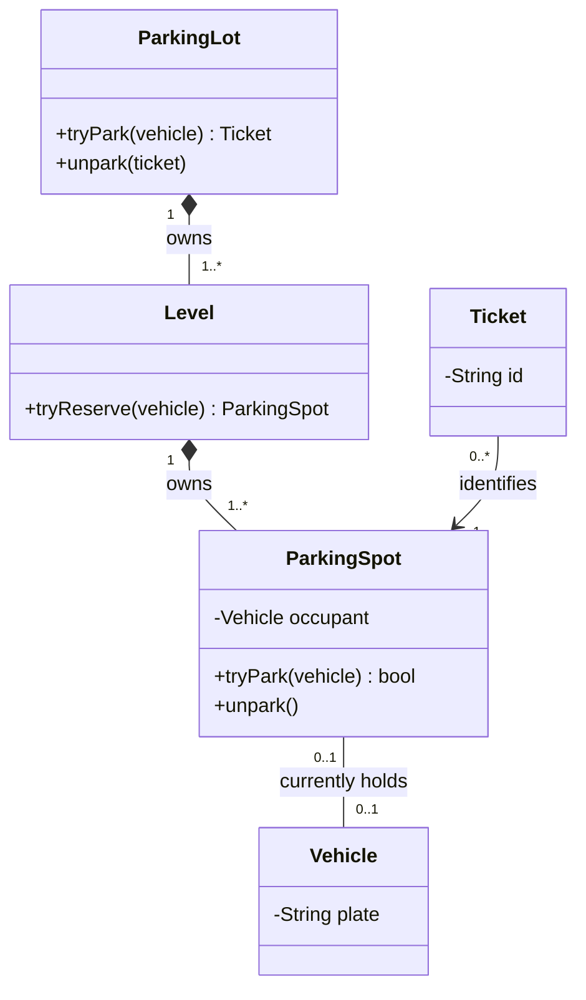
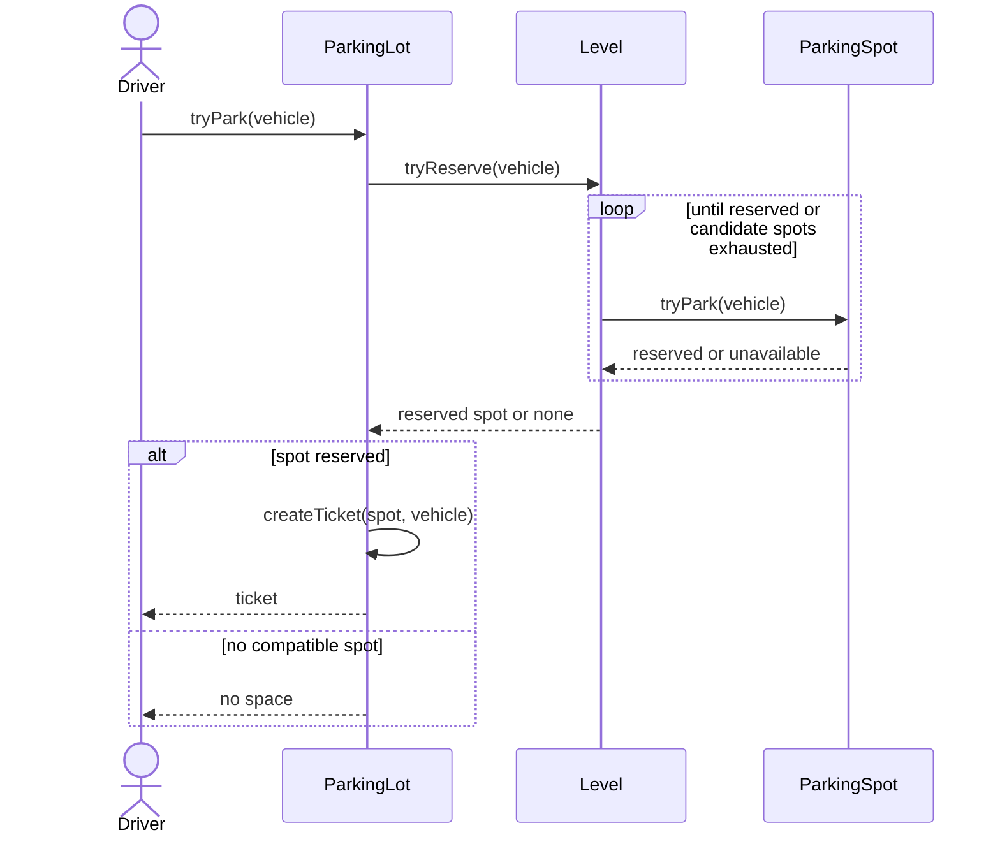

<!-- section: Design Patterns | category: Architecture | tags: concept, lld, uml, theory | role-priority: important | general-importance: specialized -->
[](#)
[](#)
[](#)
[](#)
[](../../../docs/topic-importance.md)
[](../../../docs/topic-importance.md)

# UML Basics — Class & Sequence Diagrams

A box labeled `ParkingSpot` does not say whether it owns a vehicle or merely refers to one. A list of classes also does not say whether two drivers can reserve the same spot. A useful diagram makes those relationships and operations explicit.

## Definition

**UML**, the Unified Modeling Language, is a standard notation for describing a system's structure, behavior, and interactions. A class diagram describes types and relationships; a sequence diagram follows messages among particular participants in a use case.

> **Textbook Definition:** UML is a standardized visual modeling language for specifying the structure, behavior, and interactions of software systems through defined diagram elements and relationships.

UML defines 14 diagram types. This chapter starts with class and sequence diagrams because together they answer “what relates to what?” and “what happens next?” Mermaid diagrams below use that vocabulary; Mermaid is a rendering syntax, not the UML specification itself.

## First Principles

A design review needs to distinguish three different claims. A type can hold a reference to another type, an object can own another object's lifecycle, and one operation can invoke another. Treating all three as an unlabelled arrow hides the rules that code must enforce.

Static relationships also cannot prove an execution order. Even the right components can perform a check too early or publish success before a write commits. A separate interaction view makes those orderings visible. Neither view implements the rules: the diagram states the model, and code plus tests must establish that the implementation follows it.

## Why use two views?

Start with a class diagram to agree on responsibilities and allowed relationships. Then trace one success and one failure in a sequence diagram. If the trace needs an operation or state the class diagram lacks, revise the structure. Keep versioned diagrams beside the relevant code or teaching example so changes can update both.

## Class diagrams describe types and allowed relationships

### Read a class box

```text
┌────────────────────────────┐
│ BankAccount                │  name
├────────────────────────────┤
│ - balance: number          │  attribute: name and type
├────────────────────────────┤
│ + deposit(amount): void    │  operation: input and return type
│ + getBalance(): number     │
└────────────────────────────┘
```

`+` means public, `-` private, `#` protected, and `~` package visibility. An omitted marker does not establish a universal default. Abstract class names or operations can be italicized or marked `{abstract}`; bold text alone does not indicate abstraction. An interface can be marked `«interface»`.

A private balance and public `deposit` communicate where mutation is meant to happen. They do not establish amount validation or concurrent update safety; [OOP concepts](30.1.1.03-oop-concepts.md) traces the invariant behind this interface.

### Choose the relationship by its promise

| Relationship | Notation and direction | What the reader may infer |
| -------------- | --------------------------------------------- | ------------------------------------------------------------------------------------------------------ |
| Generalization | Solid line, hollow triangle at the parent | Child is a specialization of parent; substitution still needs a behavioral contract |
| Realization | Dashed line, hollow triangle at the interface | Implementation conforms to the interface specification |
| Association | Solid line; optional navigability arrow | Instances have a structural relationship; labelled ends state roles and multiplicities |
| Aggregation | Hollow diamond at the whole | Shared whole-part grouping; it does not imply exclusive ownership or automatic deletion |
| Composition | Filled diamond at the whole | A part belongs to at most one composite at a time; the whole has lifecycle responsibility in the model |
| Dependency | Dashed arrow toward the supplier | Client relies on the supplier, for example as an operation parameter or temporary collaborator |

An association arrow describes navigation to a related instance. It is not a call trace, and not every association needs an arrow. A dependency arrow points from the dependent client to the supplier. A triangle points toward the generalized type or realized interface. Diamonds sit at the whole, not the part.



These are independent examples. `Professor`–`Student` says a professor can advise zero or more students, and a student has zero or one advisor **in this model**. `House`–`Room` models ownership; it does not instruct JavaScript to destroy objects or a database to cascade rows. Shared aggregation has deliberately weaker semantics, so do not infer precise lifetime rules from a hollow diamond.

### Multiplicity constrains each end

A multiplicity beside an endpoint counts how many instances at **that end** can relate to one instance at the opposite end. `1` means exactly one, `0..1` optional single, `0..*` or `*` zero or more, `1..*` at least one, and `n..m` an inclusive range.

The diagram above allows a new professor to have no students. Changing the student-end label to `1..*` forbids that state. A list-valued field alone cannot express that minimum.

### A library groups copies and registered members



`BookCopy` represents a physical copy, not a title shared by several copies. A copy can be outside this library's catalog (`0..1` library); a member can register at several libraries. The current-borrowing association allows one member to hold several copies and a copy to have at most one current borrower. Loan history would require a separate loan record because one current association cannot preserve past borrowers or dates.

`BookCopy` realizes `Borrowable`; neither `Library` nor `Member` inherits from it. The library coordinates lending, while the copy's operations must enforce its availability rule. The diagram does not specify concurrency control or overdue policy. Add those only when the requirements demand them.

## Sequence diagrams follow one interaction

A **lifeline** represents a participant instance or role over the interaction. Messages appear in order down a lifeline. A sent message precedes its receipt; independent lifelines do not imply a universal physical clock simply because events occupy the same horizontal row.

An **activation bar** marks an execution interval. A synchronous call uses a solid line with a filled arrowhead; an asynchronous message uses a solid line with an open arrowhead; a reply uses a dashed line with an open arrowhead. A self-call returns to the same lifeline. These distinctions explain whether a caller waits and what a reply means.

A combined fragment surrounds related messages. `alt` contains guarded alternatives, `opt` one conditional branch, and `loop` repeated messages. State the guard or repetition condition; a box labeled “loop” alone does not tell the reader when it ends.

### Trace an ATM withdrawal's consequential failure

The following is an illustrative interaction, not a complete banking protocol. Card and PIN authorization have already succeeded. The bank operation enforces account rules internally rather than exposing a separate balance-check/write pair to the ATM.



Follow the success branch: request → debit reply → dispense reply → completion. If dispensing is uncertain after a debit, returning “completed” would claim something the ATM does not know. Blindly repeating the debit can also duplicate it. The operation identifier connects the messages to the same attempt; the implementation must define duplicate handling and reconciliation. A diagram that merely debits then dispenses omits this failure boundary. It cannot prove atomicity across the bank and physical cash dispenser.

A self-call can show `ATM` invoking an internal receipt formatter. An `opt [receipt requested]` frame can surround that call and printing; a `loop [remaining bills > 0]` frame can describe dispensing each bill. Use those views when those steps matter to the question, rather than expanding every internal helper in the main trace.

## Combine structure and interaction for a parking lot

### State the ownership and occupancy rules



Here every level and spot has one owning whole, each spot holds at most one vehicle, and each vehicle occupies at most one spot in this model. Several historical tickets can refer to a spot. Ticket validity and its active occupancy are additional rules, not implied by that history multiplicity. Deleting the lot requires an explicit policy for active tickets and vehicle records; composition is a modeled responsibility, not permission to discard real occupants.

Vehicle variants need inheritance only if a substitutable behavior differs. A `VehicleType` field can be adequate for size compatibility; adding `Car` and `Truck` classes solely because their nouns differ adds no mechanism.

### Keep check and reservation under one owner



Driver A must not call `isAvailable()`, wait, then call `park()` after Driver B has taken the spot. `tryPark` owns that decision and transition together. A single-process implementation might use serialized access; several application instances need an appropriate shared concurrency mechanism. Putting the operation inside one box does not automatically provide it.

Ticket creation can fail after reservation. The contract must then release the reservation or persist enough state to recover and return the same ticket on retry. The diagram exposes where that choice belongs without claiming a full transactional implementation. See the [parking-lot case study](../../30.2-system-design/02-case-studies/30.2.2.28-parking-lot.md) for the broader design.

## Choose another view when the question changes

| Diagram | Question it helps answer |
| -------------------- | ------------------------------------------------------------ |
| Class | What types, contracts, and relationships exist? |
| Sequence | Which messages accomplish this use case, and in what order? |
| Use case | Which goals do actors pursue through the system? |
| Activity | How does a workflow branch, join, or iterate? |
| State machine | Which states and transitions may this object have? |
| Component | Which software components expose or require interfaces? |
| Deployment | Where do artifacts run across execution nodes? |
| Package | How are model elements grouped and dependent? |
| Object | Which instances and links exist in this snapshot? |
| Communication | Which connected participants exchange the numbered messages? |
| Timing | Which state changes have timing constraints? |
| Interaction overview | How do interactions fit into a larger control flow? |
| Composite structure | Which internal parts and connectors realize this structure? |
| Profile | Which stereotypes and constraints extend UML for a domain? |

An occupancy state machine can clarify reserved → occupied → released transitions more directly than another class diagram. Use the view that resolves the current uncertainty.

## Drawing in an interview or review

Start with names and the few relationships the main use case needs. Add multiplicities and operation contracts, then walk the success and failure trace. Refine when the trace contradicts the structure. Diagrams can be sketched on a whiteboard, in [Excalidraw](https://excalidraw.com/), or versioned as Mermaid or PlantUML text.

For a 60-minute low-level design discussion, an illustrative budget is: 5 minutes requirements, 5 entities/use cases, 10 class diagram, 5 key interaction, 5 behavior variation, 10 failures, 10 extension/scaling boundaries, 5 follow-up discussion, and 5 critical code. Adjust it to the interview rather than treating it as a mandatory script.

Common mistakes are unlabeled arrows, misplaced triangles or diamonds, missing minimum/maximum counts, and success-only sequences. Too much detail can also obscure the decision. Keep the operation needed to prove the behavior; leave unrelated fields and helper calls out.

## Summary

Class diagrams describe allowed structure; sequence diagrams trace messages in one interaction. Read arrowheads, diamonds, and multiplicities as distinct promises. Trace a changed condition such as an unavailable spot or uncertain dispensing result to find missing operations and failure policies. A diagram communicates ownership and ordering, while the implementation must enforce lifecycle, concurrency, and retry contracts.

## See Also

- [Foundations revision](REVISION.md) — read diagrams and change one condition
- [SOLID principles](30.1.1.01-solid-principles.md) — evaluate the boundaries
- [OOP concepts](30.1.1.03-oop-concepts.md) — state ownership and behavioral contracts
- [DRY, KISS, YAGNI](30.1.1.02-dry-kiss-yagni.md) — decide which detail is justified
- [Singleton](../02-creational/30.1.2.01-singleton.md) through [State pattern](../04-behavioral/30.1.4.04-state.md) — mechanisms for variation

## References & Learn More

- [OMG — UML 2.5.1 specification](https://www.omg.org/spec/UML/2.5.1/) — standard notation and semantics
- [Martin Fowler — UML Distilled](https://martinfowler.com/books/uml.html) — practical modeling
- [PlantUML](https://plantuml.com/) — diagrams as text
- [Excalidraw](https://excalidraw.com/) — whiteboard sketches

---

[← Previous: OOP Concepts](30.1.1.03-oop-concepts.md) · [Back to Index](INDEX.md)
