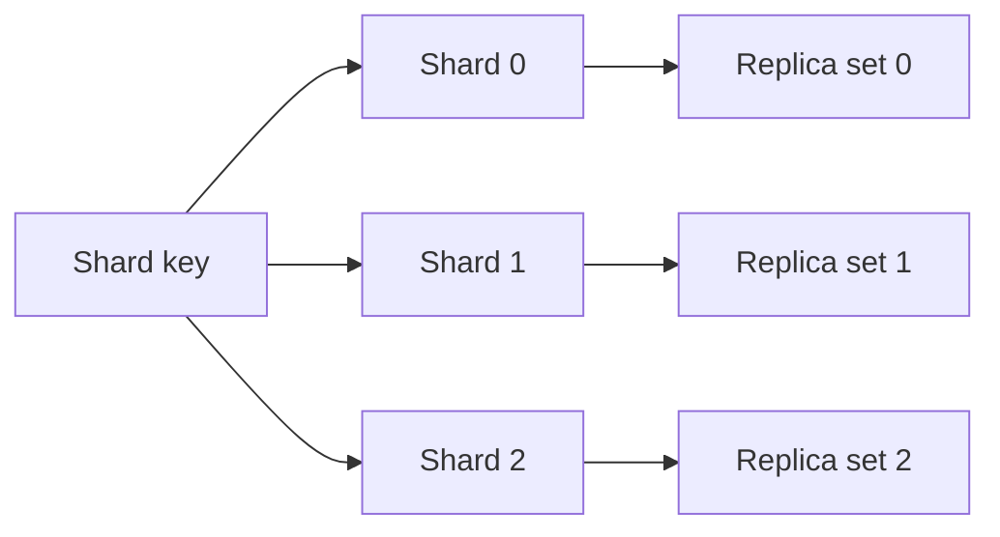

<!-- section: System Design | category: Architecture | tags: concept, distributed-systems, scaling, theory | role-priority: essential | general-importance: foundational -->
[](#)
[](#)
[](#)
[](#)
[](../../../docs/topic-importance.md)
[](../../../docs/topic-importance.md)

# Sharding & Replication

When one database cannot meet a workload's needs, first identify the limit: read load, write load, storage, or availability. Sharding splits which node owns each part of the data; replication keeps additional copies. They can combine, but they solve different problems and add different costs:

```text
Sharding (split ownership):      Replication (copy each shard):
Node 1: records A, B             Shard 1: Node 1 → Node 1 replica
Node 2: records C, D             Shard 2: Node 2 → Node 2 replica
```

## Definition

**Sharding** partitions data so each node owns some of it. It can add capacity when work distributes across shards, and requires a routing rule plus a plan for skew and rebalancing. **Replication** keeps copies on multiple nodes. Depending on protocol and configuration, it can improve read capacity, failover options, or durability; it also creates consistency and recovery questions.

> **Textbook Definition:** Sharding partitions a dataset into independently placed subsets; replication maintains multiple copies of a subset according to a protocol defining propagation, read visibility, and failure recovery.

They can compose: each shard can have replicas. The shard key affects routing and locality; the replication protocol and acknowledgment settings affect consistency, failover, and recovery.

## First Principles

One machine has finite storage, CPU, and I/O. Copying every record to another machine duplicates that storage and write-replay work; it can offload eligible reads, but all writes still pass through a single leader in that layout. Splitting ownership lets different machines perform different writes — provided the workload actually reaches different owners.

A request must now find its key's owner. An operation touching two owners cannot rely on one local transaction to protect both. A second copy introduces a different question: when can it answer a read or replace the failed owner without losing required state? Routing, cross-owner coordination, and replica visibility follow from these constraints.

## 1. Climb the cheaper rungs before sharding

Consider simpler options first; they carry fewer cross-node constraints.

| Rung | What it buys | Where it stops helping |
| -------------------------------------------- | ---------------------------------------------------------------------------------- | ----------------------------------------------------------------------------------- |
| 1. Fix the query (index, N+1, join shape) | Less work for the same request | The measured bottleneck is elsewhere |
| 2. Vertical scale (more CPU / RAM / storage) | More capacity on one node | The needed capacity exceeds the largest practical node or its cost is not justified |
| 3. Read replicas and caching | read throughput and read latency | the bottleneck is **writes** — copies don't absorb them |
| 4. Partition within one node | Manage very large tables and prune queries by partition key when the workload fits | A single node's compute or I/O is the limit |
| 5. Tune pooling, vacuum and the write path | Remove a measured source of contention or maintenance cost | The single-node limit remains after tuning |
| 6. Shard | More write capacity or data placement across nodes when work distributes | Cross-shard coordination and operations become part of the design |

**Sharding is a costly layout change.** It trades a single-node limit for distributed-system constraints:

- **Cross-shard queries need coordination.** They may scatter to multiple shards and merge results; a distributed database can provide this, but it adds work and latency.
- **Cross-shard transactions need an explicit strategy.** A local transaction can remain on one shard; atomic changes across shards need distributed commit or a workflow with separate local commits and compensation (→ 30.2.1.07).
- **Local uniqueness is not global uniqueness.** A unique index on one shard cannot enforce a key across all shards; choose a globally safe ID or add coordination when global uniqueness is required.
- **Rebalancing becomes an operations project.** Pick the key from the dominant access pattern and plan how data and routing change when shards move (→ 20.4.5.02).
- **Many operational costs grow with the shard count.** Backups, monitoring, migrations, and failure handling need a plan across the layout (→ 20.4.5.01).

**Before choosing shards, answer these questions:**

1. **What is the single-node limit?** Sharding can distribute storage and write work when requests spread across shards. Read pressure alone may be addressed with replicas or caching; slow queries may need query fixes first. "We might need it later" is not an answer.
2. **Can you name the key, and does it come from the dominant query?** If the answer is "we'll see", you have not found the access pattern yet (→ 20.4.1.04 chooses the store the same way).
3. **How will data move when the layout changes?** Describe routing during migration, validation, rollback, and the treatment of hot keys.

## 2. Split ownership with a shard key

**Sharding** splits a dataset across nodes. Each node holds a subset; a **shard key** determines where a row routes. Table partitioning inside one database is related, but never by itself distributes writes across machines.

#### Hash-based sharding

```text
shard_id = hash(shard_key) % num_shards
```

**Illustrative mapping:** `shard_id = hash(user_id) % 4`. The results below assume one fixed hash; a different hash function can assign different shards.

- user 1 → shard 0
- user 2 → shard 3
- user 3 → shard 2
- user 4 → shard 1

**Pros:** even distribution (if the hash is good); simple. **Cons:** range queries are hard ("all users with id 1-1000"); rebalancing needs a plan — changing the shard count can remap many keys, and consistent hashing or fixed virtual partitions limit movement but data still moves and routing must update; hot shards remain possible if key distribution skews. **Used by:** systems routing records by a hash of the partition key; implementation and rebalancing behavior are product-specific.

#### Range-based sharding

```text
shard_0: keys 0 - 999
shard_1: keys 1000 - 1999
shard_2: keys 2000 - 2999
```

**Pros:** efficient range queries; a range can split to add capacity, though data movement and routing updates still need coordination; easy to reason about when queries follow the range key. **Cons:** hot shards (recent data on the latest shard takes all writes); uneven distribution if keys aren't uniform. **Examples:** HBase, Bigtable, and MongoDB sharded deployments use range-oriented partitioning in their storage layouts. PostgreSQL table partitioning divides a table inside a database; by itself, it never distributes writes across database servers.

#### Directory-based sharding

A lookup table maps keys to shards:

```text
lookup_table = {
  "user_1_1000": "shard_0",
  "user_1001_2000": "shard_1",
  ...
}
```

**Pros:** flexible (can move individual users to balance); any routing logic works. **Cons:** the lookup table can become a bottleneck or failure dependency unless replicated and recoverable; it needs replication and consistency. **Use when:** routing must change independently of the key, and the lookup service can be made available and consistent enough for that routing contract.

#### Geography-based sharding

Shards by region: EU shard, US shard, APAC shard. **Pros:** can reduce latency when requests are served from the region holding the data; regional placement may support a residency requirement, but never proves regulatory compliance — backups and derived data also matter. **Cons:** slow cross-region queries, very slow cross-region writes, imbalance if traffic isn't uniform. **Use when:** data locality or a residency policy requires regional placement.

Choose a shard key with enough distinct values and reasonably even work — high cardinality alone never prevents one tenant or key from going hot. Most queries should hit one shard, not all of them. Common keys: `user_id` (most common for user-centric apps), `tenant_id` (B2B SaaS), `order_id` (e-commerce), `device_id` (IoT), a time bucket for time-series data when range queries and retention align with the partitioning scheme. Anti-patterns: `country` or `status` (low cardinality, skewed), a monotonically increasing range key when recent writes would all land on one shard.

## 3. Move data without losing writes

Tenant 42 currently routes to shard A. Copying its records to B never yet makes B the owner: new writes can still arrive at A during the copy. A move must capture those intervening writes, validate the destination, and switch the routing authority with a rule for in-flight requests.

One possible controlled migration pauses that tenant's writes, applies the final delta, validates B, then switches the directory generation. A must reject writes carrying the old generation after cutover. Resume writes only through B; retain A's data for the planned rollback window. A different online protocol can avoid the pause, but it still must prove a write is neither lost nor accepted by two independent owners. Merely changing a DNS record or modulo number supplies none of those rules.

When adding a shard, redistribute accordingly: hash-based layouts remap many keys on a modulo count change (consistent-hash or virtual-shard layouts limit the moving portion, but copying and routing updates remain); range-based layouts split a range and move its data (queries stay targeted, but ranges can go uneven or hot); directory-based layouts update the routing map and move affected records (the directory must stay available and consistent enough for the routing contract). **Consistent hashing** shares one hash space between keys and shard positions, so adding a shard moves a subset of keys instead of remapping every key, depending on placement and virtual-node strategy. It reduces movement; it never makes rebalancing automatic.

## 4. Copy data with a replication protocol

**Replication** keeps copies on multiple nodes. Depending on how reads and writes are acknowledged, it can offer read choices, failover, and durability benefits.

#### Single-leader (primary-replica)

One node (the leader) accepts writes. Reads may go to the leader or followers, depending on the application's staleness and consistency needs. Followers receive changes through replication:

```text
        Client
          │
          ▼
       Leader (writes)
          │
          ├──→ Follower 1 (read-only, async replication)
          ├──→ Follower 2 (read-only, async replication)
          └──→ Follower 3 (read-only, async replication)
```

**Pros:** simple; a single place orders writes, and configured synchronous acknowledgments can narrow the failover data-loss window; one leader orders accepted writes, though concurrent clients still need transactions or conditional updates to avoid lost updates. **Cons:** the leader is a write and availability bottleneck until failover or promotion completes; replication lag means stale reads (with async). **Used by:** Postgres, MySQL, MongoDB, most RDBMS. **Variants:** synchronous replication — the commit waits for the acknowledgment defined by the system's configuration, reducing the failover data-loss window at the cost of latency and dependence on reachable replicas, without making every replica read immediately current; asynchronous replication — the leader can respond before followers receive a change, lowering write latency but possibly leaving a failover window where recent writes are missing from a promoted replica.

#### Multi-leader (multi-master)

Multiple nodes accept writes and replicate changes to each other, commonly asynchronously. The design must define how concurrent or conflicting updates are detected and resolved:

```text
Client A → Leader 1 ⇄ Leader 2 ← Client B
                     ⇅
                  Leader 3 ← Client C
```

Each leader accepts its local write, then exchanges changes with peers; the arrows represent replication whose timing and conflict rules must be specified. **Pros:** can accept writes in more than one site when the replication and conflict policy allows it; multi-region writes. **Cons:** write conflicts need resolution; more complex; with async replication, replicas can temporarily disagree, and conflict handling depends on the protocol. **Used by:** systems allowing writes at multiple sites and defining how concurrent updates reconcile.

#### Leaderless (quorum)

Several replicas can accept reads and writes. A read quorum and write quorum can overlap, but the protocol must still decide which version wins and handle concurrent writes safely:

```text
N = total replicas
W = write quorum (how many must acknowledge)
R = read quorum (how many must respond)

If W + R > N, the read set intersects the replicas that acknowledged a write. The intersection alone does not guarantee linearizability; the protocol must select versions and order concurrent writes safely.
```

**Example:** N=3, W=2, R=2 — a write needs 2 of 3 acknowledgments, a read needs 2 of 3 responses, so the quorums overlap. The protocol still needs rules for concurrent writes and selecting the current version. That arithmetic assumes reads and writes use the same fixed replica set. In a **sloppy quorum**, an unavailable home replica can be replaced temporarily by another node; two counted response sets may then share no common home replica. Even with strict set intersection, an incomplete write can leave a value on only some replicas, and concurrent writes need a defined ordering or conflict rule. Distinguish a completed write, an unknown-outcome write, and repaired state before promising freshness. A quorum count describes participation; the rest of the protocol establishes what those participants can prove.

**Common configs:** N=3, W=2, R=2 (overlapping quorums; exact guarantees depend on version and conflict rules); N=3, W=1, R=1 (fewer acknowledgments; a read can miss a recent write); N=3, W=3, R=1 (waits for every replica on write; a single-replica read can still be stale under failures or concurrent writes). **Pros:** some systems let clients trade acknowledgment count and availability per operation. **Cons:** results depend on replica placement, acknowledgment rules, and conflict resolution (e.g. version vectors or last-write-wins); replica outages require repair or handoff behavior to bring copies back together. **Used by:** Dynamo-style databases and systems exposing quorum or tunable-consistency operations. Product behavior differs.

## 5. Read through lag with an explicit contract

With async replication, a delay separates leader and followers:

```text
t=0: Leader writes x=1
t=10ms: Follower 1 replicates x=1
t=50ms: Follower 2 replicates x=1
t=200ms: Follower 3 replicates x=1 (slow)
```

During this lag, reads from Follower 3 return the old value — the source of the "stale read" problem. **Answers:** route a single-leader client's read to the leader when that is the required read-your-writes contract; wait for replica application when required and supported (some synchronous modes wait for receipt or disk flush, others can wait for replay/visibility, with added latency); use quorum/version rules only as documented by the database — an intersecting read/write set alone orders no concurrent writes and guarantees no linearizability.

A system may use both sharding and replication:



Sharding can add write or storage capacity when work distributes across shards; replicas can add read options and recovery capacity per consistency and failover configuration. The shard key decides which shard a row reaches; the **replication factor** decides how many copies exist per shard. A design with three logical shards and three replicas per shard has nine shard replicas — which never implies nine machines, since products may place replicas and partitions across hardware differently.

In an interview, name the sharding strategy (hash, range, geography), the shard key (user_id, tenant_id) and why, the replication strategy (single-leader, multi-leader, leaderless), the replica and acknowledgment settings (no universal replication factor exists), the consistency model (linearizable, eventual), and the rebalancing plan (consistent hashing, range split, directory update). For example: "If we shard by user ID, related records can stay together, but a hot account can overload one shard. We would measure traffic, define which writes need an authoritative order, and test what a read can see after failover. Rebalancing also needs a plan for moving data and routing requests during the move." Tie the answer to the stated workload and consistency needs; naming technologies without their behavior is never enough.

## 6. Name failures and check product realities

- **Shard becomes unreachable:** whether reads or writes continue depends on the replication protocol, quorum, failover, and RPO policy.
- **Replica lag:** reads return stale data. Mitigated with read-your-writes routing.
- **Split brain:** two leaders may both attempt writes after a partition or failover. Consensus can choose a current leader within its voting group. An external resource also needs to reject writes from a stale leader, often by checking a monotonically increasing fencing token or epoch.
- **Hot shard:** one shard gets disproportionate traffic. Diagnose the skew first; changing the key or splitting a hot tenant may require a data-model change.
- **Rebalancing during failure:** adding a shard while a node is down. Mitigated by careful operational planning.

| Product | Useful design fact | Read or write detail to check |
| ---------- | ------------------------------------------------------------------------------------------------ | ------------------------------------------------------------------------------------------------------------------------------------------------------------------------------------------------------------------------------------------------------------------------------------- |
| PostgreSQL | Streaming replication is asynchronous by default; synchronous replication is configurable. | Commit acknowledgment settings and failover policy determine the durability window. A synchronous acknowledgment is not a promise that every replica read is current. |
| MongoDB | Replica sets have a primary and secondaries; sharded deployments can use replica sets per shard. | Read preference and read/write concern shape which member serves a read and which acknowledgments a write waits for. |
| Cassandra | Data is partitioned by a partition key and replicated. | Read/write consistency levels control how many replicas must respond; concurrent writes and failure recovery still need version and reconciliation rules. |
| DynamoDB | Partitioning and replica placement are managed by the service. | Global tables use MREC (asynchronous) or MRSC (cross-region strong reads); these are product modes, not user-managed quorums. |
| Spanner | A distributed SQL service uses TrueTime and replication to order transactions across regions. | Serializable transactions have external-consistency guarantees by default; stale reads are a separate option with an older timestamp. |

The table describes product interfaces, not a promise that every read uses the newest value. For DynamoDB, MREC transactions are atomic only in their originating Region; MRSC does not support transactions. Check the database's documentation for the deployment, read mode, and acknowledgment settings actually used.

## Summary

Sharding splits data so multiple nodes can store and serve different parts; replication keeps extra copies. A system may use either or both. First check whether query and schema improvements or a larger single node meet the need. If data must be split, choose a key that spreads work and matches important queries. Plan for replica consistency and moving data when the layout changes.

## See Also

- [System Design Revision](REVISION.md) — practice questions for this theory category
- [Database Scaling In Practice](../../30.3-infra-patterns/04-data-at-scale/30.3.4.01-database-scaling.md) — the rungs below sharding: replicas, partitioning, pooling, tuning
- [PostgreSQL Performance](../../../20-backend/20.4-database/01-postgresql-foundations/20.4.1.05-postgresql-performance.md) — rung 1, before any of the above
- [Migration Strategies](../../../20-backend/20.4-database/05-operations-and-scaling/20.4.5.02-migration-strategies.md) — the expand-migrate-contract move a re-shard needs
- [Cap Theorem](30.2.1.01-cap-theorem.md) — the trade-off framework
- [Consistency Models](30.2.1.02-consistency-models.md) — strong vs eventual vs causal
- [Consensus And Leader Election](30.2.1.09-consensus-and-leader-election.md) — how to elect a leader
- [Distributed Transactions](30.2.1.07-distributed-transactions.md) — when you need to update multiple shards atomically

---
## References & Learn More

- [Martin Kleppmann — Designing Data-Intensive Applications](https://dataintensive.net/) — 2017 first edition, Chapter 5 for replication and quorum limitations; Chapter 6 for partitioning and skew
- [MongoDB — Sharding](https://www.mongodb.com/docs/manual/sharding/)
- [Cassandra — Dynamo-style replication and tunable consistency](https://cassandra.apache.org/doc/latest/cassandra/architecture/dynamo)
- [PostgreSQL — Warm Standby and Streaming Replication](https://www.postgresql.org/docs/current/warm-standby.html)
- [MongoDB — Read Preference and Server Selection](https://www.mongodb.com/docs/manual/core/read-preference-mechanics/)
- [DynamoDB — Read Consistency](https://docs.aws.amazon.com/amazondynamodb/latest/developerguide/HowItWorks.ReadConsistency.html)
- [DynamoDB — Global Tables and Consistency Modes](https://docs.aws.amazon.com/amazondynamodb/latest/developerguide/V2globaltables_HowItWorks.html)
- [Google Cloud Spanner — TrueTime and External Consistency](https://docs.cloud.google.com/spanner/docs/true-time-external-consistency)

---

[← Previous: Consistency Models](30.2.1.02-consistency-models.md) · [ Back to Index](INDEX.md) · [Next: Load Balancing →](30.2.1.04-load-balancing.md)
