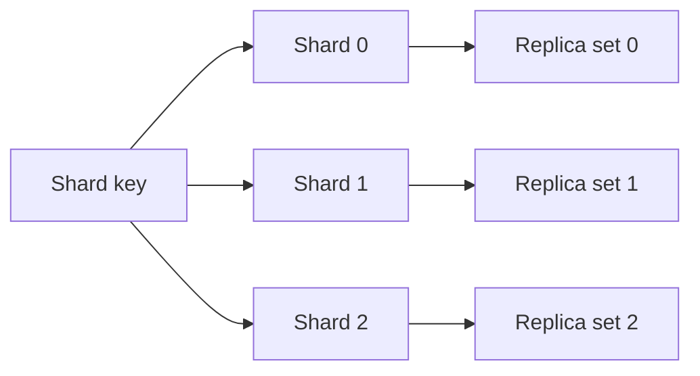

<!-- section: System Design | category: Architecture | tags: concept, distributed-systems, scaling, theo | role-priority: essential | general-importance: foundational -->
[](#)
[](#)
[](#)
[](#)
[](../../../docs/topic-importance.md)
[](../../../docs/topic-importance.md)

# Sharding & Replication

When one database cannot meet a workload's needs, first identify the limit: read load, write load, storage, or availability. Sharding splits which node owns each part of the data; replication keeps additional copies. They can be combined, but they solve different problems and add different costs.

## Definition

**Sharding** and **replication** are two distinct ways to place data across machines:

```text
Sharding (split ownership):      Replication (copy each shard):
Node 1: records A, B             Shard 1: Node 1 → Node 1 replica
Node 2: records C, D             Shard 2: Node 2 → Node 2 replica
```

- **Sharding** partitions data so each node owns some of it. It can add capacity when work distributes across shards, and requires a routing rule and a plan for skew and rebalancing.
- **Replication** keeps copies on multiple nodes. Depending on the protocol and configuration, it can improve read capacity, failover options, or durability; it also creates consistency and recovery questions.

They can compose: each shard can have replicas. The shard key affects routing and locality; the replication protocol and acknowledgment settings affect consistency, failover and recovery.

> **Textbook Definition:** Partitioning (sharding) divides a database horizontally into disjoint subsets assigned to distinct nodes to scale storage volume and write throughput (Silberschatz, Korth & Sudarshan, *Database System Concepts* / Kleppmann, *Designing Data-Intensive Applications*). Replication maintains identical copies of data across independent nodes to provide fault tolerance, high availability, and horizontal read scaling.


---

## First Principles

Sharding and replication solve two different walls, and their combination follows:

1. **Copies and ownership solve different limits.** Replicas may serve selected reads or help recover a node; they do not automatically increase one writer's capacity.
2. **Split ownership only when one node is the measured limit.** Queries or transactions that touch several shards need fan-out, coordination or a different data model (→ 30.2.1.07).
3. **Routing follows the access pattern.** The shard key determines which requests reach one shard and which must scatter. Changing the layout later requires a planned data migration (→ 20.4.5.02). Hash-based schemes can reduce how much data moves when membership changes, but they do not remove migration work.

## Why it matters

In an interview, state the observed or assumed bottleneck first. Explain whether a larger node, indexing, partitioning, caching, replicas or shards address it, then state what changes for consistency and recovery.

---

## When to Shard (and When Not To)

Consider simpler options before sharding; they have fewer cross-node constraints.

| Rung | What it buys | Where it stops helping |
| -------------------------------------------- | ---------------------------------------------------------------------------------- | ----------------------------------------------------------------------------------- |
| 1. Fix the query (index, N+1, join shape) | Less work for the same request | The measured bottleneck is elsewhere |
| 2. Vertical scale (more CPU / RAM / storage) | More capacity on one node | The needed capacity exceeds the largest practical node or its cost is not justified |
| 3. Read replicas and caching | read throughput and read latency | the bottleneck is **writes** — copies don't absorb them |
| 4. Partition within one node | Manage very large tables and prune queries by partition key when the workload fits | A single node's compute or I/O is the limit |
| 5. Tune pooling, vacuum and the write path | Remove a measured source of contention or maintenance cost | The single-node limit remains after tuning |
| 6. Shard | More write capacity or data placement across nodes when work distributes | Cross-shard coordination and operations become part of the design |

**Sharding is a costly layout change.** It trades a single-node limit for distributed-system constraints:

- **Cross-shard queries need coordination.** They may scatter to multiple shards and merge results; a distributed database can provide this, but it adds work and latency.
- **Cross-shard transactions need an explicit strategy.** A local transaction can remain on one shard; atomic changes across shards need distributed commit or a workflow with separate local commits and compensation (→ 30.2.1.07).
- **Local uniqueness is not global uniqueness.** A unique index on one shard cannot enforce a key across all shards; choose a globally safe ID or add coordination when global uniqueness is required.
- **Rebalancing becomes an operations project.** Pick the key from the dominant access pattern and plan how data and routing change when shards move (→ 20.4.5.02).
- **Many operational costs grow with the shard count.** Backups, monitoring, migrations and failure handling need a plan across the layout (→ 20.4.5.01).

**Before choosing shards, answer these questions:**

1. **What is the single-node limit?** Sharding can distribute storage and write work when requests spread across shards. Read pressure alone may be addressed with replicas or caching; slow queries may need query fixes first. "We might need it later" is not an answer.
2. **Can you name the key, and does it come from the dominant query?** If the answer is "we'll see", you have not found the access pattern yet (→ 20.4.1.04 chooses the store the same way).
3. **How will data move when the layout changes?** Describe routing during migration, validation, rollback and the treatment of hot keys.

**Example interview answer:** "I would keep one PostgreSQL primary while it meets the measured write and storage needs, then add replicas only for reads that can tolerate their consistency contract. If a single writer becomes the limit, I would choose a shard key from the dominant transaction and explain how cross-tenant queries and rebalancing would work."

---

## Sharding (Partitioning)

**Sharding** splits a dataset across nodes. Each node holds a subset of the data; a **shard key** determines where a row is routed. Table partitioning inside one database is related, but does not by itself distribute writes across machines.

### Sharding strategies

#### 1. Hash-based sharding

```
shard_id = hash(shard_key) % num_shards
```

**Example:** `shard_id = hash(user_id) % 4`
- user 1 → shard 0
- user 2 → shard 3
- user 3 → shard 2
- user 4 → shard 1

**Pros:**
- Even distribution (if hash is good)
- Simple

**Cons:**
- Hard to do range queries ("give me all users with id 1-1000")
- Rebalancing needs a plan: changing the shard count can remap many keys. Consistent hashing or fixed virtual partitions can limit movement, but data still has to move and routing must be updated.
- Hot shards possible (if key distribution is skewed)

**Used by:** systems that route records by a hash of the partition key; implementation and rebalancing behavior are product-specific.

#### 2. Range-based sharding

```
shard_0: keys 0 - 999
shard_1: keys 1000 - 1999
shard_2: keys 2000 - 2999
```

**Pros:**
- Range queries are efficient
- A range can be split to add capacity, though data movement and routing updates still need coordination
- Easy to reason about when queries follow the range key

**Cons:**
- Hot shards (recent data on the latest shard gets all the writes)
- Uneven distribution if keys aren't uniform

**Examples:** HBase, Bigtable, and MongoDB sharded deployments use range-oriented partitioning in their storage layouts. PostgreSQL table partitioning divides a table inside a database; by itself, it does not distribute writes across database servers.

#### 3. Directory-based sharding

A lookup table maps keys to shards.

```
lookup_table = {
  "user_1_1000": "shard_0",
  "user_1001_2000": "shard_1",
  ...
}
```

**Pros:**
- Flexible (can move individual users to balance)
- Can use any routing logic

**Cons:**
- Lookup table can become a bottleneck or failure dependency unless it is replicated and recoverable
- Needs to be replicated and consistent

**Use when:** Routing needs to change independently of the key, and the lookup service can be made available and consistent enough for that routing contract.

#### 4. Geography-based sharding

Shards by region: EU shard, US shard, APAC shard.

**Pros:**
- Can reduce latency when requests are served from the region holding the data.
- Regional placement may support a residency requirement, but does not prove regulatory compliance; backups and derived data also matter.

**Cons:**
- Cross-region queries are slow
- Cross-region writes are very slow
- Imbalanced if traffic isn't uniform

**Use when:** Data locality or a residency policy requires regional placement.

### Choosing a shard key

Choose a shard key that:

1. **Enough distinct values and reasonably even work.** High cardinality alone does not prevent one tenant or key from becoming hot.
2. **Even distribution.** For example, avoid a country key if work is heavily concentrated in one country.
3. **Query alignment.** Most queries should hit one shard, not all of them.

**Common shard keys:**
- `user_id` (most common for user-centric apps)
- `tenant_id` (for B2B SaaS)
- `order_id` (for e-commerce)
- `device_id` (for IoT)
- a time bucket for time-series data when range queries and retention align with the partitioning scheme

**Anti-patterns:**
- `country` (low cardinality, skewed)
- `status` (low cardinality)
- a monotonically increasing range key when recent writes would all land on one shard

### Rebalancing

When you add a shard, you need to redistribute data:

- **Hash-based:** changing a modulo shard count can remap many keys. Consistent-hash or virtual-shard layouts can limit the portion that moves, but still require copying data and updating routing.
- **Range-based:** split a range and move its data; range queries can stay targeted, but ranges can become uneven or hot.
- **Directory-based:** update the routing map and move affected records; keep the directory available and consistent enough for the routing contract.

**Consistent hashing:** keys and shard positions share a hash space. Adding a shard can move a subset of keys instead of remapping every key, depending on placement and virtual-node strategy. It reduces movement; it does not make rebalancing automatic.

---

## Replication

**Replication** means keeping copies of data on multiple nodes. Depending on how reads and writes are acknowledged, it can offer read choices, failover and durability benefits.

### Replication strategies

#### 1. Single-leader (primary-replica)

One node (the leader) accepts writes. Reads may go to the leader or to followers, depending on the application's staleness and consistency needs. Followers receive changes through replication.

```
        Client
          │
          ▼
       Leader (writes)
          │
          ├──→ Follower 1 (read-only, async replication)
          ├──→ Follower 2 (read-only, async replication)
          └──→ Follower 3 (read-only, async replication)
```

**Pros:**
- Simple
- A single place orders writes; configured synchronous acknowledgments can narrow the failover data-loss window
- No write conflicts

**Cons:**
- The leader is a write and availability bottleneck until failover or promotion completes
- Replication lag = stale reads (with async)

**Used by:** Postgres, MySQL, MongoDB, most RDBMS

**Variants:**
- **Synchronous replication:** the commit waits for the acknowledgment defined by the system's configuration. This can reduce the failover data-loss window, at the cost of latency and dependence on reachable replicas; it does not make every replica read immediately current.
- **Asynchronous replication:** the leader can respond before followers receive a change. It lowers write latency but may leave a failover window in which recent writes are missing from a promoted replica.

#### 2. Multi-leader (multi-master)

Multiple nodes accept writes and replicate changes to each other, commonly asynchronously. A design must define how concurrent or conflicting updates are detected and resolved.

```
        Client ──→ Leader 1 ──┐
                ↗ ↘
        Client ──→ Leader 2 ──→ (sync between leaders)
                ↗ ↗
        Client ──→ Leader 3 ──┘
```

**Pros:**
- Can accept writes in more than one site when the replication and conflict policy allows it
- Multi-region writes

**Cons:**
- Write conflicts (need to resolve)
- More complex
- With asynchronous replication, replicas can temporarily disagree; conflict handling depends on the protocol.

**Used by:** systems that allow writes at multiple sites and define how concurrent updates are reconciled.

#### 3. Leaderless (quorum)

Several replicas can accept reads and writes. A read quorum and write quorum can overlap, but the protocol must still decide which version wins and handle concurrent writes safely.

```
N = total replicas
W = write quorum (how many must acknowledge)
R = read quorum (how many must respond)

If W + R > N, the read set intersects the replicas that acknowledged a write. The intersection alone does not guarantee linearizability; the protocol must select versions and order concurrent writes safely.
```

**Example:** N=3, W=2, R=2
- Write must be acknowledged by 2 of 3 nodes
- Read must respond from 2 of 3 nodes
- W + R = 4 > 3, so the read quorum overlaps the write quorum. The protocol still needs rules for concurrent writes and selecting the current version.

**Common configs:**
- N=3, W=2, R=2 (overlapping quorums; exact guarantees depend on version and conflict rules)
- N=3, W=1, R=1 (fewer acknowledgments; a read can miss a recent write)
- N=3, W=3, R=1 (waits for every replica on a write; a single-replica read can still be stale under failures or concurrent writes)

**Pros:**
- Some systems let clients trade acknowledgment count and availability per operation.

**Cons:**
- Results depend on replica placement, acknowledgment rules and conflict resolution (for example, version vectors or last-write-wins)
- Replica outages require repair or handoff behavior to bring copies back together

**Used by:** Dynamo-style databases and systems that expose quorum or tunable-consistency operations. Product behavior differs.

---

## Replication lag and consistency

With async replication, there's a delay between leader and followers:

```
t=0: Leader writes x=1
t=10ms: Follower 1 replicates x=1
t=50ms: Follower 2 replicates x=1
t=200ms: Follower 3 replicates x=1 (slow)
```

During this lag, reads from Follower 3 return the old value. This is the source of the "stale read" problem.

**Solutions:**
- **Route a single-leader client's read to the leader** when that is the required read-your-writes contract.
- **Wait for replica application when required and supported.** Some synchronous modes wait for receipt or disk flush; others can wait for replay/visibility, with added latency.
- **Use quorum/version rules only as documented by the database.** An intersecting read/write set alone does not order concurrent writes or guarantee linearizability.

---

## Combining sharding + replication

**A system may use both:**



- Sharding can add write or storage capacity when work is distributed across shards
- Replicas can add read options and recovery capacity, according to consistency and failover configuration
- Sharding key determines which shard a row goes to
- The **replication factor** determines how many copies exist for each shard.

**Example:** A design with three logical shards and three replicas per shard has nine shard replicas. This does not imply nine machines: products may place replicas and partitions across hardware in different ways.

---

## Sharding + Replication in interviews

When you discuss a database in a system design round, name:

1. **Sharding strategy** (hash, range, geography)
2. **Shard key** (user_id, tenant_id, etc.) and why
3. **Replication strategy** (single-leader, multi-leader, leaderless)
4. **Replica and acknowledgment settings** (there is no universal replication factor)
5. **Consistency model** (linearizable, eventual, etc.)
6. **Rebalancing plan** (consistent hashing, range split, directory update)

**Example:**
> "If we shard by user ID, related records can stay together, but a hot account can overload one shard. We would measure traffic, define which writes need an authoritative order, and test what a read can see after failover. Rebalancing also needs a plan for moving data and routing requests during the move."

Tie the answer to the stated workload and consistency needs; naming technologies without their behavior is not enough.

---

## Failure modes

- **Shard becomes unreachable:** whether reads or writes can continue depends on the replication protocol, quorum, failover and RPO policy.
- **Replica lag:** reads return stale data. Mitigated with read-your-writes routing.
- **Split brain:** two leaders may both attempt writes after a partition or failover. Consensus can choose a current leader within its voting group. An external resource also needs to reject writes from a stale leader, often by checking a monotonically increasing fencing token or epoch.
- **Hot shard:** one shard gets disproportionate traffic. Diagnose the skew first; changing the key or splitting a hot tenant may require a data-model change.
- **Rebalancing during failure:** adding a shard while a node is down. Mitigated by careful operational planning.

---

## How database products expose these choices

| Product | Useful design fact | Read or write detail to check |
| ---------- | ------------------------------------------------------------------------------------------------ | ------------------------------------------------------------------------------------------------------------------------------------------------------------------------ |
| PostgreSQL | Streaming replication is asynchronous by default; synchronous replication is configurable. | Commit acknowledgment settings and failover policy determine the durability window. A synchronous acknowledgment is not a promise that every replica read is current. |
| MongoDB | Replica sets have a primary and secondaries; sharded deployments can use replica sets per shard. | Read preference and read/write concern shape which member serves a read and which acknowledgments a write waits for. |
| Cassandra | Data is partitioned by a partition key and replicated. | Read/write consistency levels control how many replicas must respond; concurrent writes and failure recovery still need version and reconciliation rules. |
| DynamoDB | Partitioning and replica placement are managed by the service. | Do not infer a node count or configure `N`, `R` and `W` as if using a user-managed quorum system. Check the table and global-table consistency modes your workload uses. |
| Spanner | A distributed SQL service uses TrueTime and replication to order transactions across regions. | Serializable transactions have external-consistency guarantees by default; stale reads are a separate option with an older timestamp. |

The table describes product interfaces, not a promise that every read uses the newest value. Check the database's documentation for the deployment, read mode and acknowledgment settings you actually use.

## Summary

Sharding splits data so multiple nodes can store and serve different parts; replication keeps extra copies. A system may use either or both. First check whether query and schema improvements or a larger single node meet the need. If data must be split, choose a key that spreads work and matches important queries. Plan for replica consistency and moving data when the layout changes.

## See Also

- [System Design Revision](REVISION.md) — practice questions for this theory category
- [Database Scaling In Practice](../../30.3-infra-patterns/04-data-at-scale/30.3.4.01-database-scaling.md) — the rungs below sharding: replicas, partitioning, pooling, tuning
- [PostgreSQL Performance](../../../20-backend/20.4-database/01-postgresql-foundations/20.4.1.05-postgresql-performance.md) — rung 1, before any of the above
- [Migration Strategies](../../../20-backend/20.4-database/05-operations-and-scaling/20.4.5.02-migration-strategies.md) — the expand-migrate-contract move a re-shard needs
- [Cap Theorem](30.2.1.01-cap-theorem.md) — the trade-off framework
- [Consistency Models](30.2.1.02-consistency-models.md) — strong vs eventual vs causal
- [Consensus And Leader Election](30.2.1.09-consensus-and-leader-election.md) — how to elect a leader
- [Distributed Transactions](30.2.1.07-distributed-transactions.md) — when you need to update multiple shards atomically

---
## References & Learn More

- [Martin Kleppmann — DDIA Chapter 6](https://dataintensive.net/)
- [MongoDB — Sharding](https://www.mongodb.com/docs/manual/sharding/)
- [Cassandra — Dynamo-style replication and tunable consistency](https://cassandra.apache.org/doc/stable/cassandra/architecture/dynamo)
- [PostgreSQL — Warm Standby and Streaming Replication](https://www.postgresql.org/docs/current/warm-standby.html)
- [MongoDB — Replica Set Read and Write Semantics](https://www.mongodb.com/docs/manual/applications/replication/)
- [DynamoDB — Read Consistency](https://docs.aws.amazon.com/amazondynamodb/latest/developerguide/HowItWorks.ReadConsistency.html)
- [Google Cloud Spanner — TrueTime and External Consistency](https://cloud.google.com/spanner/docs/true-time-external-consistency)

---

[← Previous: Consistency Models](30.2.1.02-consistency-models.md) · [ Back to Index](INDEX.md) · [Next: Load Balancing →](30.2.1.04-load-balancing.md)
