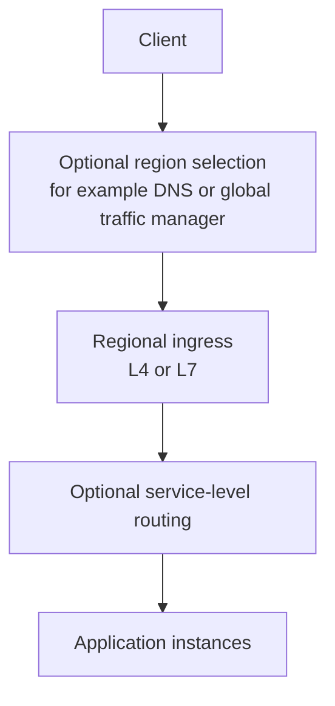

<!-- section: System Design | category: Architecture | tags: concept, scaling, theory | role-priority: essential | general-importance: foundational -->
[](#)
[](#)
[](#)
[](#)
[](../../../docs/topic-importance.md)
[](../../../docs/topic-importance.md)

# Load Balancing

When several backends can handle the same work, a load balancer chooses where a connection or request goes and how to handle an unavailable backend. The choice depends on the protocol, connection lifetime, server capacity and state model.

## Definition

A **load balancer** is a routing mechanism that selects a backend for traffic and defines how unhealthy backends are handled. It may sit in the traffic path as a proxy, or run in clients that discover and select service instances. It turns a pool of backends into a service callers can use through a shared address or service name.

The design space has three independent axes:

| Axis | Options | Consequence |
| ------------- | ------------------------------------------------------------------------------- | ------------------------------------------------------------------------------------------------------------------------ |
| **Layer** | L4 (transport) vs L7 (application protocol) | Determines which request details are available for routing |
| **Algorithm** | round-robin, weighted, least-connections, least-latency, consistent hash | determines which backend is selected and whether configured weights, observed work or key locality influence that choice |
| **Placement** | client-side (service discovery), dedicated (ALB/Envoy), global (Anycast/GeoDNS) | determines the failure domain and where health knowledge lives |

Backend health detection and removal are important, but their signals and timing depend on the load balancer. Consistent hashing can reduce how many keys move when the backend pool changes; hot keys and the specific ring or partition scheme still matter.

> **Textbook Definition:** Load balancing distributes traffic or work among eligible backends according to a selection policy, using availability and capacity signals to maintain the service's routing contract.


---

## First Principles

One instance can handle only finite work, and a failed instance cannot answer new requests. A caller must select a reachable instance without knowing every backend in advance. The router needs enough information to distribute the relevant unit of work—connections or requests—rather than merely counting servers:

1. **Requests need a route.** A shared address can distribute work through DNS, a proxy, client-side discovery or a service mesh. Stateless backends make reassignment easier; stateful backends need an explicit state or affinity plan.
2. **Routing rules express a tradeoff.** Round-robin ignores current work, least-connections reacts to open connections, and key-based routing can preserve cache locality. None is best for every workload.
3. **Failure detection is imperfect.** A timeout can mean a slow server or a network problem. Set health signals and removal thresholds to avoid keeping a broken server in rotation or ejecting healthy servers during a transient slowdown.

## Why it matters

In an interview, name where routing occurs, what information it uses, how it detects backend failure, and what happens to in-flight requests.

---

## L4 vs L7

### L4 — Transport Layer

**What it routes by:** transport connection information such as IP address, port and protocol (TCP/UDP)

**How it works:** Routes at the connection or transport layer without parsing application payloads. Depending on the implementation, it can distribute connections using address/port information or configured hashing.

**Pros:**
- Often has less application-protocol processing because it does not parse HTTP requests.
- Can forward TCP or UDP traffic without understanding the application payload. For gRPC over TCP, an L4 balancer can distribute connections but cannot route by gRPC method.

**Cons:**
- Can't make smart routing decisions (no URL-based routing, no header-based routing)
- Cannot select a backend from an HTTP path or application header

**Examples:** AWS NLB (Network Load Balancer), HAProxy TCP mode, Linux Virtual Server (LVS)

**When to use:** When connection-level routing is sufficient, such as TCP or UDP services that do not need path-, header-, or method-based routing.

### L7 — Application Layer

**What it routes by:** Application-protocol details such as HTTP host, path, method or headers. Routing by a cookie or gRPC method requires the proxy to understand the relevant protocol. Inspecting a request body is a separate, more expensive choice and is rarely needed for ordinary routing.

**How it works:** Parses an application protocol such as HTTP and routes using configured details such as host, path or headers. TLS termination and body inspection depend on the proxy and configuration.

**Pros:**
- Application-aware routing (for example, `/api/*` to API servers and `/static/*` to a static-content origin)
- Can do A/B testing by cookie
- Can do path-based or host-based routing
- Can rewrite URLs, inject headers

**Cons:**
- Terminates or parses the application connection, adding processing and resource costs.
- Requires enough capacity and protection for the additional proxying work.

**Examples:** AWS ALB (Application Load Balancer), HAProxy HTTP mode, Nginx, Envoy, Traefik

**When to use:** Web traffic, microservices, A/B testing, canary deployments, blue-green.

---

## Trace connections versus requests

A client opens one HTTP/2 connection and sends 100 requests over it. An L4 balancer selects server A when that connection starts; those multiplexed requests stay on A. Adding server B does not move existing streams. An HTTP-aware L7 proxy can terminate the client connection and select upstreams per request, if configured for that protocol and routing policy.

Now A begins draining. New connections or requests can go to B, while existing work follows the drain deadline. If an update reached A but its response was lost, forwarding a retry to B does not prove that the first update failed. Routing and mutation idempotency remain separate responsibilities.

## Load Balancing Algorithms

### 1. Round Robin

**Algorithm:** Assign each new connection or request to the next eligible server in order. Whether the balancer chooses per connection or per request depends on its layer and configuration.

```
Item 1 → Server 1
Item 2 → Server 2
Item 3 → Server 3
Item 4 → Server 1
```

**Pros:** Simple and gives eligible backends equal assignments over time.

**Cons:** Doesn't account for server capacity. A small server and a large server get equal load.

**When to use:** Homogeneous servers (same capacity).

### 2. Weighted Round Robin

**Algorithm:** Like round-robin, but with weights. With a 2:1 weight, Server 1 receives about twice as many eligible assignments as Server 2 over time; this does not guarantee equal resource use.

**When to use:** Heterogeneous servers (different capacities). e.g., 1 large + 2 small.

### 3. Least Connections

**Algorithm:** Route to the server with the fewest active connections reported by the balancer.

**Pros:** Can distribute long-lived connections more evenly than round-robin when connection counts reflect actual work.

**Cons:** Doesn't account for request cost (a "light" request counts the same as a "heavy" one).

**When to use:** Long-lived connections such as WebSocket or gRPC streams, when active connection count is a useful proxy for backend load.

### 4. Least Response Time

**Algorithm:** Prefer a server with a lower measured response time over a configured window. Exact scoring varies; delayed or noisy measurements can send too much work to a backend that only recently looked fast.

**Pros:** Uses observed latency as a signal, which can reflect request cost and backend load.

**Cons:** Requires measuring response times, more complex.

**When to use:** When latency is a useful routing signal and the measurement window, capacity limits and feedback behavior are understood.

### 5. IP Hash

**Algorithm:** Hash a client attribute, such as an IP address, to choose a backend.

**Pros:** Can keep a client on the same backend while the pool and routing configuration stay stable.

**Cons:** Uneven distribution (one client with lots of traffic → that server is hot).

**When to use:** Only when temporary session affinity is needed and the application handles backend changes. Prefer a shared session store when the service must survive rebalancing or failover.

### 6. Consistent Hashing

**Algorithm:** Hash keys and backend nodes into a shared key space. A key maps to a backend according to the chosen ring or partition rule. Adding or removing a node can move a subset of keys; the amount depends on the algorithm and configuration.

```
Ring:
 0 ────────── 360°
   Server A at 0°
   Server B at 120°
   Server C at 240°

Key X at 50° → Server B (next clockwise)
Key Y at 200° → Server C (next clockwise)
Key Z at 300° → Server A (next clockwise, wrapping)
```

**Pros:** Can preserve most key-to-node mappings when the pool changes, which helps distributed caches or shard routing.

**Cons:** More complex than simple hashing. Can have hot spots if keys are skewed (mitigated with **virtual nodes** — each server owns multiple positions on the ring).

**When to use:** Distributed caches and sharded data stores where keys map to nodes and you want to limit remapping when nodes change.

---

## Health Checks

Health checks and failure signals help avoid routing new requests to an unavailable backend. Configure them for the service's behavior; a slow dependency or transient overload can also make a health endpoint fail.

**Types:**
- **Active:** the balancer probes a configured endpoint and applies its timeout and failure threshold.
- **Passive:** the balancer uses real-traffic outcomes or connection failures as a signal, according to its policy.
- **TCP check:** LB opens a TCP connection. If it fails, mark as unhealthy. Cheaper than HTTP check but less informative.
- **Dependency check:** a probe also checks dependencies. It gives a broader signal but can amplify load or eject many backends when one shared dependency is down. Separate “can this instance serve traffic?” from “is the whole service healthy?” so a shared dependency failure does not make every instance flap in and out of rotation without a recovery plan.

**What to do with unhealthy servers:**
- **Stop new assignments:** in-flight requests may finish, be canceled or time out depending on the proxy and protocol.
- **Drain:** allow existing work to finish before removing a backend during planned changes.
- **Retry only when safe:** a retry can duplicate a request if the first backend applied the change before its response was lost. Use idempotency or another retry contract.

---

## Routing across layers

Some systems combine global traffic management, an edge proxy and service-level routing. Each layer adds a decision point and a failure mode, so use only the layers the deployment needs.



This is one possible path. DNS-based region selection and anycast routing are different mechanisms; a CDN may serve cached content at the edge but does not automatically act as the application's global load balancer.

**Global traffic management** may choose a region using health, latency, capacity or policy. DNS-based answers can be cached by resolvers and clients, so they do not move existing connections.

**Edge proxies** can terminate TLS, filter traffic and cache static responses. A CDN is related to load distribution but does not replace service-level routing.

**Service-level routing** can choose a backend using application details, discovery data or service-mesh policy.

---

## Specific Technologies

| Placement | Typical role | Example |
| --------------------------- | ---------------------------------------------------------- | ----------------------------------- |
| Edge or cloud load balancer | Route network or HTTP traffic to healthy targets | Cloud provider L4/L7 load balancers |
| Reverse proxy | Terminate or forward HTTP and apply host/path/header rules | Nginx, HAProxy, Envoy |
| Service mesh | Route service-to-service traffic with discovery and policy | Envoy-based meshes |
| Client-side discovery | Client selects from service instances it discovers | Libraries using a service registry |

---

## When to discuss in interviews

| Mention load balancing when... | What to say |
| ------------------------------- | ------------------------------------------------------------------------------------------------------------------------------------------ |
| You have multiple app servers | "Round-robin LB in front of the API servers" |
| You have long-lived connections | "Consider least-connections routing if connection counts reflect backend load; verify how the balancer handles upgrades and draining" |
| You have session state | "Prefer a shared session store. If temporary affinity is necessary, account for shared client IPs, changing addresses and backend removal" |
| You have multi-region | "Choose a region using health, latency and residency constraints; account for DNS caching and cross-region failover" |
| You have microservices | "Choose service discovery and routing from the actual protocol and operational needs; a mesh is optional" |
| You have a cache | "Use a key-routing scheme that limits remapping when the pool changes; measure skew and plan rebalancing" |
| You have health concerns | "Choose a health signal, timeout and failure threshold from service behavior, then test slow-start and recovery" |
| You have varying capacity | "Weighted round-robin to account for different server sizes" |

---

## Anti-patterns

- **No backend health or failure handling.** Unavailable servers can continue receiving new work.
- **Sticky sessions by default.** Causes uneven load. Prefer stateless services.
- **Layer 7 without a routing need.** Protocol inspection and TLS termination add work; measure the cost and use it when application-aware routing is useful.
- **In-memory session storage with no routing or recovery plan.** A later request may reach another backend or the original backend may fail. Prefer a shared session store or a stateless session design; affinity alone does not preserve the session through backend loss.
- **Blindly retrying failed requests.** A timed-out mutation may have committed; retry only with a safe idempotency or reconciliation contract.
- **Assuming DNS changes move traffic immediately.** Resolvers and clients can cache answers, and an existing connection stays where it is.

---

## Summary

A load balancer routes connections or requests using network information such as IP addresses and ports, or application details such as an HTTP path. Choose rules that fit connection length, session needs and failure handling. Health checks help detect unavailable backends, but their timing and thresholds must avoid ejecting a server that is only temporarily slow. Routing around an unhealthy backend does not make a failed dependency or data store available.

## See Also

- [System Design Revision](REVISION.md) — practice questions for this theory category
- [Caching Patterns](30.2.1.05-caching-patterns.md) — cache hits may bypass backend routing; freshness and invalidation are separate concerns
- [Rate Limiting](30.2.1.08-rate-limiting.md) — apply request limits at an appropriate ingress or service boundary
- [Cap Theorem](30.2.1.01-cap-theorem.md) — routing around an unhealthy instance does not change a data store's consistency or partition behavior

---

## References & Learn More

- [Nginx — Load Balancing](https://docs.nginx.com/nginx/admin-guide/load-balancer/http-load-balancer/)
- [AWS — ELB Documentation](https://docs.aws.amazon.com/elasticloadbalancing/)
- [HAProxy — Configuration](https://www.haproxy.org/)

---

[← Previous: Sharding And Replication](30.2.1.03-sharding-and-replication.md) · [ Back to Index](INDEX.md) · [Next: Caching Patterns →](30.2.1.05-caching-patterns.md)
