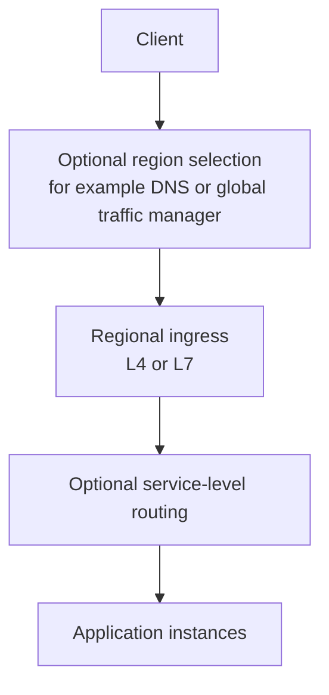

<!-- section: System Design | category: Architecture | tags: concept, scaling, theory | role-priority: essential | general-importance: foundational -->
[](#)
[](#)
[](#)
[](#)
[](../../../docs/topic-importance.md)
[](../../../docs/topic-importance.md)

# Load Balancing

When several backends can handle the same work, a load balancer chooses where a connection or request goes and how to handle an unavailable backend. The choice depends on the protocol, connection lifetime, server capacity, and state model:

```text
100 HTTP/2 requests on 1 connection → L4 keeps all on server A;
an HTTP-aware L7 proxy can spread them per request.
```

## Definition

A **load balancer** is a **routing mechanism** that selects a backend for traffic and defines how unhealthy backends are handled. It may sit in the traffic path as a proxy, or run in clients that discover and select service instances. It lets callers use a service without selecting every backend themselves.

> **Textbook Definition:** Load balancing distributes traffic or work among eligible backends according to a selection policy, using availability and capacity signals to maintain the service's routing contract.

## First Principles

One instance can handle only finite work, and a failed instance cannot answer new requests. A caller must select a reachable instance without knowing every backend in advance. The router needs enough information to distribute the relevant unit of work — connections or requests — rather than merely counting servers:

1. **Requests need a route.** A shared address can distribute work through DNS, a proxy, client-side discovery, or a service mesh. Stateless backends make reassignment easier; stateful backends need an explicit state or affinity plan.
2. **Routing rules express a tradeoff.** Round-robin ignores current work, least-connections reacts to open connections, and key-based routing can preserve cache locality. None is best for every workload.
3. **Failure detection is imperfect.** A timeout can mean a slow server or a network problem. Set health signals and removal thresholds to avoid keeping a broken server in rotation or ejecting healthy servers during a transient slowdown.
4. **Measure the result.** A balanced request count never guarantees balanced CPU or latency when request costs differ. Compare the chosen routing signal with backend utilization and the service's latency objective.

## 1. Route at the layer carrying the signal

The design space has three independent axes:

| Axis | Options | Consequence |
| ------------- | ------------------------------------------------------------------------------- | ------------------------------------------------------------------------------------------------------------------------ |
| **Layer** | L4 (transport) vs L7 (application protocol) | Determines which request details are available for routing |
| **Algorithm** | Round-robin, weighted, least-connections, least-latency, consistent hash | Determines which backend is selected and whether configured weights, observed work or key locality influence that choice |
| **Placement** | client-side (service discovery), dedicated (ALB/Envoy), global (Anycast/GeoDNS) | determines the failure domain and where health knowledge lives |

Backend health detection and removal matter, but their signals and timing depend on the balancer. Consistent hashing can reduce how many keys move when the backend pool changes; hot keys and the specific ring or partition scheme still matter.

**L4 (transport)** routes by connection information such as IP address, port, and protocol (TCP/UDP), without parsing application payloads. It often costs less application-protocol processing, and can forward TCP or UDP traffic blindly — for gRPC over TCP, an L4 balancer distributes connections but cannot route by gRPC method. It can never select a backend from an HTTP path or application header. **Examples:** AWS NLB, HAProxy TCP mode, Linux Virtual Server (LVS). **Use when** connection-level routing suffices, e.g. TCP/UDP services needing no path-, header-, or method-based routing.

**L7 (application)** routes by protocol details such as HTTP host, path, method, or headers; routing by cookie or gRPC method requires the proxy to understand the relevant protocol. Inspecting a request body is a separate, more expensive choice, rarely needed for ordinary routing. It parses the application protocol, so it can do path/host routing, A/B testing by cookie, URL rewrites, and header injection — at the cost of terminating or parsing the application connection, which needs capacity and protection for the extra proxying work. TLS termination and body inspection depend on proxy and configuration. **Examples:** AWS ALB, HAProxy HTTP mode, Nginx, Envoy, Traefik. **Use for** web traffic, microservices, A/B testing, canary deployments, blue-green.

## 2. Trace connections versus requests

A client opens one HTTP/2 connection and sends 100 requests over it. An L4 balancer selects server A when that connection starts; those multiplexed requests stay on A. Adding server B moves no existing streams. An HTTP-aware L7 proxy can terminate the client connection and select upstreams per request, if configured for that protocol and routing policy.

Now A begins draining. New connections or requests can go to B, while existing work follows the drain deadline. If an update reached A but its response was lost, forwarding a retry to B never proves the first update failed. Routing and mutation idempotency remain separate responsibilities.

## 3. Select a backend with an explicit algorithm

**Round robin** assigns each new connection or request to the next eligible server in order (per connection or per request, depending on layer and configuration). Simple, with equal assignments over time — but equal counts never imply equal CPU, memory, or latency. **Use for** homogeneous servers.

**Weighted round robin** assigns by configured weights: with 2:1, Server 1 receives about twice the eligible assignments of Server 2 over time — never guaranteeing equal resource use. **Use for** heterogeneous capacities, e.g. 1 large + 2 small.

**Least connections** routes to the server with the fewest active connections reported by the balancer. Can distribute long-lived connections more evenly than round-robin when connection counts reflect actual work — but a "light" request counts the same as a "heavy" one. **Use for** long-lived connections such as WebSocket or gRPC streams, when active connection count usefully proxies backend load.

**Least response time** prefers a server with lower measured latency over a configured window; exact scoring varies, and delayed or noisy measurements can flood a backend that only recently looked fast. It uses observed latency as a signal reflecting request cost and load, at the cost of measurement complexity. **Use when** latency is a useful routing signal and the measurement window, capacity limits, and feedback behavior are understood.

**IP hash** hashes a client attribute such as an IP address to choose a backend. Can keep a client on one backend while pool and routing stay stable — but distribution skews (one heavy client heats its server). **Use only when** temporary session affinity is needed and the application handles backend changes. Prefer a shared session store when the service must survive rebalancing or failover.

**Consistent hashing** hashes keys and backend nodes into a shared key space; a key maps to a backend by the chosen ring or partition rule. Adding or removing a node moves a subset of keys, depending on algorithm and configuration:

```text
Ring:
 0 ────────── 360°
   Server A at 0°
   Server B at 120°
   Server C at 240°

Key X at 50° → Server B (next clockwise)
Key Y at 200° → Server C (next clockwise)
Key Z at 300° → Server A (next clockwise, wrapping)
```

It can preserve most key-to-node mappings when the pool changes, helping distributed caches or shard routing — but it is more complex than simple hashing. **Virtual nodes** give each server multiple ring positions to smooth ownership across many keys. They never split one hot key: that key still maps to one destination unless replication, caching, or key-splitting changes the design. **Use for** distributed caches and sharded stores where keys map to nodes and remapping should stay limited when nodes change.

## 4. Detect unhealthy backends without flapping

Health checks and failure signals help avoid routing new work to an unavailable backend. Configure them for the service's behavior — a slow dependency or transient overload can also fail a health endpoint.

- **Active:** the balancer probes a configured endpoint and applies its timeout and failure threshold.
- **Passive:** the balancer uses real-traffic outcomes or connection failures as a signal, per its policy.
- **TCP check:** attempts a connection and applies the failure threshold. Success proves transport reachability, never that an HTTP handler or its dependencies can serve a request.
- **Dependency check:** a probe also checks dependencies. It gives a broader signal but can amplify load or eject many backends when one shared dependency is down. Separate "can this instance serve traffic?" from "is the whole service healthy?" so a shared dependency failure never flaps every instance in and out of rotation without a recovery plan.

**With unhealthy servers:** stop new assignments (in-flight requests may finish, be canceled, or time out depending on proxy and protocol); drain existing work to completion during planned changes before removal; retry only when safe — a retry can duplicate a request if the first backend applied the change before its response was lost, so use idempotency or another retry contract.

## 5. Compose layers and technologies deliberately

Some systems combine global traffic management, an edge proxy, and service-level routing. Each layer adds a decision point and a failure mode — use only the layers the deployment needs:



This is one possible path. DNS-based region selection and anycast routing are different mechanisms; a CDN may serve cached content at the edge but never automatically acts as the application's global load balancer. **Global traffic management** may choose a region by health, latency, capacity, or policy — but DNS answers can be cached by resolvers and clients, so they never move existing connections. **Edge proxies** can terminate TLS, filter traffic, and cache static responses; a CDN is related to load distribution but never replaces service-level routing. **Service-level routing** can choose a backend from application details, discovery data, or service-mesh policy.

| Placement | Typical role | Example |
| --------------------------- | ---------------------------------------------------------- | ----------------------------------- |
| Edge or cloud load balancer | Route network or HTTP traffic to healthy targets | Cloud provider L4/L7 load balancers |
| Reverse proxy | Terminate or forward HTTP and apply host/path/header rules | Nginx, HAProxy, Envoy |
| Service mesh | Route service-to-service traffic with discovery and policy | Envoy-based meshes |
| Client-side discovery | Client selects from service instances it discovers | Libraries using a service registry |

## When to discuss in interviews

| Mention load balancing when... | What to say |
| ------------------------------- | ------------------------------------------------------------------------------------------------------------------------------------------ |
| You have multiple app servers | "Round-robin LB in front of the API servers" |
| You have long-lived connections | "Consider least-connections routing if connection counts reflect backend load; verify how the balancer handles upgrades and draining" |
| You have session state | "Prefer a shared session store. If temporary affinity is necessary, account for shared client IPs, changing addresses and backend removal" |
| You have multi-region | "Choose a region using health, latency and residency constraints; account for DNS caching and cross-region failover" |
| You have microservices | "Choose service discovery and routing from the actual protocol and operational needs; a mesh is optional" |
| You have a cache | "Use a key-routing scheme that limits remapping when the pool changes; measure skew and plan rebalancing" |
| You have health concerns | "Choose a health signal, timeout and failure threshold from service behavior, then test slow-start and recovery" |
| You have varying capacity | "Weighted round-robin to account for different server sizes" |

## Common Mistakes

- No backend health or failure handling. Unavailable servers keep receiving new work.
- Sticky sessions by default. Causes uneven load. Prefer stateless services.
- Layer 7 without a routing need. Protocol inspection and TLS termination add work; measure the cost and use it when application-aware routing is useful.
- In-memory session storage with no routing or recovery plan. A later request may reach another backend or the original backend may fail. Prefer a shared session store or a stateless session design; affinity alone never preserves the session through backend loss.
- Blindly retrying failed requests. A timed-out mutation may have committed; retry only with a safe idempotency or reconciliation contract.
- Assuming DNS changes move traffic immediately. Resolvers and clients can cache answers, and an existing connection stays where it is.

## Summary

A load balancer routes connections or requests using network information such as IP addresses and ports, or application details such as an HTTP path. Choose rules that fit connection length, session needs and failure handling. Health checks help detect unavailable backends, but their timing and thresholds must avoid ejecting a server that is only temporarily slow. Routing around an unhealthy backend does not make a failed dependency or data store available.

## See Also

- [System Design Revision](REVISION.md) — practice questions for this theory category
- [Caching Patterns](30.2.1.05-caching-patterns.md) — cache hits may bypass backend routing; freshness and invalidation are separate concerns
- [Rate Limiting](30.2.1.08-rate-limiting.md) — apply request limits at an appropriate ingress or service boundary
- [Cap Theorem](30.2.1.01-cap-theorem.md) — routing around an unhealthy instance does not change a data store's consistency or partition behavior

---

## References & Learn More

- [Nginx — Load Balancing](https://docs.nginx.com/nginx/admin-guide/load-balancer/http-load-balancer/)
- [AWS — ELB Documentation](https://docs.aws.amazon.com/elasticloadbalancing/)
- [HAProxy — Configuration](https://www.haproxy.org/)

---

[← Previous: Sharding And Replication](30.2.1.03-sharding-and-replication.md) · [ Back to Index](INDEX.md) · [Next: Caching Patterns →](30.2.1.05-caching-patterns.md)
