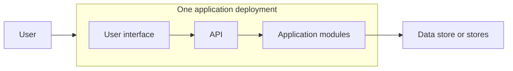
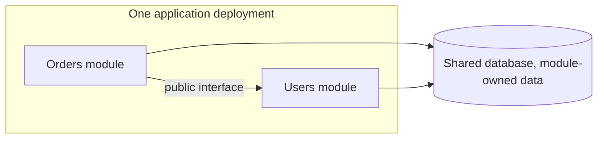
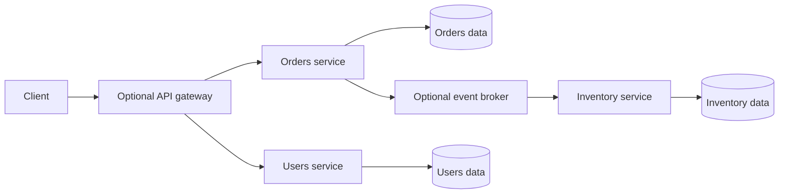
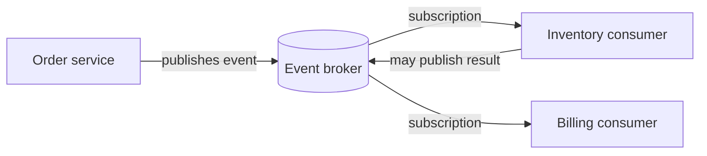
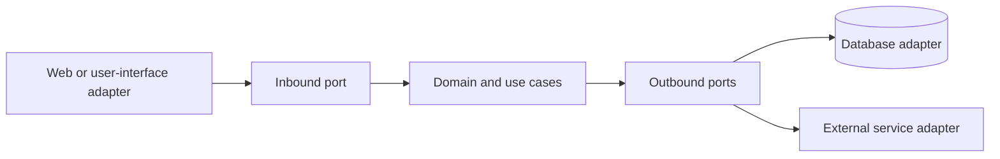
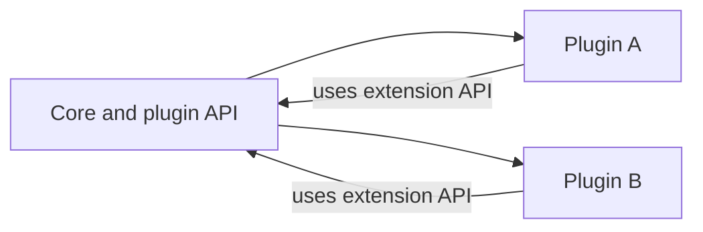

<!-- section: System Design | category: Architecture | tags: concept, architecture, patterns, theory | role-priority: essential | general-importance: foundational -->
[](#)
[](#)
[](#)
[](#)
[](../../../docs/topic-importance.md)
[](../../../docs/topic-importance.md)

# Architecture Patterns and Boundaries

Imagine an order workflow reserving stock in its database, then calling an external payment provider. The reservation can commit, then payment succeeds while its reply is lost; a timeout cannot tell the caller whether the charge happened. The architecture decision determines where ownership sits and how the system detects and recovers from that partial outcome:

```text
reserve stock succeeds → payment reply lost ? → who owns the partial outcome?
```

## Definition

An **architecture pattern** is a way to divide **responsibilities** and control how parts of an application depend on one another. It helps answer which part owns a business rule, how modules communicate, and which components deploy together.

> **Textbook Definition:** An architecture pattern is a reusable arrangement of system responsibilities, components, and dependency rules that addresses a recurring design problem under explicit constraints and trade-offs.

## First Principles

A change to one shared deployment requires releasing that deployment. A network call can fail after the callee has acted. A business rule tied to one vendor is harder to test unless an interface separates it. These constraints lead to four questions:

1. **Deployment boundary:** should these parts release and scale together, or separately?
2. **Data boundary:** which part owns each business rule that must always hold (an invariant) and the data needed to enforce it? A network boundary makes coordination and recovery more visible.
3. **Timing boundary:** does the caller need an immediate answer, or can it react to an event later?
4. **Dependency direction:** should business rules work without depending on the web framework, database, or vendor application programming interface (API)?

## 1. Choose the deployment and ownership boundary

The pattern names below describe different design choices. Monolith, modular monolith, and microservices set deployment and ownership boundaries. Event-driven architecture changes communication timing. Layered, hexagonal, and clean architecture shape internal dependencies. Microkernel architecture exposes plugin extension points. Combine them when useful: a service can publish events externally and keep its own modules layered internally.

The first question is whether parts of the system need separate release and ownership boundaries.

**Monolith:** an application whose parts release as one deployment unit. It may run as several processes and use more than one data store; its defining feature is the shared release boundary.



**Benefits:**

- Often simpler to build and operate than many independently deployed services.
- Avoids network contracts between internal modules.
- Can make local debugging and coordinated changes straightforward.
- A shared database can support transactions across modules when that matches the data model.

**Costs:**

- Changes share a release boundary, so a coordinated deploy may be needed even when one part changed.
- Coarse scaling may force the whole application to scale when one feature uses most resources.
- Shared technology choices leave teams fewer runtime and release-schedule options.
- Without module ownership and dependency rules, unrelated code couples and boundaries erode.

**Use when** one application boundary fits the current domain and operating model; workflows need frequent coordinated changes or local transactions; product and domain boundaries are still changing.

**Modular monolith:** one deployment unit divided into modules with explicit responsibilities and allowed dependencies.



**Module rules:**

- Each module has its own folder, namespace, or package.
- Modules call each other through defined interfaces, with dependency rules enforceable by packages or build checks.
- Each module owns its data changes — other modules use its interface instead of coupling to its private tables.
- A module may be extracted later, but only after its data ownership and dependencies are clear.

**Pros:**

- One deployment and mostly in-process communication with explicit boundaries.
- A local transaction can cross module operations when the invariant requires it.
- Boundaries stay visible and tooling can enforce some dependency rules.
- Module boundaries can inform a later extraction, but they do not by themselves make extraction safe or easy.

**Cons:**

- It is still one deployment boundary: modules never release separately.
- Discipline is required; someone will eventually reach across a module boundary.
- One release/runtime model constrains technology choices, and embedded components are possible but add integration cost.

**Use when** several responsibilities need clearer ownership but independent deployment is not yet required; modules can share one release and operational model.

**Microservices:** independently deployable services communicating over a network. Each service owns a defined capability and the data rules needed to enforce it. Data ownership is a logical boundary, never a requirement for one physical database server per service. Other services use the owner's contract instead of writing its private tables:



**Pros:**

- Independent deploys on each service's own schedule.
- Independent scaling when workload or resource needs differ.
- Ownership options letting service boundaries align with teams owning a capability end-to-end.
- Technology flexibility when the benefit justifies supporting another runtime.
- Potential failure isolation — though isolation requires bounded dependencies and capacity, since one unhealthy service can still cascade through callers.

**Cons:**

- **Distributed-systems complexity** — network calls can fail independently and async workflows may expose intermediate state.
- **Operational overhead** — each service needs a deployment path, monitoring, logs, capacity planning, and an owner.
- **Data consistency** — local database transactions never automatically cover several services, so cross-service invariants need deliberate coordination or recovery.
- **Latency and failures** — network calls add variable delay and can time out after work completed.
- **Debugging needs correlation** — a request may cross several services, so logs and traces need consistent request context.

**Use when** a clear capability boundary meets a real need for independent ownership or release; the team can operate the additional deployments and cross-service workflows; separate scaling or technology needs justify the network and data-consistency costs.

**Do NOT use when** the domain boundary is still changing and extraction would create many cross-service calls; the team cannot yet support the monitoring, deployment, and recovery work the services require.

## 2. Choose the communication timing

Deployment boundaries never dictate communication style. Within one application or many services, the caller may need an immediate answer or may react later.

**Event-driven architecture (EDA):** producers publish events describing facts; consumers react. Commonly asynchronous, often through a broker, usable inside one application or across services. An event says something happened, such as `OrderPlaced`; a command asks a particular owner to do something, such as `ReserveInventory`. Consumers may process an event later or more than once, so the event contract needs delivery, deduplication, and recovery rules:



**Pros:**

- Loose coupling — producers never know each consumer, and a new consumer can use an existing event contract.
- Async option — the producer finishes its request without waiting for every downstream consumer, after its own state and event intent are durably recorded.
- Decoupled timing — a broker can retain events for a configured period while a consumer is unavailable (delivery and retention guarantees depend on broker and configuration).
- Multiple consumers — one event feeds several workflows (retention and event sourcing are separate design choices).

**Cons:**

- **Delayed effects** — async consumers may lag the producer, so readers can see intermediate state.
- **Not every flow is asynchronous** — a user may need an immediate result, so request-response can still be right.
- **Schema management** — event schemas evolve and consumers may run different versions, so compatibility needs a plan.
- **Ordering needs a contract** — a broker may preserve order within a partition or key, but cross-key and cross-consumer ordering needs explicit design.
- **Testing and tracing need care** — a workflow may span several processes and finish after the original request.

**Use for** cross-service workflows (saga), event broadcasting (notify multiple systems), several independent consumers reacting to one fact, workflows that can finish after the initiating request with explicit retry and failure handling.

## 3. Constrain internal dependencies

These patterns organize code inside a deployable application or service. They never by themselves require separate network tiers.

**Layered architecture:** technical responsibilities organized into layers. Strict layering allows only the adjacent lower layer; relaxed layering permits selected lower-layer calls. A code layer is not necessarily a separately deployed network tier:

```text
┌─────────────────┐
│ Presentation    │ ← user interface, controllers, API endpoints
├─────────────────┤
│ Business Logic  │ ← Services, domain logic
├─────────────────┤
│ Data Access     │ ← Repositories, data access objects
├─────────────────┤
│ Database        │ ← Postgres, MySQL, etc.
└─────────────────┘
```

Each layer's defined responsibility can make a conventional web application easier to navigate — but dependencies may leak between layers or business rules may scatter. Layering alone never decides whether domain objects own business behavior or mostly hold data. If a controller intentionally bypasses a layer, document which component owns the skipped responsibility; never call the design strict layering. **Use when** separating presentation, application logic, and storage matches the system's needs. Keep dependencies pointing in the intended direction.

**Hexagonal architecture (ports & adapters):** the domain sits at the center. Outside adapters (UI, DB, external APIs) connect through **ports** (interfaces):



The arrows show **runtime calls**. Source dependencies point differently: the database adapter implements an outbound interface defined by the application/domain boundary; business code depends on that interface rather than importing the concrete database client.

**Trace:** a web adapter validates a reserve-stock request and calls an application use case. The use case applies its quantity rule and invokes a `StockRepository` port. The injected PostgreSQL adapter performs the conditional update. A test can inject an in-memory implementation, but only an integration test establishes real database locking and constraint behavior. Replacing the adapter never erases those transactional assumptions.

**Pros:**

- Isolated rule tests (test adapter for domain decisions; test the real adapter's contract separately).
- Adapters isolate external details (replacing a database may still change data mapping, queries, and transaction assumptions).
- Framework independence for pure domain logic.
- Clear boundaries keeping the domain from depending directly on frameworks and external clients (adapters must still meet its contracts).

**Cons:**

- More files (each port needs interface + adapter).
- Over-engineering for simple apps.
- Indirection — following layers to understand behavior.

**Use for** complex business logic where the domain is the hard part; long-lived systems where business rules and external integrations should evolve through distinct boundaries; testing the domain without DB/UI.

**Clean architecture:** separates business policy from external mechanisms through inward-pointing source dependencies. Its commonly shown four circles illustrate policy levels; they mandate neither exactly four packages nor runtime tiers:

```text
┌──────────────────────────────────────┐
│ Frameworks & Drivers (outermost)     │ ← Web, DB, UI, external
├──────────────────────────────────────┤
│ Interface Adapters                   │ ← Controllers, gateways, presenters
├──────────────────────────────────────┤
│ Use Cases (Application Business)     │ ← Application-specific business rules
├──────────────────────────────────────┤
│ Entities (Enterprise Business)       │ ← Domain, business rules
└──────────────────────────────────────┘
```

**Dependency rule:** source-code dependencies point only inward; inner layers know nothing about outer layers. An inner use case can still call an outer database adapter at runtime: it calls an interface owned by the inner boundary, and the outer adapter implements it, so the source dependency points inward even when control flows outward. Keep vendor types, HTTP requests, and database records outside that contract when they would force policy to depend on those details. The composition root — the code constructing and connecting the application — knows the concrete implementations.

**Compared with hexagonal:** both use dependency inversion to keep business policy independent of infrastructure. Clean names policy levels; hexagonal emphasizes ports and adapters. Neither requires a fixed folder layout or separate deployment tiers.

**Decision:** use the vocabulary making the boundary easiest to review. Prove which imports are permitted and which adapter behaviors are required. Drawing circles or naming a folder `domain` establishes neither property.

## 4. Open a plugin boundary when extensions are the product

**Microkernel (plugin) architecture:** a small core provides stable extension points; plugins add capabilities through those interfaces. Whether plugins can load or unload at runtime depends on the host:



**Benefits:**

- Extensibility without changing the core.
- The host supports optional or replaceable plugins.
- Clear separation between platform and features.
- The core stays stable while extensions evolve behind a compatibility contract.

**Costs:** the host must define plugin compatibility, permissions, and failure isolation — extension points exposing too little are unusable, while unstable or overly broad APIs couple every plugin to the core. Plugins can conflict or consume shared resources, and in-process loading never makes them safe.

**Use for** platforms supporting many features — integrated development environments (IDEs), browsers, content management systems (CMSs) — or third-party extensibility as a goal, with a plugin API designable upfront.

## 5. Migrate only across clarified boundaries

| Design question | Likely fit | Cost or condition to prove |
| -------------------------------------------------------------- | ---------------------------------------- | ---------------------------------------------------------------------------------------------------- |
| Should these parts release and scale together? | Monolith or modular monolith | The shared deployment is acceptable; modules still need clear ownership if they change independently |
| Does a capability need independent ownership or release? | Microservices | Cross-service data rules, network failure and operations justify the split |
| Can consumers react after the initiating request? | Event-driven | Delivery, ordering, duplicates, lag and recovery have explicit contracts |
| Should business policy depend on a framework or vendor? | Layered, hexagonal or clean architecture | Enforce the intended source-dependency rule without adding empty indirection |
| Are third-party or replaceable extensions part of the product? | Microkernel | Plugin permissions, isolation, version compatibility and failure behavior are designed |

In an interview, state the constraint forcing the boundary, then explain who owns the data and whether the caller needs an immediate answer. Trace one failure across that boundary and name the deployment or operating work it adds. Never claim independent releases or failure isolation when the services still share one release or failure path.

**Clarify module boundaries before extracting a service:** add module boundaries; define which module owns each rule and data change, sharing a library only when its behavior is genuinely common; enforce module dependencies with build tools or architecture tests.

**Extract a service only when independent operation is worth its cost:** a modular monolith can make boundaries easier to see, but it is no required migration step. Pick a capability with clear data ownership and few dependencies. Define its network contract, deployment, observability, and recovery behavior. Move data and callers with a compatibility period; reconcile before removing the old path. Repeat only when another boundary holds a clear operational benefit.

If services still depend on one another's schemas and release together, the split adds network failure modes without independent change or ownership. An async event is no shortcut around defining that contract.

## Summary

Architecture patterns answer different questions. A monolith or modular monolith keeps one release boundary; microservices divide ownership and operation across networked services. Event-driven communication lets consumers react later. Layered, hexagonal and clean architecture constrain internal responsibilities or dependency direction, while a microkernel defines a plugin boundary. Choose only the boundaries that solve a real constraint, then account for their failure, data and operating costs.

## See Also

- [System Design Revision](REVISION.md) — choose a boundary and defend its failure, data and operating costs
- [Queues And Async](30.2.1.06-queues-and-async.md) — brokered asynchronous messaging and its delivery trade-offs
- [Distributed Transactions](30.2.1.07-distributed-transactions.md) — why a cross-service write needs a saga or compensation instead of one local transaction
- [Cap Theorem](30.2.1.01-cap-theorem.md) — consistency and availability choices for an operation during a network partition
- [Microservices & Distributed Patterns](../../../20-backend/20.6-microservices/INDEX.md) — service data ownership, sagas, and monolith decomposition
- [SOLID Principles](../../30.1-design-patterns/01-foundations/30.1.1.01-solid-principles.md) — class- and module-level rules for cohesion and dependency direction

---

## References & Learn More

- [Martin Fowler — Patterns of Enterprise Application Architecture](https://martinfowler.com/books/eaa.html)
- [Sam Newman — Building Microservices](https://www.oreilly.com/library/view/building-microservices-2nd/9781492034018/)
- [Alistair Cockburn — Hexagonal Architecture](https://alistair.cockburn.us/hexagonal-architecture/)
- Robert C. Martin, *Clean Architecture* — Chapters 19 and 22: policy levels and the source dependency rule
- Mark Richards and Neal Ford, *Fundamentals of Software Architecture* (2020 first edition) — Chapters 3 and 9–18: modularity and architecture styles with characteristic trade-offs

---

[← Previous: Failure Modes](30.2.1.10-failure-modes.md) · [ Back to Index](INDEX.md) · [Next: Capacity Planning →](30.2.1.12-capacity-planning.md)
