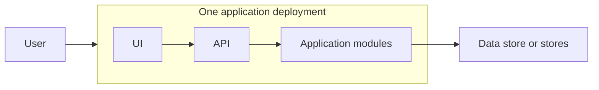
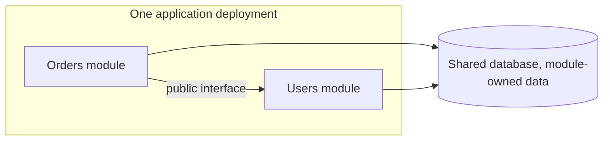
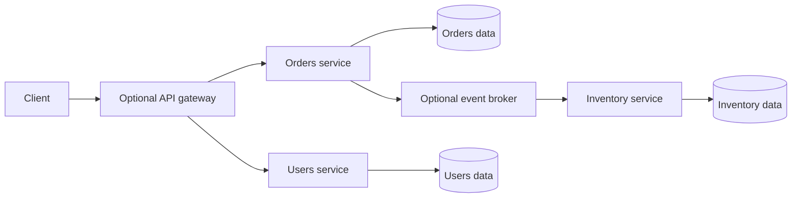
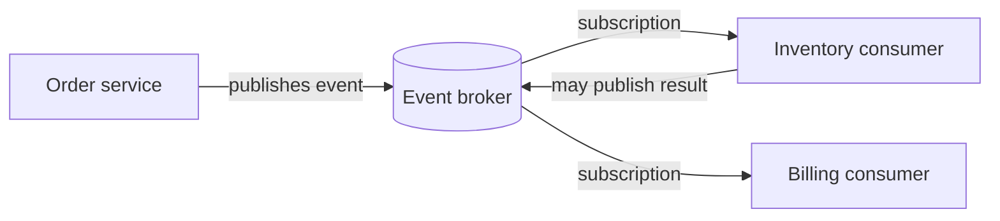
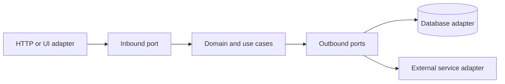
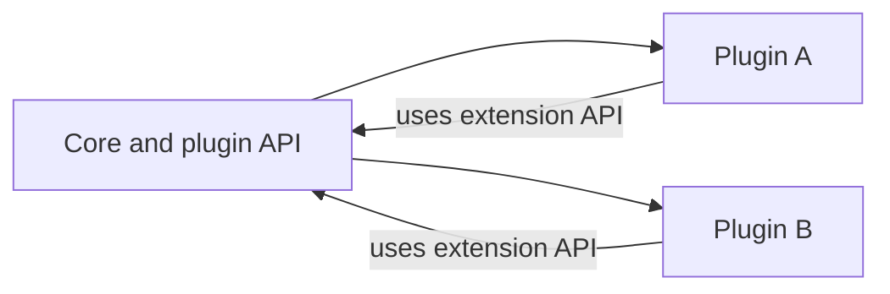

<!-- section: System Design | category: Architecture | tags: concept, architecture, patterns, theory | role-priority: essential | general-importance: foundational -->
[](#)
[](#)
[](#)
[](#)
[](../../../docs/topic-importance.md)
[](../../../docs/topic-importance.md)

# Architecture Patterns and Boundaries

## Definition

An **architecture pattern** is a way to divide responsibilities and control how parts of an application depend on one another. It helps answer questions such as which part owns a business rule, how modules communicate and which components deploy together.

> **Textbook Definition:** An architecture pattern is a reusable arrangement of system responsibilities, components, and dependency rules that addresses a recurring design problem under explicit constraints and trade-offs.

These names describe different design choices. Monolith, modular monolith and microservices describe deployment and ownership boundaries. Event-driven describes communication. Layered, hexagonal and clean architecture describe internal dependency structure. Microkernel architecture describes extension through plugins. They can be combined: a service may use events to communicate externally and keep its code modular internally.

---

## First Principles

A change to one shared deployment requires releasing that deployment; a network call can fail after the callee has acted; a business rule tied to one vendor cannot be tested without that dependency unless an interface separates them. These constraints create four boundary questions:

1. **Deployment boundary:** should these parts release and scale together, or separately?
2. **Data boundary:** which part owns an invariant and its data? A network boundary makes coordination and recovery more visible.
3. **Timing boundary:** does the caller need an immediate answer, or can it react to an event later?
4. **Dependency direction:** should business rules work without depending on the web framework, database or vendor API?

## Why it matters

The pattern changes deployment, data consistency, failure handling and team responsibilities. An interview answer is stronger when it names these consequences and explains which requirements justify them.

---

## 1. Monolith

**Definition:** An application whose parts are released as one deployment unit. It may run as several processes and use more than one data store; its defining feature is the shared release boundary.



**Pros:**
- Often simpler to build and operate than many independently deployed services.
- Avoids network contracts between internal modules.
- Can make local debugging and coordinated changes straightforward.
- A shared database can support transactions across modules when that matches the data model.

**Cons:**
- **Changes share a release boundary.** A coordinated deploy may be needed even when only one part changed.
- **Coarse scaling.** The application may need to scale as a unit even when one feature uses most of the resources.
- **Shared technology choices.** Teams may have fewer options to choose different runtimes or release schedules.
- **Boundaries can erode.** Without module ownership and dependency rules, unrelated code becomes coupled.

**When to use:**
- One application boundary fits the current domain and operating model
- Workflows need frequent coordinated changes or local transactions
- Product and domain boundaries are still changing

---

## 2. Modular Monolith

**Definition:** One deployment unit divided into modules with explicit responsibilities and allowed dependencies.



**Module rules:**
- Each module has its own folder, namespace, or package
- Modules call each other through defined interfaces; dependency rules can be enforced with packages or build checks.
- Each module owns its data changes. Other modules use its interface instead of coupling to its private tables.
- A module may be extracted later, but only after its data ownership and dependencies are clear.

**Pros:**
- One deployment and mostly in-process communication, with explicit module boundaries. A local transaction can cross module operations when the invariant requires it.
- Makes boundaries visible; tooling can enforce some dependency rules.
- Module boundaries can inform a later extraction, but do not by themselves make it safe or easy.

**Cons:**
- Still one deployment boundary; individual modules cannot be released separately
- Discipline required (someone will reach across module boundaries)
- One release/runtime model constrains technology choices; embedded components are possible but add integration cost

**When to use:**
- Several responsibilities need clearer ownership, but independent deployment is not yet required
- Modules can share one release and operational model

---

## 3. Microservices

**Definition:** Independently deployable services communicate over a network. Each service is responsible for a defined capability and the data rules it owns.



**Pros:**
- **Independent deploys.** Each service can ship on its own schedule.
- **Independent scaling.** Scale a service separately when its workload or resource needs differ.
- **Ownership options.** Service boundaries can align with teams that own a capability end-to-end.
- **Technology flexibility.** A service can use a different runtime when the benefit justifies supporting it.
- **Potential failure isolation.** Isolation requires bounded dependencies and capacity; one unhealthy service can still cascade through callers.

**Cons:**
- **Distributed systems complexity.** Network calls can fail independently; asynchronous workflows may expose intermediate state.
- **Operational overhead.** Each service needs a deployment path, monitoring, logs, capacity planning and an owner.
- **Data consistency.** Local database transactions do not automatically cover several services. Cross-service invariants need a deliberate coordination or recovery strategy.
- **Latency and failures.** Network calls add variable delay and can time out after work has completed.
- **Debugging needs correlation.** A request may cross several services, so logs and traces need consistent request context.

**When to use:**
- There is a clear capability boundary and a real need for independent ownership or release
- The team can operate the additional deployments and cross-service workflows
- Separate scaling or technology needs justify the network and data-consistency costs

**When NOT to use:**
- The domain boundary is still changing and extraction would create many cross-service calls.
- The team cannot yet support the monitoring, deployment and recovery work the services require.

---

## 4. Event-Driven Architecture (EDA)

**Definition:** Producers publish events describing facts; consumers react to them. This is commonly asynchronous, often through a broker, and can be used inside one application or across services.



**Pros:**
- **Loose coupling.** Producers do not need to know each consumer; a new consumer can use an existing event contract.
- **Async option.** The producer can finish its request without waiting for every downstream consumer, after its own state and event intent are durably recorded.
- **Decoupled timing.** A broker can retain events for a configured period while a consumer is unavailable; delivery and retention guarantees depend on the broker and configuration.
- **Multiple consumers.** One event can feed several workflows. Retention and event sourcing are separate design choices.

**Cons:**
- **Delayed effects.** Async consumers may lag behind the producer, so readers can see intermediate state.
- **Not every flow is asynchronous.** A user may need an immediate result, so request-response can still be the right choice.
- **Schema management.** Event schemas evolve and consumers may run different versions, so compatibility needs a plan.
- **Ordering needs a contract.** A broker may preserve order within a partition or key, but cross-key and cross-consumer ordering needs explicit design.
- **Testing and tracing need care.** A workflow may span several processes and finish after the original request.

**When to use:**
- Cross-service workflows (saga)
- Event broadcasting (notify multiple systems)
- Several independent consumers need to react to one fact
- A workflow can finish after the initiating request and has explicit retry and failure handling

**See also:** [Queues And Async](30.2.1.06-queues-and-async.md), [Saga Pattern](../../../20-backend/20.6-microservices/03-data-and-consistency/20.6.3.01-saga-pattern.md), [Event Sourcing](../../../20-backend/20.6-microservices/03-data-and-consistency/20.6.3.03-event-sourcing.md)

---

## 5. Layered Architecture

**Definition:** Technical responsibilities are organized into layers. Strict layering allows only the adjacent lower layer; relaxed layering permits selected lower-layer calls. A code layer is not necessarily a separately deployed network tier.

```
┌─────────────────┐
│ Presentation    │ ← UI, controllers, API endpoints
├─────────────────┤
│ Business Logic  │ ← Services, domain logic
├─────────────────┤
│ Data Access     │ ← Repositories, DAOs
├─────────────────┤
│ Database        │ ← Postgres, MySQL, etc.
└─────────────────┘
```

**Strength:** Each layer has a defined responsibility, which can make a conventional web application easier to navigate.

**Risk:** Dependencies may leak between layers or business rules may become scattered. Layering alone does not decide whether the domain model is rich or anemic.

**When to use:** When separating presentation, application logic and storage matches the system's needs. Keep dependencies pointing in the intended direction.

---

## 6. Hexagonal Architecture (Ports & Adapters)

**Definition:** The domain is at the center. Outside adapters (UI, DB, external APIs) connect to the domain through "ports" (interfaces).



The arrows above show **runtime calls**. Source dependencies point differently: the database adapter implements an outbound interface defined by the application/domain boundary; business code depends on that interface rather than importing the concrete database client.

**Trace:** An HTTP adapter validates a reserve-stock request and calls an application use case. The use case applies its quantity rule and invokes a `StockRepository` port. The injected PostgreSQL adapter performs the conditional update. A test can inject an in-memory implementation, but only an integration test can establish real database locking and constraint behavior. Replacing the adapter does not erase those transactional assumptions.

**Pros:**
- **Testable.** Mock the adapters, test the domain.
- **Adapters isolate external details.** Replacing a database may still require changes to data mapping, queries and transaction assumptions.
- **Independent of frameworks.** Domain is pure business logic.
- **Clear boundaries.** The domain can avoid depending directly on frameworks and external clients; adapters still need to meet its contracts.

**Cons:**
- **More files.** Each port has an interface + adapter.
- **Over-engineering for simple apps.**
- **Indirection.** You have to follow the layers to understand what's happening.

**When to use:**
- Complex business logic (the domain is the hard part)
- Long-lived systems (the adapters change, the domain doesn't)
- You want to test the domain without DB/UI

---

## 7. Clean Architecture

**Similar to hexagonal.** Four layers:

```
┌──────────────────────────────────────┐
│ Frameworks & Drivers (outermost)     │ ← Web, DB, UI, external
├──────────────────────────────────────┤
│ Interface Adapters                   │ ← Controllers, gateways, presenters
├──────────────────────────────────────┤
│ Use Cases (Application Business)     │ ← Application-specific business rules
├──────────────────────────────────────┤
│ Entities (Enterprise Business)       │ ← Domain, business rules
└──────────────────────────────────────┘
```

**Dependency rule:** Source code dependencies point only inward. Inner layers know nothing about outer layers.

**vs Hexagonal:** Very similar. Clean Architecture is more prescriptive about the layer names. Hexagonal emphasizes "ports and adapters" terminology.

**In interviews:** Use whichever you're more familiar with. Both demonstrate the same idea: domain at the center, adapters at the edges.

---

## 8. Microkernel (Plugin) Architecture

**Definition:** A small core provides stable extension points; plugins add capabilities through those interfaces. Whether plugins can load or unload at runtime depends on the host.



**Pros:**
- Extensibility without changing the core
- The host can support optional or replaceable plugins
- Clear separation between platform and features

**Cons:**
- Plugin API design is hard (you can't predict all future plugins)
- Plugins might conflict with each other
- Versioning nightmare (which plugin versions are compatible with which core?)

**When to use:**
- Platform that supports many features (IDEs, browsers, CMSs)
- Third-party extensibility is a goal
- Clear plugin API can be designed upfront

---

## Comparison

| Pattern | Fits when | Trade-off to explain |
| ----------------- | ------------------------------------------------------------ | ----------------------------------------------------------------------- |
| Monolith | One release boundary fits the product | Changes and scaling share that boundary |
| Modular monolith | Internal ownership needs structure | Enforce module APIs and data ownership |
| Microservices | A capability needs independent ownership or release | Operate networked services and cross-service data flows |
| Event-driven | Consumers can react later or independently | Define delivery, ordering, retries and visibility of intermediate state |
| Layered | Technical responsibilities need clear separation | Keep dependency direction from becoming tangled |
| Hexagonal / clean | Business rules should be isolated from external tools | Maintain useful ports without adding needless indirection |
| Microkernel | Third-party or optional extensions are a product requirement | Keep plugin APIs compatible and secure |

## Applying the choice in a design interview

Name the boundary, then explain who owns the data, which operations need an immediate answer, how failure is contained, and what deployment or operational work the pattern adds. State assumptions instead of inventing team sizes or performance numbers.

## Migration paths

### Monolith → Modular Monolith

- Add module boundaries
- Extract shared code into libraries
- Enforce module dependencies with build tools or architecture tests

### Modular Monolith → Microservices

- Pick a capability with clear data ownership and few dependencies
- Define its network contract, deployment, observability and recovery behavior
- Move data and callers with a compatibility period; reconcile before removing the old path
- Repeat only when another boundary has a clear operational benefit

### Monolith → Microservices (skip modular)

- Map dependencies and data ownership before extraction. A modular monolith can make boundaries easier to see, but it is not a required migration step.
- If services remain tightly coupled, network calls add failure modes without providing independent change or ownership.

---

## Anti-patterns

- **Distributed monolith.** Microservices that are tightly coupled. Network calls everywhere. No independent deploys possible.
- **Splitting a service without a clear reason.** It adds deployment and network failure modes without a useful ownership or scaling boundary.
- **Premature event-driven.** Sync is often fine. Don't add Kafka for one workflow.
- **Ignoring internal structure.** A monolith can still become tightly coupled; define module boundaries where they help change safely.
- **Layered violation.** Controller talks directly to DB. Service layer skipped.
- **Microkernel without API design.** Plugins can't be built because the API keeps changing.

---

## Summary

Architecture patterns describe common ways to organize software. A layered design separates interface, application and storage responsibilities. A modular monolith keeps those boundaries in one deployable application; microservices split them into separately operated services and add network and data-consistency costs. Event-driven designs communicate through events, and hexagonal designs keep domain rules separate from external adapters. Choose a pattern for the team and requirements, then explain its costs.

## See Also

- [System Design Revision](REVISION.md) — practice questions for this theory category
- [Queues And Async](30.2.1.06-queues-and-async.md) — async is the foundation of EDA
- [Distributed Transactions](30.2.1.07-distributed-transactions.md) — saga for cross-service
- [Cap Theorem](30.2.1.01-cap-theorem.md) — microservices force trade-offs
- [Microservices & Distributed Patterns](../../../20-backend/20.6-microservices/INDEX.md) — full microservices reference
- [SOLID Principles](../../30.1-design-patterns/01-foundations/30.1.1.01-solid-principles.md) — apply to your architecture

---

## References & Learn More

- [Martin Fowler — Patterns of Enterprise Application Architecture](https://martinfowler.com/books/eaa.html)
- [Sam Newman — Building Microservices](https://www.oreilly.com/library/view/building-microservices-2nd/9781492034018/)
- [Alistair Cockburn — Hexagonal Architecture](https://alistair.cockburn.us/hexagonal-architecture/)

---

[← Previous: Failure Modes](30.2.1.10-failure-modes.md) · [ Back to Index](INDEX.md) · [Next: Capacity Planning →](30.2.1.12-capacity-planning.md)
