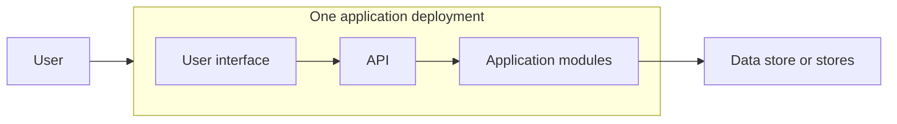
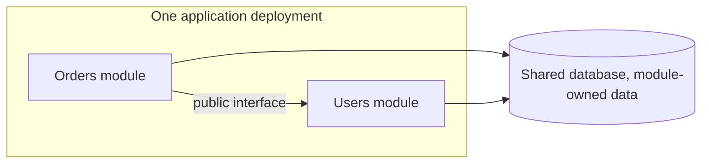
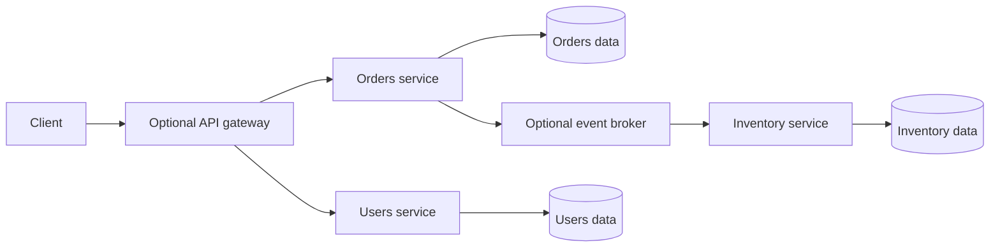
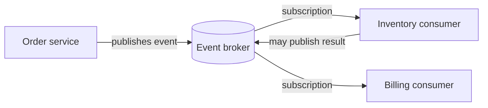
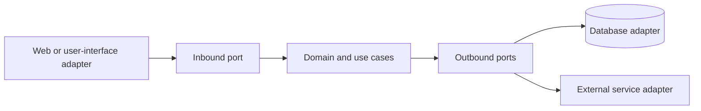
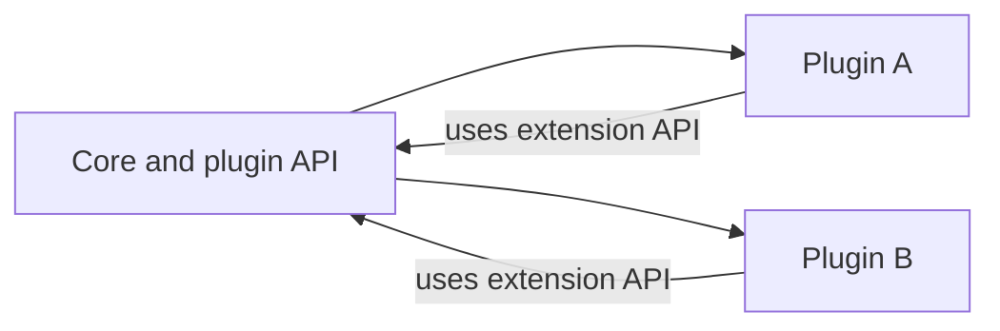

<!-- section: System Design | category: Architecture | tags: concept, architecture, patterns, theory | role-priority: essential | general-importance: foundational -->
[](#)
[](#)
[](#)
[](#)
[](../../../docs/topic-importance.md)
[](../../../docs/topic-importance.md)

# Architecture Patterns and Boundaries

Imagine an order workflow that reserves stock in its database and then calls an external payment provider. The reservation can commit, then payment can succeed while its reply is lost; a timeout cannot tell the caller whether the charge happened. The architecture decision determines where ownership sits and how the system detects and recovers from that partial outcome.

## Definition

An **architecture pattern** is a way to divide responsibilities and control how parts of an application depend on one another. It helps answer questions such as which part owns a business rule, how modules communicate and which components deploy together.

> **Textbook Definition:** An architecture pattern is a reusable arrangement of system responsibilities, components, and dependency rules that addresses a recurring design problem under explicit constraints and trade-offs.

These names describe different design choices. Monolith, modular monolith and microservices set deployment and ownership boundaries. Event-driven architecture changes communication timing. Layered, hexagonal and clean architecture shape internal dependencies. Microkernel architecture exposes plugin extension points. Combine them when useful: a service can publish events externally and keep its own modules layered internally.

---

## First Principles

A change to one shared deployment requires releasing that deployment. A network call can fail after the callee has acted. A business rule tied to one vendor is harder to test unless an interface separates it. These constraints lead to four questions:

1. **Deployment boundary:** should these parts release and scale together, or separately?
2. **Data boundary:** which part owns each business rule that must always hold (an invariant) and the data needed to enforce it? A network boundary makes coordination and recovery more visible.
3. **Timing boundary:** does the caller need an immediate answer, or can it react to an event later?
4. **Dependency direction:** should business rules work without depending on the web framework, database or vendor application programming interface (API)?

## Deployment and ownership boundaries

The first question is whether parts of the system need separate release and ownership boundaries.

### Monolith

**Definition:** An application whose parts are released as one deployment unit. It may run as several processes and use more than one data store; its defining feature is the shared release boundary.



**Pros:**
- Often simpler to build and operate than many independently deployed services.
- Avoids network contracts between internal modules.
- Can make local debugging and coordinated changes straightforward.
- A shared database can support transactions across modules when that matches the data model.

**Cons:**
- **Changes share a release boundary.** A coordinated deploy may be needed even when only one part changed.
- **Coarse scaling.** The application may need to scale as a unit even when one feature uses most of the resources.
- **Shared technology choices.** Teams may have fewer options to choose different runtimes or release schedules.
- **Boundaries can erode.** Without module ownership and dependency rules, unrelated code becomes coupled.

**When to use:**
- One application boundary fits the current domain and operating model
- Workflows need frequent coordinated changes or local transactions
- Product and domain boundaries are still changing

---

### Modular Monolith

**Definition:** One deployment unit divided into modules with explicit responsibilities and allowed dependencies.



**Module rules:**
- Each module has its own folder, namespace, or package
- Modules call each other through defined interfaces; dependency rules can be enforced with packages or build checks.
- Each module owns its data changes. Other modules use its interface instead of coupling to its private tables.
- A module may be extracted later, but only after its data ownership and dependencies are clear.

**Pros:**
- One deployment and mostly in-process communication, with explicit module boundaries. A local transaction can cross module operations when the invariant requires it.
- Makes boundaries visible; tooling can enforce some dependency rules.
- Module boundaries can inform a later extraction, but do not by themselves make it safe or easy.

**Cons:**
- Still one deployment boundary; individual modules cannot be released separately
- Discipline required (someone will reach across module boundaries)
- One release/runtime model constrains technology choices; embedded components are possible but add integration cost

**When to use:**
- Several responsibilities need clearer ownership, but independent deployment is not yet required
- Modules can share one release and operational model

---

### Microservices

**Definition:** Independently deployable services communicate over a network. Each service is responsible for a defined capability and the data rules it owns.

Data ownership is a logical boundary, not a requirement for one physical database server per service. Other services use the owner's contract instead of writing its private tables.



**Pros:**
- **Independent deploys.** Each service can ship on its own schedule.
- **Independent scaling.** Scale a service separately when its workload or resource needs differ.
- **Ownership options.** Service boundaries can align with teams that own a capability end-to-end.
- **Technology flexibility.** A service can use a different runtime when the benefit justifies supporting it.
- **Potential failure isolation.** Isolation requires bounded dependencies and capacity; one unhealthy service can still cascade through callers.

**Cons:**
- **Distributed systems complexity.** Network calls can fail independently; asynchronous workflows may expose intermediate state.
- **Operational overhead.** Each service needs a deployment path, monitoring, logs, capacity planning and an owner.
- **Data consistency.** Local database transactions do not automatically cover several services. Cross-service invariants need a deliberate coordination or recovery strategy.
- **Latency and failures.** Network calls add variable delay and can time out after work has completed.
- **Debugging needs correlation.** A request may cross several services, so logs and traces need consistent request context.

**When to use:**
- There is a clear capability boundary and a real need for independent ownership or release
- The team can operate the additional deployments and cross-service workflows
- Separate scaling or technology needs justify the network and data-consistency costs

**When NOT to use:**
- The domain boundary is still changing and extraction would create many cross-service calls.
- The team cannot yet support the monitoring, deployment and recovery work the services require.

---

## Communication timing

Deployment boundaries do not dictate communication style. Within either one application or many services, the caller may need an immediate answer or may be able to react later.

### Event-Driven Architecture (EDA)

**Definition:** Producers publish events describing facts; consumers react to them. This is commonly asynchronous, often through a broker, and can be used inside one application or across services.

An event says something happened, such as `OrderPlaced`; a command asks a particular owner to do something, such as `ReserveInventory`. Consumers may process an event later or more than once, so the event contract needs delivery, deduplication and recovery rules.



**Pros:**
- **Loose coupling.** Producers do not need to know each consumer; a new consumer can use an existing event contract.
- **Async option.** The producer can finish its request without waiting for every downstream consumer, after its own state and event intent are durably recorded.
- **Decoupled timing.** A broker can retain events for a configured period while a consumer is unavailable; delivery and retention guarantees depend on the broker and configuration.
- **Multiple consumers.** One event can feed several workflows. Retention and event sourcing are separate design choices.

**Cons:**
- **Delayed effects.** Async consumers may lag behind the producer, so readers can see intermediate state.
- **Not every flow is asynchronous.** A user may need an immediate result, so request-response can still be the right choice.
- **Schema management.** Event schemas evolve and consumers may run different versions, so compatibility needs a plan.
- **Ordering needs a contract.** A broker may preserve order within a partition or key, but cross-key and cross-consumer ordering needs explicit design.
- **Testing and tracing need care.** A workflow may span several processes and finish after the original request.

**When to use:**
- Cross-service workflows (saga)
- Event broadcasting (notify multiple systems)
- Several independent consumers need to react to one fact
- A workflow can finish after the initiating request and has explicit retry and failure handling

---

## Internal dependency rules

These patterns organize code inside a deployable application or service. They do not, by themselves, require separate network tiers.

### Layered Architecture

**Definition:** Technical responsibilities are organized into layers. Strict layering allows only the adjacent lower layer; relaxed layering permits selected lower-layer calls. A code layer is not necessarily a separately deployed network tier.

```
┌─────────────────┐
│ Presentation    │ ← user interface, controllers, API endpoints
├─────────────────┤
│ Business Logic  │ ← Services, domain logic
├─────────────────┤
│ Data Access     │ ← Repositories, data access objects
├─────────────────┤
│ Database        │ ← Postgres, MySQL, etc.
└─────────────────┘
```

**Strength:** Each layer has a defined responsibility, which can make a conventional web application easier to navigate.

**Risk:** Dependencies may leak between layers or business rules may become scattered. Layering alone does not decide whether domain objects own business behavior or mostly hold data.

If a controller intentionally bypasses a layer, document which component owns the skipped responsibility; do not call the design strict layering.

**When to use:** When separating presentation, application logic and storage matches the system's needs. Keep dependencies pointing in the intended direction.

---

### Hexagonal Architecture (Ports & Adapters)

**Definition:** The domain is at the center. Outside adapters (UI, DB, external APIs) connect to the domain through "ports" (interfaces).



The arrows above show **runtime calls**. Source dependencies point differently: the database adapter implements an outbound interface defined by the application/domain boundary; business code depends on that interface rather than importing the concrete database client.

**Trace:** A web adapter validates a reserve-stock request and calls an application use case. The use case applies its quantity rule and invokes a `StockRepository` port. The injected PostgreSQL adapter performs the conditional update. A test can inject an in-memory implementation, but only an integration test can establish real database locking and constraint behavior. Replacing the adapter does not erase those transactional assumptions.

**Pros:**
- **Isolated rule tests.** Supply a test adapter to exercise domain decisions; test the real adapter's contract separately.
- **Adapters isolate external details.** Replacing a database may still require changes to data mapping, queries and transaction assumptions.
- **Independent of frameworks.** Domain is pure business logic.
- **Clear boundaries.** The domain can avoid depending directly on frameworks and external clients; adapters still need to meet its contracts.

**Cons:**
- **More files.** Each port has an interface + adapter.
- **Over-engineering for simple apps.**
- **Indirection.** You have to follow the layers to understand what's happening.

**When to use:**
- Complex business logic (the domain is the hard part)
- Long-lived systems where business rules and external integrations should evolve through distinct boundaries
- You want to test the domain without DB/UI

---

### Clean Architecture

**Definition:** Clean Architecture separates business policy from external mechanisms through inward-pointing source dependencies. Its commonly shown four circles illustrate policy levels; they do not mandate exactly four packages or runtime tiers:

```
┌──────────────────────────────────────┐
│ Frameworks & Drivers (outermost)     │ ← Web, DB, UI, external
├──────────────────────────────────────┤
│ Interface Adapters                   │ ← Controllers, gateways, presenters
├──────────────────────────────────────┤
│ Use Cases (Application Business)     │ ← Application-specific business rules
├──────────────────────────────────────┤
│ Entities (Enterprise Business)       │ ← Domain, business rules
└──────────────────────────────────────┘
```

**Dependency rule:** Source code dependencies point only inward. Inner layers know nothing about outer layers.

An inner use case can still call an outer database adapter at runtime. It calls an interface owned by the inner boundary, and the outer adapter implements it; the source dependency therefore points inward even when control flows outward. Keep vendor types, HTTP requests and database records outside that contract when they would force policy to depend on those details. The composition root—the code that constructs and connects the application—knows the concrete implementations.

**Compared with hexagonal architecture:** Both use dependency inversion to keep business policy independent of infrastructure. Clean Architecture gives names to policy levels; hexagonal architecture emphasizes ports and adapters. Neither requires a fixed folder layout or separate deployment tiers.

**Decision:** Use the vocabulary that makes the boundary easiest to review. Prove which imports are permitted and which adapter behaviors are required. Drawing circles or naming a folder `domain` does not establish either property.

---

## Extension boundary

When optional or third-party capabilities are part of the product, the host needs a stable contract for adding them.

### Microkernel (Plugin) Architecture

**Definition:** A small core provides stable extension points; plugins add capabilities through those interfaces. Whether plugins can load or unload at runtime depends on the host.



**Pros:**
- Extensibility without changing the core
- The host can support optional or replaceable plugins
- Clear separation between platform and features
- The core can remain stable while extensions evolve behind a compatibility contract

**Cons:**
- The host must define plugin compatibility, permissions and failure isolation; extension points that expose too little are unusable, while unstable or overly broad APIs couple every plugin to the core
- Plugins can conflict or consume shared resources; loading them in-process does not make them safe

**When to use:**
- Platform that supports many features (IDEs, browsers, CMSs)
- Third-party extensibility is a goal
- Clear plugin API can be designed upfront

---

## Choose by the boundary you need

| Design question | Likely fit | Cost or condition to prove |
| -------------------------------------------------------------- | ---------------------------------------- | ---------------------------------------------------------------------------------------------------- |
| Should these parts release and scale together? | Monolith or modular monolith | The shared deployment is acceptable; modules still need clear ownership if they change independently |
| Does a capability need independent ownership or release? | Microservices | Cross-service data rules, network failure and operations justify the split |
| Can consumers react after the initiating request? | Event-driven | Delivery, ordering, duplicates, lag and recovery have explicit contracts |
| Should business policy depend on a framework or vendor? | Layered, hexagonal or clean architecture | Enforce the intended source-dependency rule without adding empty indirection |
| Are third-party or replaceable extensions part of the product? | Microkernel | Plugin permissions, isolation, version compatibility and failure behavior are designed |

## Explain the choice in a design interview

State the constraint that forces the boundary, then explain who owns the data and whether the caller needs an immediate answer. Trace one failure across that boundary and name the deployment or operating work it adds. Avoid claiming independent releases or failure isolation when the services still share one release or failure path.

## Migration paths

### Clarify module boundaries before extracting a service

- Add module boundaries
- Define which module owns each rule and data change; share a library only when its behavior is genuinely common
- Enforce module dependencies with build tools or architecture tests

### Extract a service only when independent operation is worth its cost

- A modular monolith can make boundaries easier to see, but it is not a required migration step.
- Pick a capability with clear data ownership and few dependencies.
- Define its network contract, deployment, observability and recovery behavior
- Move data and callers with a compatibility period; reconcile before removing the old path
- Repeat only when another boundary has a clear operational benefit

If services still depend on one another's schemas and release together, the split adds network failure modes without independent change or ownership. An async event is not a shortcut around defining that contract.

---

## Summary

Architecture patterns answer different questions. A monolith or modular monolith keeps one release boundary; microservices divide ownership and operation across networked services. Event-driven communication lets consumers react later. Layered, hexagonal and clean architecture constrain internal responsibilities or dependency direction, while a microkernel defines a plugin boundary. Choose only the boundaries that solve a real constraint, then account for their failure, data and operating costs.

## See Also

- [System Design Revision](REVISION.md) — practice questions for this theory category
- [Queues And Async](30.2.1.06-queues-and-async.md) — brokered asynchronous messaging and its delivery trade-offs
- [Distributed Transactions](30.2.1.07-distributed-transactions.md) — saga for cross-service
- [Cap Theorem](30.2.1.01-cap-theorem.md) — consistency and availability choices for an operation during a network partition
- [Microservices & Distributed Patterns](../../../20-backend/20.6-microservices/INDEX.md) — full microservices reference
- [SOLID Principles](../../30.1-design-patterns/01-foundations/30.1.1.01-solid-principles.md) — apply to your architecture

---

## References

- [Martin Fowler — Patterns of Enterprise Application Architecture](https://martinfowler.com/books/eaa.html)
- [Sam Newman — Building Microservices](https://www.oreilly.com/library/view/building-microservices-2nd/9781492034018/)
- [Alistair Cockburn — Hexagonal Architecture](https://alistair.cockburn.us/hexagonal-architecture/)
- Robert C. Martin, *Clean Architecture* — Chapters 19 and 22: policy levels and the source dependency rule
- Mark Richards and Neal Ford, *Fundamentals of Software Architecture* (2020 first edition) — Chapters 3 and 9–18: modularity and architecture styles with characteristic trade-offs

---

[← Previous: Failure Modes](30.2.1.10-failure-modes.md) · [ Back to Index](INDEX.md) · [Next: Capacity Planning →](30.2.1.12-capacity-planning.md)
