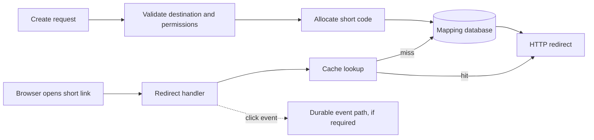

<!-- section: System Design | category: Architecture | tags: concept, url-shortener, interview | role-priority: important | general-importance: important -->
[](#)
[](#)
[](#)
[](#)
[](../../../docs/topic-importance.md)
[](../../../docs/topic-importance.md)

# URL Shortener System Design

A campaign link is printed on thousands of flyers. The destination later changes, but a browser that cached a permanent redirect still opens the old page. That small failure reveals the central design question: how much control must the service retain after it sends a redirect?

## Definition

A URL shortener stores a mapping from a short code to a destination URL. When someone opens the short link, the service looks up the code and returns an HTTP redirect. Creating links is a write path; redirecting is a read path; optional click analytics is a separate workload.

> **Textbook Definition:** A URL shortener is a service that assigns a compact identifier to a destination URL and resolves requests for that identifier through a redirect, subject to lifecycle and abuse-control policies.

## First Principles

1. A visit contains the short code, not the destination. The service therefore needs a durable, uniquely keyed mapping; an existence check before insertion cannot protect against two concurrent creators.
2. A redirect can be reused from a browser or CDN cache without another service request. The cache lifetime is part of the link's edit, expiration and revocation contract.
3. The destination can be resolved without analytics, so the redirect and reporting paths can be separated. That separation is safe only after the product states whether an event may be lost or must be durably accepted.

## Clarify the requirements

Ask whether links are public or private, whether users may choose aliases, whether destinations can change, how expiration and deletion work, and what analytics must mean. Also clarify the expected create and redirect traffic, peak load, retention, and availability goals from the interviewer. Treat any numbers you introduce as exercise assumptions, not measurements.

A small initial contract might be:

- An authorized user creates a link and receives a unique short code.
- A public `GET /{code}` redirects only to an allowed destination scheme.
- A link can expire or be revoked; analytics has a stated retention and privacy policy.
- A duplicate custom alias is rejected, while generated-code collisions are retried safely.

## Design the request paths



### Create a link

1. Parse and validate the destination. Accept only supported schemes, usually `https` and optionally `http`; reject malformed input and control characters.
2. Authenticate the caller when the product requires accounts. Derive ownership from the authenticated identity rather than trusting an arbitrary `user_id` in the body.
3. Allocate either a generated code or a requested alias.
4. Insert the mapping with a unique constraint on the code. If a generated code collides, generate another and retry a bounded number of times. If a custom alias already exists, return a conflict.
5. Return the short URL and the link's expiration or update policy.

A uniqueness pre-check can improve a user-facing error, but the database constraint is what resolves concurrent creation safely.

For example, two create requests both observe that alias `notes` is unused. Both then try to insert it. The primary key lets one insert commit; the other receives a uniqueness conflict instead of replacing the destination. If this was a generated code, retry with a new code; for a caller-selected alias, return a conflict. Replaying a lost create response is a separate idempotency decision, not a collision decision.

### Choose a code-generation strategy

| Strategy | How it works | Trade-off |
| ---------------------- | --------------------------------------------------------------------------------------------------------------- | ----------------------------------------------------------------------------------------------------------------------------------------------------------------------------------- |
| Random code | Generate a uniformly random code and insert it under a unique constraint; retry on collision. | Simple and harder to enumerate when enough randomness is used; collisions remain possible and must be handled. |
| Numeric ID plus Base62 | Allocate a unique positive ID from a database sequence or ID generator, then encode it with letters and digits. | Base62 is only an encoding; uniqueness comes from the allocator. Codes can reveal order and be enumerable. A centralized sequence can become a coordination or availability limit. |
| Hash of destination | Hash the URL and encode part of the digest. | Deterministic for the same input, but truncation can collide and identical URLs map together unless extra policy is added. A cryptographic hash does not remove collision handling. |

For an alphabet of 62 symbols, a fixed-length code of length `k` has `M = 62^k` possible values. If `n` codes are drawn uniformly at random, the chance of at least one collision is approximately `1 - exp(-n(n - 1) / (2M))` while `n` is small relative to `M`. Use this to size the code space, but keep the unique constraint as the correctness mechanism. If codes must be hard to guess, use enough random entropy; Base62 encoding an increasing ID is not a security control.

Custom aliases need a documented normalization rule. Decide whether codes are case-sensitive and reserve names used by system routes. Apply the same rule during creation and lookup.

### Store the mapping

A relational table is a reasonable starting point because the key is unique and link ownership, expiration and revocation need clear constraints.

```sql
CREATE TABLE short_links (
    short_code TEXT PRIMARY KEY,
    destination_url TEXT NOT NULL,
    owner_id UUID,
    created_at TIMESTAMPTZ NOT NULL DEFAULT now(),
    expires_at TIMESTAMPTZ,
    revoked_at TIMESTAMPTZ,
    CHECK (expires_at IS NULL OR expires_at > created_at)
);
```

Keep click events out of this hot mapping row. A write to a `click_count` column on every redirect turns a read-heavy path into a contended write. Store analytics separately and aggregate asynchronously if the reporting contract allows it.

### Redirect to the destination

The handler looks up the code, checks revocation and expiration on the returned link state, and returns a redirect. Those checks also apply to a cache hit: the diagram's response arrow does not bypass link policy. Return `404` for an unknown code. Whether an expired or revoked code returns `404` or `410 Gone` is a product decision; use one policy consistently.

Choose redirect semantics based on whether links can change:

- `301 Moved Permanently` tells clients the move is permanent and may be cached. It can make later destination changes or revocation harder to enforce.
- `302 Found` is temporary and commonly used for a shortener's `GET` redirect. Its cacheability still depends on the response's caching rules.
- `307 Temporary Redirect` preserves the request method. `308 Permanent Redirect` also preserves it while declaring the move permanent.

If the endpoint accepts methods beyond `GET`, `301` and `302` can allow a client to change `POST` to `GET`; use `307` or `308` when preserving the method is required.

Set `Cache-Control` deliberately. Browser or CDN caching can bypass the redirect service on repeat visits, so HTTP status alone does not guarantee one analytics event per human click. A CDN purge cannot clear a redirect already cached by a browser; promise immediate revocation only if the redirect policy and cache lifetime can enforce it.

### Record click analytics

Define what one click means. A redirect request can come from a person, a link preview, a crawler or a retry; IP geolocation and user-agent parsing are approximate signals, not identity.

If occasional event loss is acceptable, emit a bounded asynchronous event after the mapping is found and return the redirect without waiting for analytics processing. If events must survive process failure, use a durable queue or persist an event intent before acknowledging it. Consumers should deduplicate by event ID if delivery can repeat. Minimize collected data, restrict access, and set retention explicitly; do not retain full IP addresses or referrers by default without a justified need.

## Cache and scaling choices

Start with a relational mapping store and a cache-aside read path. Cache `short_code → destination and link state`; set cache expiry no later than the link's expiration. Revocation and destination edits need invalidation or a short enough freshness window. If a local in-process cache is added, its stale period must also fit that policy.

A cache outage may fall back to the database while capacity allows. A database outage can serve only mappings already cached, and those entries may be stale; decide whether that is acceptable for public redirects, revocation and expiration.

Scale in response to observed limits:

- Add indexes and tune the lookup before partitioning or sharding.
- Use read replicas only when their staleness is acceptable for the redirect contract.
- Partition click-event data by time if volume and retention operations justify it; the mapping lookup is keyed by short code, not click date.
- Shard mappings only when a single database is the measured limit. A hash of the short code can route lookups, but rebalancing still requires moving data and changing routing.

For interview arithmetic, calculate average rates from the assumptions you are given:

```text
average creates/second   = links created per day ÷ 86,400
average redirects/second = redirects per day ÷ 86,400
mapping storage          ≈ active mappings × average row-and-index size
```

Use a stated peak-to-average factor when one is provided or clearly label your own assumption. These formulas estimate workload; they do not prove a specific database, cache or latency target is sufficient.

## Security and failure cases

- **Open-redirect abuse and phishing:** rate-limit creation, restrict schemes, provide reporting and takedown, and monitor abuse. A link preview or destination-checking worker that fetches URLs needs separate server-side request forgery (SSRF) protections.
- **Code guessing:** avoid treating an ID as authorization. Private links need access control even if their codes are difficult to guess.
- **Cache staleness:** expired or revoked links may remain usable while cached. Bound response freshness to the product's revocation promise, including browser caches that the service cannot purge.
- **Mapping database unavailable:** cached links may continue to work, but misses cannot be resolved. Do not claim full availability from a cache alone.
- **Analytics unavailable:** either accept documented event loss or use a durable intake path; do not let an unbounded in-memory buffer threaten redirect capacity.
- **Destination change:** invalidate cached mappings and choose redirect cache headers that allow the product's update policy.

## Common mistakes

- Hashing or truncating a URL and assuming collisions cannot happen.
- Checking whether a code exists, then inserting without a unique constraint.
- Using MD5 or another digest as if it guarantees unique or unguessable codes.
- Calling a `301` permanent while promising immediate edits or revocation.
- Incrementing a shared database counter on every redirect without considering write contention.
- Treating every redirect request as a human click.
- Adding Kafka, a CDN, replicas or shards before a requirement or measured bottleneck calls for them.

## Summary

Store one unique mapping per code, enforce uniqueness in the database, and choose a code strategy based on collision, predictability and allocation needs. The redirect path checks link state and returns cache headers consistent with the edit and revocation policy. Keep analytics separate, and make its durability and privacy contract explicit. Add distributed components only when requirements or measurements justify their cost.

## See Also

- [System Design Revision](REVISION.md) — practice questions for this case-study category
- [System Design Interview Questions](../01-theory/30.2.1.16-interview-questions.md) — compare this design with the short-link interview prompt
- [REST API design](../../../20-backend/20.3-rest-apis/INDEX.md) — HTTP status, redirects and API contracts
- [Sharding and replication](../01-theory/30.2.1.03-sharding-and-replication.md) — when a single mapping store reaches a measured limit
- [Distributed ID Generator](30.2.2.26-distributed-id-generator.md) — allocator trade-offs when sequential IDs become a coordination limit
- [Caching patterns](../01-theory/30.2.1.05-caching-patterns.md) — freshness and invalidation trade-offs
- [Queues and asynchronous work](../01-theory/30.2.1.06-queues-and-async.md) — durable analytics processing

## References

- [System Design Primer](https://github.com/donnemartin/system-design-primer)
- [HTTP Semantics — RFC 9110](https://www.rfc-editor.org/rfc/rfc9110)

---

[← Previous: Case Studies](INDEX.md) · [Back to Index](INDEX.md) · [Next: WhatsApp →](30.2.2.02-whatsapp.md)
