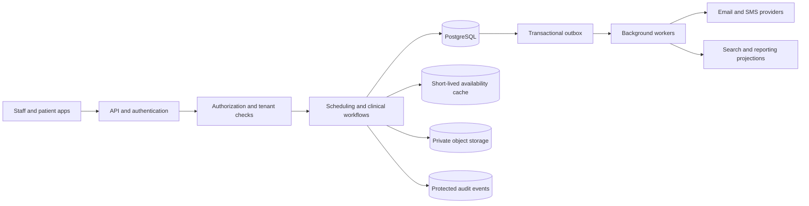

<!-- section: System Design | category: Architecture | tags: concept | role-priority: important | general-importance: important -->
[](#)
[](#)
[](#)
[](#)
[](../../../docs/topic-importance.md)
[](../../../docs/topic-importance.md)

# Hospital Management System Design

A clinic books an appointment while several staff members may be looking at the same slot. The design must prevent two bookings from claiming that slot, protect patient records, and preserve a clear history of changes. The numbers below are hypothetical inputs for an interview exercise, not measured system capacity or evidence of regulatory compliance.

> **Textbook Definition:** A hospital-management system coordinates clinical and administrative workflows around patient records, scheduling, access control, and auditable changes under explicit data-handling requirements.

## First Principles

Start with three rules:

1. **Clinical changes need traceable history.** Store who changed a record, what changed and when, according to the product's clinical policy and legal obligations. Event sourcing is one possible design; it is not required for every system.
2. **Check access for each request.** Role-based access control (RBAC) checks a user's role. Attribute-based access control (ABAC) can also check facts such as clinic, relationship to the patient or request purpose. Record and protect the access events required by policy; do not assume that logging every read is a universal legal rule.
3. **The database must reject conflicting bookings.** A page can show an available slot that another user books a moment later. Enforce the no-overlap rule when saving, using a transaction and an appropriate database constraint or lock.

## Requirements
### Functional Requirements

- Patient registration and profiles
- Appointment scheduling
- Doctor management
- Medical records (EHR)
- Prescription management
- Lab results management
- Billing and insurance
- Pharmacy management
- Multi-branch support
- Role-based access control
- Telemedicine support

### Non-Functional Requirements

- Meet privacy, security and retention requirements for the chosen markets, customers and data flows. HIPAA applies to covered entities and their business associates in the United States; EU data-protection rules can apply to organizations established in the EU and to some organizations outside the EU that offer services to or monitor people there. An architecture diagram alone cannot establish compliance.
- Choose and measure an availability target for each critical workflow; do not assume every feature needs the same target.
- Data encryption at rest and in transit
- Size the example for 100 hospitals and 10 million patient accounts; these are workload assumptions to confirm with product owners.
- After a booking commits, other users must not be able to confirm the same slot.
- Define how quickly other screens should reflect a confirmed booking.
- Tenant isolation enforced by the application and database

## Capacity Estimation

```text
Hospital Estimates:

- 100 hospitals
- 10K doctors
- 100K patients per hospital
- 10M total patients
- 10 appointments per patient per year

Appointment Estimates:

- 274K appointments per day (10 appointments per patient per year across 10M patients)
- Average appointment: 30 minutes
- Peak hours: 9 AM - 5 PM
- About 17K visits in progress on average if appointments are spread evenly across 8 hours and each lasts 30 minutes; actual peaks depend on scheduling patterns

Storage Estimates:

- Patient records: 10M × 10 KB = 100 GB
- Medical records: 10M × 100 KB = 1 TB
- Lab results: 10M × 50 KB = 500 GB
- Prescriptions: 10M × 5 KB = 50 GB
- Total: ~1.65 TB of logical records in this simplified estimate; excludes indexes, audit history, files, replicas, backups and growth overhead

Bandwidth Estimates:

- Patient reads: 1K requests/second × 10 KB = 10 MB/s (illustrative peak assumption)
- Appointment writes: 50 requests/second × 1 KB = 0.05 MB/s (illustrative peak assumption)
- Total: ~10 MB/s before protocol overhead and other workflows

```

## API Design

These request shapes are illustrative. Every endpoint authenticates the caller, resolves an authorized hospital membership, and scopes resource access to that tenant. Derive staff identity from the authenticated session. Resolve appointment wall-clock times using the clinic's configured time zone, then store instants with their offset.

```yaml
# Patient Registration
POST /api/v1/patients
  Request:
    {
      "first_name": "John",
      "last_name": "Doe",
      "date_of_birth": "1990-01-15",
      "email": "john@example.com",
      "phone": "+1234567890",
      "insurance": {
        "provider": "BlueCross",
        "policy_number": "BC123456"
      }
    }
  Response:
    {
      "patient_id": "pat_123",
      "mrn": "MRN0000123" # Medical Record Number
    }

# Appointment Scheduling
GET /api/v1/doctors/{id}/availability
  Query: ?date=2025-01-15&specialty=cardiology
  Response:
    {
      "doctor_id": "doc_456",
      "available_slots": [
        {"time": "09:00", "duration": 30},
        {"time": "09:30", "duration": 30}
      ]
    }

POST /api/v1/appointments
  Request:
    {
      "patient_id": "pat_123",
      "doctor_id": "doc_456",
      "starts_at": "2025-01-15T09:00:00-05:00",
      "ends_at": "2025-01-15T09:30:00-05:00",
      "type": "consultation",
      "reason": "Chest pain"
    }
  Response:
    {
      "appointment_id": "apt_789",
      "status": "scheduled"
    }

# Medical Records
GET /api/v1/patients/{id}/records
  Response:
    {
      "patient_id": "pat_123",
      "records": [
        {
          "record_id": "rec_012",
          "type": "consultation",
          "doctor": "Dr. Smith",
          "date": "2025-01-15",
          "notes": "..."
        }
      ]
    }

# Prescription
POST /api/v1/prescriptions
  Request:
    {
      "patient_id": "pat_123",
      "doctor_id": "doc_456",
      "appointment_id": "apt_789",
      "medications": [
        {
          "name": "Aspirin",
          "dosage": "100mg",
          "frequency": "Once daily",
          "duration": "30 days"
        }
      ]
    }

# Lab Results
GET /api/v1/patients/{id}/lab-results
  Response:
    {
      "results": [
        {
          "test_name": "Blood Sugar",
          "value": 120,
          "unit": "mg/dL",
          "range": "70-140",
          "status": "normal"
        }
      ]
    }

# Billing
POST /api/v1/billing
  Request:
    {
      "patient_id": "pat_123",
      "appointment_id": "apt_789",
      "services": [...],
      "insurance_claim": {...}
    }

```

The API may return a conflict if another request books an overlapping interval first. The availability response helps users choose; it does not reserve a slot.

## Database Design
### Schema

This is a starting schema, not a complete clinical data model. It simplifies each staff account to one hospital membership; systems where staff work across tenants should separate global identity from tenant membership. Tenant-scoped identifiers and appointment overlap rules need database constraints as well as application checks. Store time-zone-aware instants and keep each facility's scheduling time zone explicit.

```sql
-- Hospitals table (multi-tenant)
CREATE TABLE hospitals (
    id BIGSERIAL PRIMARY KEY,
    name VARCHAR(255) NOT NULL,
    code VARCHAR(20) UNIQUE NOT NULL,
    address TEXT,
    phone VARCHAR(20),
    email VARCHAR(255),
    created_at TIMESTAMP DEFAULT CURRENT_TIMESTAMP
);

-- Users table (doctors, nurses, staff)
CREATE TABLE users (
    id BIGSERIAL PRIMARY KEY,
    hospital_id BIGINT NOT NULL REFERENCES hospitals(id),
    email VARCHAR(255) NOT NULL,
    password_hash VARCHAR(255) NOT NULL,
    role VARCHAR(20) NOT NULL, -- 'admin', 'doctor', 'nurse', 'staff'
    first_name VARCHAR(100),
    last_name VARCHAR(100),
    specialty VARCHAR(100),
    license_number VARCHAR(50),
    is_active BOOLEAN DEFAULT TRUE,
    created_at TIMESTAMPTZ NOT NULL DEFAULT now(),
    UNIQUE (hospital_id, id),
    UNIQUE (hospital_id, email)
);

-- Patients table
CREATE TABLE patients (
    id BIGSERIAL PRIMARY KEY,
    hospital_id BIGINT NOT NULL REFERENCES hospitals(id),
    mrn VARCHAR(20) NOT NULL, -- Medical Record Number; often scoped to one hospital
    first_name VARCHAR(100) NOT NULL,
    last_name VARCHAR(100) NOT NULL,
    date_of_birth DATE NOT NULL,
    gender VARCHAR(10),
    email VARCHAR(255),
    phone VARCHAR(20),
    address TEXT,
    blood_type VARCHAR(5),
    allergies TEXT[],
    emergency_contact JSONB,
    insurance JSONB,
    created_at TIMESTAMPTZ NOT NULL DEFAULT now(),
    UNIQUE (hospital_id, id),
    UNIQUE (hospital_id, mrn)
);

CREATE INDEX idx_patients_name ON patients(hospital_id, last_name, first_name);

-- Appointments table
CREATE TABLE appointments (
    id BIGSERIAL PRIMARY KEY,
    hospital_id BIGINT NOT NULL REFERENCES hospitals(id),
    patient_id BIGINT NOT NULL,
    doctor_id BIGINT NOT NULL,
    starts_at TIMESTAMPTZ NOT NULL,
    ends_at TIMESTAMPTZ NOT NULL,
    type VARCHAR(50) NOT NULL,
    status VARCHAR(20) NOT NULL DEFAULT 'scheduled',
    reason TEXT,
    notes TEXT,
    queue_number INT,
    created_at TIMESTAMPTZ NOT NULL DEFAULT now(),
    UNIQUE (hospital_id, id),
    CHECK (ends_at > starts_at),
    FOREIGN KEY (hospital_id, patient_id) REFERENCES patients(hospital_id, id),
    FOREIGN KEY (hospital_id, doctor_id) REFERENCES users(hospital_id, id)
);

-- Prevent overlapping active appointments for one doctor, including races
-- where two requests both saw the slot as free. Requires btree_gist.
CREATE EXTENSION IF NOT EXISTS btree_gist;
ALTER TABLE appointments ADD CONSTRAINT no_active_doctor_overlap
  EXCLUDE USING gist (
    hospital_id WITH =,
    doctor_id WITH =,
    tstzrange(starts_at, ends_at, '[)') WITH &&
  ) WHERE (status IN ('scheduled', 'confirmed'));

CREATE INDEX idx_appointments_hospital_start ON appointments(hospital_id, starts_at);
CREATE INDEX idx_appointments_patient_start ON appointments(hospital_id, patient_id, starts_at);

-- Medical records
CREATE TABLE medical_records (
    id BIGSERIAL PRIMARY KEY,
    hospital_id BIGINT NOT NULL REFERENCES hospitals(id),
    patient_id BIGINT NOT NULL,
    doctor_id BIGINT NOT NULL,
    appointment_id BIGINT,
    record_type VARCHAR(50) NOT NULL,
    chief_complaint TEXT,
    diagnosis TEXT,
    treatment_plan TEXT,
    notes TEXT,
    created_at TIMESTAMPTZ NOT NULL DEFAULT now(),
    FOREIGN KEY (hospital_id, patient_id) REFERENCES patients(hospital_id, id),
    FOREIGN KEY (hospital_id, doctor_id) REFERENCES users(hospital_id, id),
    FOREIGN KEY (hospital_id, appointment_id) REFERENCES appointments(hospital_id, id)
);
CREATE INDEX idx_medical_records_patient ON medical_records(hospital_id, patient_id, created_at);

-- Prescriptions
CREATE TABLE prescriptions (
    id BIGSERIAL PRIMARY KEY,
    hospital_id BIGINT NOT NULL REFERENCES hospitals(id),
    patient_id BIGINT NOT NULL,
    doctor_id BIGINT NOT NULL,
    appointment_id BIGINT,
    medications JSONB NOT NULL,
    instructions TEXT,
    created_at TIMESTAMPTZ NOT NULL DEFAULT now(),
    FOREIGN KEY (hospital_id, patient_id) REFERENCES patients(hospital_id, id),
    FOREIGN KEY (hospital_id, doctor_id) REFERENCES users(hospital_id, id),
    FOREIGN KEY (hospital_id, appointment_id) REFERENCES appointments(hospital_id, id)
);

-- Lab results
CREATE TABLE lab_results (
    id BIGSERIAL PRIMARY KEY,
    hospital_id BIGINT NOT NULL REFERENCES hospitals(id),
    patient_id BIGINT NOT NULL,
    test_name VARCHAR(255) NOT NULL,
    test_date DATE NOT NULL,
    results JSONB NOT NULL,
    status VARCHAR(20) NOT NULL DEFAULT 'completed',
    ordered_by BIGINT NOT NULL,
    created_at TIMESTAMPTZ NOT NULL DEFAULT now(),
    FOREIGN KEY (hospital_id, patient_id) REFERENCES patients(hospital_id, id),
    FOREIGN KEY (hospital_id, ordered_by) REFERENCES users(hospital_id, id)
);

-- Billing
CREATE TABLE billing (
    id BIGSERIAL PRIMARY KEY,
    hospital_id BIGINT NOT NULL REFERENCES hospitals(id),
    patient_id BIGINT NOT NULL,
    appointment_id BIGINT,
    services JSONB NOT NULL,
    subtotal NUMERIC(10,2),
    insurance_covered NUMERIC(10,2),
    patient_responsibility NUMERIC(10,2),
    status VARCHAR(20) NOT NULL DEFAULT 'pending',
    created_at TIMESTAMPTZ NOT NULL DEFAULT now(),
    FOREIGN KEY (hospital_id, patient_id) REFERENCES patients(hospital_id, id),
    FOREIGN KEY (hospital_id, appointment_id) REFERENCES appointments(hospital_id, id)
);

-- Example audit-event store. Required events and retention depend on policy.
CREATE TABLE audit_log (
    id BIGINT GENERATED BY DEFAULT AS IDENTITY NOT NULL,
    hospital_id BIGINT NOT NULL REFERENCES hospitals(id),
    user_id BIGINT,
    action VARCHAR(50) NOT NULL,
    entity_type VARCHAR(50) NOT NULL,
    entity_id BIGINT,
    outcome VARCHAR(20) NOT NULL,
    ip_address INET,
    user_agent TEXT,
    created_at TIMESTAMPTZ NOT NULL DEFAULT now(),
    PRIMARY KEY (created_at, id),
    FOREIGN KEY (hospital_id, user_id) REFERENCES users(hospital_id, id)
) PARTITION BY RANGE (created_at);
```

Use the same composite foreign-key pattern for other tenant-owned tables so a row cannot point to a patient or user from a different hospital. Create and monitor audit partitions before their time ranges are needed. Real systems should add only indexes needed by measured queries. The exclusion constraint is one way to prevent overlapping appointments; fixed, discrete slots can instead use a unique constraint on tenant, doctor and slot.

### Core relationships

- A hospital owns staff memberships and patient records.
- A patient can have many appointments, clinical records, prescriptions, lab results and bills.
- A doctor is a staff member and can have many appointments.
- An appointment may be linked to clinical records, prescriptions and billing entries.
- Tenant-scoped foreign keys prevent relationships from crossing hospital boundaries.

## Architecture

Start with one API and a relational database. Split services only when separate scaling, ownership or deployment needs justify the added network and operational boundaries. Keep appointment booking transactional; use asynchronous workers for notifications and derived views.



The cache is never the booking authority. Store clinical files in private object storage with access checks and retention controls. Keep event payloads minimal, and apply access and retention rules to audit records and derived systems too.

## Key Components

### Authorization and audit

There is no single “compliance service” that makes an application compliant. For each request, authenticate the actor, confirm their active membership in the tenant, check the requested action against their role and relationship to the patient, and deny by default. Enforce tenant scope in database access as well as application code.

An audit event should capture enough metadata to investigate access without copying an entire clinical record into the log. Define which reads and writes are recorded, how records are protected from alteration, who can review them, and how long they are retained for the applicable policy.

```python
async def authorize(actor, action, patient_id):
    membership = await db.get_active_membership(
        actor_id=actor.id,
        hospital_id=actor.selected_hospital_id,
    )
    if membership is None:
        raise PermissionError("Access denied")

    patient = await db.get_patient(
        hospital_id=membership.hospital_id,
        patient_id=patient_id,
    )
    if patient is None or not policy.allows(
        role=membership.role,
        action=action,
        patient=patient,
        actor=actor,
    ):
        raise PermissionError("Access denied")

    return membership, patient


async def record_access(actor, membership, action, resource_type, resource_id, outcome):
    # Avoid putting diagnoses or full request/response bodies in the audit row.
    await db.insert_audit_event(
        actor_id=actor.id,
        hospital_id=membership.hospital_id,
        action=action,
        resource_type=resource_type,
        resource_id=resource_id,
        outcome=outcome,
    )
```

Use managed encryption and key controls appropriate to the threat model. Encryption at rest and in transit protect different boundaries; field-level encryption can reduce exposure in some designs but affects search, indexing and key operations. Avoid inventing a field list and encrypting values with an unspecified helper.

### Appointment scheduling service

The availability endpoint is advisory: a cached list can become stale before the user selects a slot. The booking write is authoritative. Convert the clinic's local appointment time to a time-zone-aware interval, then insert inside a transaction. The database exclusion constraint shown above rejects overlapping active appointments even when requests race.

```python
async def get_available_slots(hospital_id, doctor_id, local_date):
    cache_key = f"availability:{hospital_id}:{doctor_id}:{local_date}"
    cached = await redis.get(cache_key)
    if cached:
        return json.loads(cached)  # Display hint only; not a reservation.

    schedule = await db.get_schedule(hospital_id, doctor_id, local_date)
    appointments = await db.get_active_appointments(
        hospital_id, doctor_id, local_date
    )
    slots = calculate_slots(schedule, appointments)
    await redis.setex(cache_key, 60, json.dumps(slots))
    return slots


async def book_appointment(actor, hospital_id, patient_id, doctor_id, starts_at, ends_at):
    # Require offset-aware timestamps; reject naive local datetimes.
    membership, _ = await authorize(actor, "book_appointment", patient_id)
    if membership.hospital_id != hospital_id:
        raise PermissionError("Access denied")
    clinic_timezone = await db.get_clinic_timezone(hospital_id)

    try:
        async with db.transaction() as tx:
            appointment = await tx.insert_appointment(
                hospital_id=hospital_id,
                patient_id=patient_id,
                doctor_id=doctor_id,
                starts_at=starts_at,
                ends_at=ends_at,
                status="scheduled",
            )
            # Persist notification work with the booking; do not call a mail
            # or SMS provider before this transaction commits.
            await tx.insert_outbox("appointment.booked", appointment.id)
    except AppointmentOverlap:
        raise SlotUnavailableError("That time was just booked")

    local_date = starts_at.astimezone(clinic_timezone).date().isoformat()
    await redis.delete(f"availability:{hospital_id}:{doctor_id}:{local_date}")
    return appointment
```

Use a cache design that can invalidate the affected date key, or tolerate a short display delay while continuing to enforce the conflict rule in the database. Send confirmations from an outbox worker after commit; retries should not create duplicate notifications.

Cancellation should also be tenant-scoped and authorized. Update the appointment and record a notification event in one transaction. The notification worker then retries delivery without undoing the cancellation if an email or SMS provider is unavailable.

### Medical records access

Keep patient data behind a repository that requires tenant context, and check the user's permission for the specific action before reading or writing. Do not accept a `hospital_id` or doctor identity from the request body as proof of authorization; derive the actor from the authenticated session and verify the membership and care relationship.

```python
async def get_patient_records(actor, hospital_id, patient_id):
    membership, _ = await authorize(actor, "read_records", patient_id)
    if membership.hospital_id != hospital_id:
        raise PermissionError("Access denied")

    records = await db.get_records(
        hospital_id=membership.hospital_id,
        patient_id=patient_id,
    )
    await record_access(
        actor, membership, "read", "patient_records", patient_id, "allowed"
    )
    return records
```

Use encryption controls appropriate to the storage and threat model, protect keys separately, and avoid logging full clinical payloads. For create/update paths, write the record and any required audit event atomically when they share a database; a durable outbox can carry audit work to another service.

### Tenant isolation

Get the tenant from a verified user membership, not from an untrusted query parameter alone. Every tenant-owned query and write must carry that tenant scope. Composite foreign keys can prevent a row in one hospital from referencing a patient or staff member in another. PostgreSQL row-level security can add a database guard, but application roles and table ownership must be configured so the policy is actually enforced.

```python
async def get_hospital_stats(actor, hospital_id):
    membership = await db.get_active_membership(actor.id, hospital_id)
    if membership is None or not policy.can_view_stats(membership.role):
        raise PermissionError("Access denied")

    # Tenant ID is passed as a bound parameter, never interpolated into SQL.
    return await db.fetch_one(
        """SELECT count(*) AS total_patients
             FROM patients
            WHERE hospital_id = %s""",
        (membership.hospital_id,),
    )
```

For PostgreSQL RLS, set the tenant context inside each transaction and test with the actual application role. RLS is defense in depth; a privileged database role can bypass policies unless the deployment is configured to force them.

## Caching

Availability can be cached briefly to make the calendar responsive, but it is only a display hint. The booking transaction and database constraint remain authoritative. Include the tenant and clinic-local date in the cache key, invalidate the affected key after a booking or cancellation, and accept that a stale slot may still be shown briefly.

Avoid caching clinical records by default. If a measured workload requires it, define tenant and user authorization boundaries, data minimization, encryption, expiry, invalidation, and behavior during access revocation. A cache must never become an alternate path around authorization.

---

## Asynchronous work

Use a queue for work that can finish after the request, such as sending appointment reminders or updating a search projection. Persist the business change and an outbox event in one database transaction; a relay publishes it, and consumers handle duplicate delivery idempotently. Start with the simplest queue that meets measured throughput, ordering and replay needs.

Keep event payloads small. For example, an appointment event can carry an event ID, tenant ID, appointment ID and event type; a consumer can fetch current authorized data rather than copying clinical details into every message. Treat event topics and logs as data stores with access and retention policies.

## Scaling

Scale stateless application instances behind a load balancer when measured demand requires it. Use connection pools and bounded worker concurrency so adding application instances does not overload PostgreSQL or downstream providers.

Do not shard the database at the workload-estimation stage. First measure query patterns, storage growth, write contention, and the limits of vertical scaling, partitioning, and read replicas. If sharding becomes necessary, choose a key that keeps tenant data and common transactions together, and maintain a directory or routing strategy that can evolve when shards move.

## Failure Handling

A concurrent booking that violates the database exclusion constraint returns a conflict. Translate that constraint failure to a clear response (for example, HTTP 409), then read fresh availability if the user wants alternatives. Do not treat a cache lock or a prior availability check as the correctness guarantee.

### Failure scenarios and recovery

| Failure | Response |
| ---------------------------------- | --------------------------------------------------------------------------------------------------------------------------------- |
| Database failover | Retry safe operations with bounded backoff; use replicas only for reads that can tolerate their lag. |
| Redis unavailable | Fall back to the database for availability reads, while retaining the database booking constraint. |
| Notification provider unavailable | Keep the outbox event and retry without undoing the committed booking. |
| Key-management service unavailable | Follow the documented key-provider failure policy; do not bypass encryption or keep unprotected key copies in application memory. |
| Audit-event write unavailable | Decide which operations must stop and which can use a durable transactional outbox; expose the backlog and alert operators. |
| Accidental data change | Restore to a separate environment or point in time, validate it, and reapply legitimate changes made after that point. |

Backup restoration is an operational recovery procedure, not a normal endpoint that fetches one deleted row. After restoring a snapshot, verify tenant boundaries and reapply deletion or retention actions that occurred after the snapshot.

---

## Monitoring

### Key Metrics

```yaml
Business Metrics:

  - appointments_per_day
  - patient_satisfaction_score
  - average_wait_time
  - no_show_rate

System Metrics:

  - appointment_booking_latency_p95
  - medical_record_access_latency
  - api_response_time
  - error_rate

Infrastructure Metrics:

  - server_cpu_usage
  - memory_usage
  - database_query_latency
  - redis_memory_usage

Security and audit signals:

  - audit_event_delivery_lag
  - audit_write_failures
  - denied_access_rate_by_action_and_tenant

```

### Alerting Rules

```yaml
alerts:

  - name: No-Show Rate Above Product Threshold
    condition: compare no_show_rate with the agreed product baseline
    severity: warning

  - name: Unusual Access-Denial Spike
    condition: denied_access_rate exceeds the tenant-aware security baseline
    severity: critical

  - name: Appointment Booking Slow
    condition: p95_booking_latency breaches the agreed booking SLO
    severity: warning

  - name: Database Connection Pool Exhausted
    condition: pool_wait_time or pool_saturation breaches the service threshold
    severity: critical

```

## Trade-offs

| Decision | Starting point | Revisit when |
| ----------------- | -------------------------------------------------------------------------------------- | ------------------------------------------------------------------------ |
| Primary storage | PostgreSQL for relational workflows and transactions | Data shape or measured workload justifies another store |
| Encryption | Transport and storage encryption; consider field-level controls from the threat model | Search, key rotation or data-sharing requirements change |
| Tenant isolation | Shared schema with tenant checks and database safeguards | Contractual, regulatory or operational needs call for stronger isolation |
| Audit capture | Persist required audit events durably; send downstream asynchronously when appropriate | Risk or policy requires the operation to wait for audit persistence |
| Booking conflicts | Enforce the interval rule in PostgreSQL | Slot model or scheduling policy changes |

## Summary

This example design covers:

- **Privacy and security**: authentication, tenant isolation, authorization, encryption and protected audit events
- **Appointment scheduling**: cached availability for display and a database constraint for correctness
- **Clinical records**: scoped reads and writes with deliberate retention and key handling
- **Operations**: an outbox for notifications, observable failure recovery and measured scaling decisions

Key design decisions:

1. Confirm which privacy and retention rules apply to each customer, region and data flow; implementation choices alone do not prove compliance.
2. Enforce appointment-slot uniqueness in the database. Select a transaction or constraint that matches how the schedule is represented.
3. Use encryption in transit and at rest, and consider field-level encryption when the threat model requires it. Plan key storage and rotation.
4. Define which sensitive-data actions must be audited, and protect the resulting audit records from unauthorized changes.
5. Scope every query and write to the authorized hospital or clinic; verify tenant isolation at the database and application boundaries.

The capacity example assumes 100 hospitals, 10 million patient accounts, and about 274,000 appointments per day. These are interview inputs, not measured demand. Validate capacity with representative load tests and production telemetry. Security controls support a compliance program; this example alone does not establish compliance.

---

## See Also
- [Database](../../../20-backend/20.4-database/INDEX.md) — appointment scheduling is a time-window contention model — the indexing chapters apply
- [Microservices](../../../20-backend/20.6-microservices/INDEX.md) — scheduling, records, and billing separate on privacy boundaries
- [REST APIs](../../../20-backend/20.3-rest-apis/INDEX.md) — the appointment CRUD surface with audit requirements
- [WebSockets](../../../60-realtime/60.1-websockets/INDEX.md) — queue/waiting-room status boards update live

## References & Learn More

- [PostgreSQL — Exclusion Constraints](https://www.postgresql.org/docs/current/ddl-constraints.html#DDL-CONSTRAINTS-EXCLUSION) — prevent overlapping active appointment ranges
- [PostgreSQL — `btree_gist`](https://www.postgresql.org/docs/current/btree-gist.html) — GiST operator support for scalar columns in the example constraint
- [U.S. HHS — Covered Entities and Business Associates](https://www.hhs.gov/hipaa/for-professionals/covered-entities/index.html)
- [European Commission — When EU data-protection law applies](https://commission.europa.eu/law/law-topic/data-protection/data-protection-explained_en)
---

[← Previous: E Commerce](30.2.2.09-e-commerce.md) · [ Back to Index](INDEX.md) · [Next: Live Betting →](30.2.2.11-live-betting.md)
