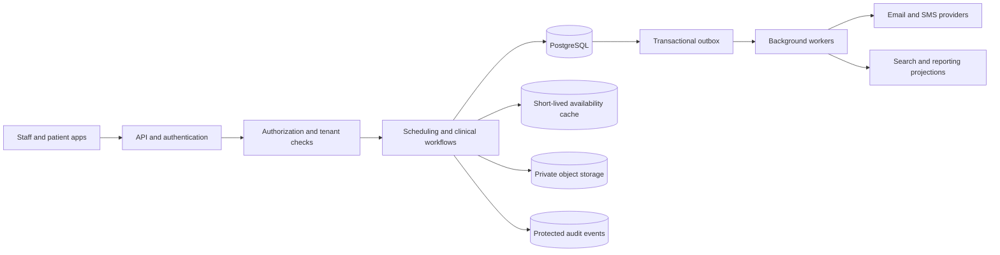

<!-- section: System Design | category: Architecture | tags: concept | role-priority: important | general-importance: important -->
[](#)
[](#)
[](#)
[](#)
[](../../../docs/topic-importance.md)
[](../../../docs/topic-importance.md)

# Hospital Management System Design

A clinic books an appointment while several staff members look at the same slot. The design must prevent two bookings from claiming that slot, protect patient records, and preserve a clear history of changes:

```text
A + B see 09:00 free → A commits → B's overlap violates the exclusion constraint.
```

## Definition

**In practice:** A **hospital-management system** coordinates patient registration, scheduling, clinical documentation, prescriptions, test results, and billing while enforcing tenant and patient-specific **access rules**. Every write is attributed to an authenticated actor and recorded in an append-only audit trail so clinical actions stay reconstructible.

> **Textbook Definition:** A hospital-management system coordinates clinical and administrative workflows around patient records, scheduling, access control, and auditable changes under explicit data-handling requirements.

## First Principles

Start with three rules:

1. **Clinical changes need traceable history.** Store who changed a record, what changed, and when, per the product's clinical policy and legal obligations. Event sourcing is one possible design; it is never required for every system.
2. **Check access for each request.** Role-based access control (RBAC) checks a user's role. Attribute-based access control (ABAC) can also check facts such as clinic, relationship to the patient, or request purpose. Record and protect the access events required by policy; never assume that logging every read is a universal legal rule.
3. **The database must reject conflicting bookings.** A page can show an available slot that another user books a moment later. Enforce the no-overlap rule when saving, using a transaction and an appropriate database constraint or lock.

## Requirements
### Functional Requirements

- **Core workflow in this design:** patient registration, staff membership, appointment scheduling, clinical records, prescriptions, lab results, and billing records.
- **Cross-cutting requirements:** tenant-scoped access, attributable changes, safe retries, and appointment conflict prevention.
- **Integration boundary:** exchange appointments and clinical results with other providers using the versioned standards and contracts agreed with each partner.
- **Expansion points, not modeled here:** multi-facility scheduling, pharmacy inventory, insurance-claim submission, and telemedicine sessions. Each introduces its own ownership and workflow rules; never imply the schema below already implements them.

### Non-Functional Requirements

- Meet the privacy, security, and retention requirements for the actual markets, customers, and data flows. In the United States, the Health Insurance Portability and Accountability Act (HIPAA) applies to defined covered entities and business associates; [HHS explains those roles](https://www.hhs.gov/hipaa/for-professionals/covered-entities/index.html). The General Data Protection Regulation (GDPR) can also apply to an organization outside the European Union (EU) when it offers goods or services to data subjects in the Union or monitors behavior there. It treats health data as special-category data; processing needs an Article 6 lawful basis and an applicable Article 9 condition, subject to Member State law. See the [GDPR text](https://eur-lex.europa.eu/legal-content/EN/TXT/?uri=CELEX%3A32016R0679). Legal roles, lawful basis, safeguards, contracts, and operating controls need review for the real service; an architecture diagram cannot establish compliance.
- Choose and measure an availability target for each critical workflow; never assume every feature needs the same target.
- Encrypt data in transit and at rest using managed keys, with defined access, rotation, and recovery controls.
- Size the example for 100 single-facility tenants and 10 million patient accounts; these are workload assumptions to confirm with product owners.
- After a booking commits, other users must never confirm the same slot.
- Define how quickly other screens should reflect a confirmed booking.
- Enforce tenant scope in both application queries and database safeguards.
- Define each scheduling facility's time zone with an Internet Assigned Numbers Authority (IANA) Time Zone Database name, such as `America/New_York`, and an explicit policy for daylight-saving transitions.

## Capacity Estimation

The values below are hypothetical interview inputs, not measured system capacity. Confirm them with product owners and distinguish logical data from indexes, replicas, files, and backups:

```text
Hospital Estimates:

- 100 hospitals
- 20K doctors (hypothetical staffing capacity)
- 100K patients per hospital
- 10M total patients
- 10 appointments per patient per year

Appointment Estimates:

- 274K appointments per day (10 appointments per patient per year across 10M patients)
- Average appointment: 30 minutes
- Peak hours: 09:00–17:00 facility-local time
- About 17K visits in progress on average if appointments are spread evenly across 8 hours and each lasts 30 minutes; actual peaks depend on scheduling patterns
- 20K doctors × 16 half-hour visits/day provides 320K nominal visits/day before breaks, specialty mismatch, and non-working days; 10K doctors would be insufficient for 274K visits/day under these assumptions.

Storage Estimates:

- Patient records: 10M × 10 KB = 100 GB
- Medical records: 10M × 100 KB = 1 TB
- Lab results: 10M × 50 KB = 500 GB
- Prescriptions: 10M × 5 KB = 50 GB
- Total: ~1.65 TB of logical records in this simplified estimate; excludes indexes, audit history, files, replicas, backups and growth overhead

Bandwidth Estimates:

- Patient reads: 1K requests/second × 10 KB = 10 MB/s (illustrative peak assumption)
- Appointment writes: 50 requests/second × 1 KB = 0.05 MB/s (illustrative peak assumption)
- Total: ~10 MB/s before protocol overhead and other workflows
```

## Boundary contracts

Every request authenticates the actor, derives tenant membership from trusted identity, and checks action-specific access to the patient or appointment. Availability is advisory; booking carries a stable idempotency key and conflicts when another request wins. Appointment timestamps include an offset and are validated against the facility's IANA time zone. Clinical reads and writes use tenant-scoped resource identifiers, with PHI minimized in responses and logs.

| Operation | Contract to preserve |
| -------------------------------- | ----------------------------------------------------------------------------------------------------------- |
| Check availability | Return a local-date view; do not reserve a slot. |
| Book appointment | Recheck current access and interval availability atomically; return the same appointment for a valid retry. |
| Read or update a clinical record | Check current tenant, patient relationship and action permission on every request. |
| Exchange a result with a partner | Use an agreed versioned standard, stable external identity and replay-safe delivery. |

## Database Design
### Schema

This is a starting schema, not a complete clinical data model. It models one scheduling facility per tenant and one hospital membership per staff account; systems with multiple facilities or cross-tenant staff should separate global identity, tenant membership, and facility scheduling. Tenant-scoped identifiers and appointment overlap rules need database constraints as well as application checks. Store appointment instants as `timestamptz` and keep each facility's IANA scheduling zone explicit.

PostgreSQL's `JSONB` type stores JSON in a decomposed binary form. Use it for genuinely flexible payloads; keep fields needed for joins, constraints, or reliable reporting in typed columns or child tables:

```sql
-- Hospitals table (multi-tenant)
CREATE TABLE hospitals (
    id BIGSERIAL PRIMARY KEY,
    name VARCHAR(255) NOT NULL,
    code VARCHAR(20) UNIQUE NOT NULL,
    address TEXT,
    phone VARCHAR(20),
    email VARCHAR(255),
    timezone_name TEXT NOT NULL, -- IANA name, such as America/New_York
    created_at TIMESTAMPTZ NOT NULL DEFAULT now()
);

-- Tenant memberships; authentication credentials belong to the identity provider.
CREATE TABLE users (
    id BIGSERIAL PRIMARY KEY,
    hospital_id BIGINT NOT NULL REFERENCES hospitals(id),
    identity_subject TEXT NOT NULL, -- Stable subject from the identity provider
    email VARCHAR(255) NOT NULL,
    role VARCHAR(20) NOT NULL CHECK (role IN ('admin','doctor','nurse','staff')),
    first_name VARCHAR(100),
    last_name VARCHAR(100),
    specialty VARCHAR(100),
    license_number VARCHAR(50),
    is_active BOOLEAN NOT NULL DEFAULT TRUE,
    created_at TIMESTAMPTZ NOT NULL DEFAULT now(),
    UNIQUE (hospital_id, id),
    UNIQUE (hospital_id, identity_subject),
    UNIQUE (hospital_id, email)
);

-- Patients table
CREATE TABLE patients (
    id BIGSERIAL PRIMARY KEY,
    hospital_id BIGINT NOT NULL REFERENCES hospitals(id),
    mrn VARCHAR(20) NOT NULL, -- Medical Record Number; often scoped to one hospital
    first_name VARCHAR(100) NOT NULL,
    last_name VARCHAR(100) NOT NULL,
    date_of_birth DATE NOT NULL,
    gender VARCHAR(10),
    email VARCHAR(255),
    phone VARCHAR(20),
    address TEXT,
    blood_type VARCHAR(5),
    allergies TEXT[],
    emergency_contact JSONB,
    insurance JSONB,
    created_at TIMESTAMPTZ NOT NULL DEFAULT now(),
    UNIQUE (hospital_id, id),
    UNIQUE (hospital_id, mrn)
);

CREATE INDEX idx_patients_name ON patients(hospital_id, last_name, first_name);

-- Appointments table
CREATE TABLE appointments (
    id BIGSERIAL PRIMARY KEY,
    hospital_id BIGINT NOT NULL REFERENCES hospitals(id),
    patient_id BIGINT NOT NULL,
    doctor_id BIGINT NOT NULL,
    starts_at TIMESTAMPTZ NOT NULL,
    ends_at TIMESTAMPTZ NOT NULL,
    type VARCHAR(50) NOT NULL,
    status VARCHAR(20) NOT NULL DEFAULT 'scheduled'
      CHECK (status IN ('scheduled','confirmed','checked_in','in_progress','completed','cancelled','no_show')),
    reason TEXT,
    notes TEXT,
    queue_number INT,
    created_at TIMESTAMPTZ NOT NULL DEFAULT now(),
    UNIQUE (hospital_id, id),
    CHECK (ends_at > starts_at),
    FOREIGN KEY (hospital_id, patient_id) REFERENCES patients(hospital_id, id),
    FOREIGN KEY (hospital_id, doctor_id) REFERENCES users(hospital_id, id)
);

-- Prevent overlapping active appointments for one doctor, including races
-- where two requests both saw the slot as free. Requires btree_gist.
CREATE EXTENSION IF NOT EXISTS btree_gist;
ALTER TABLE appointments ADD CONSTRAINT no_active_doctor_overlap
  EXCLUDE USING gist (
    hospital_id WITH =,
    doctor_id WITH =,
    tstzrange(starts_at, ends_at, '[)') WITH &&
  ) WHERE (status IN ('scheduled', 'confirmed', 'checked_in', 'in_progress'));

-- This outpatient policy also prevents one patient being booked into
-- simultaneous visits with different doctors. Omit or refine it if the
-- product explicitly supports concurrent visits such as coordinated care.
ALTER TABLE appointments ADD CONSTRAINT no_active_patient_overlap
  EXCLUDE USING gist (
    hospital_id WITH =,
    patient_id WITH =,
    tstzrange(starts_at, ends_at, '[)') WITH &&
  ) WHERE (status IN ('scheduled', 'confirmed', 'checked_in', 'in_progress'));

CREATE INDEX idx_appointments_hospital_start ON appointments(hospital_id, starts_at);
CREATE INDEX idx_appointments_patient_start ON appointments(hospital_id, patient_id, starts_at);

-- Successful command identity and request fingerprint are committed with the
-- appointment. The deferred FK permits reserving the command's generated
-- appointment ID before inserting the appointment in the same transaction.
CREATE TABLE appointment_booking_commands (
    hospital_id BIGINT NOT NULL,
    actor_id BIGINT NOT NULL,
    idempotency_key TEXT NOT NULL CHECK (btrim(idempotency_key) <> ''),
    request_fingerprint BYTEA NOT NULL CHECK (octet_length(request_fingerprint) = 32),
    appointment_id BIGINT NOT NULL,
    created_at TIMESTAMPTZ NOT NULL DEFAULT now(),
    PRIMARY KEY (hospital_id, actor_id, idempotency_key),
    UNIQUE (hospital_id, appointment_id),
    FOREIGN KEY (hospital_id, actor_id) REFERENCES users(hospital_id, id),
    FOREIGN KEY (hospital_id, appointment_id)
      REFERENCES appointments(hospital_id, id) DEFERRABLE INITIALLY DEFERRED
);

-- Clinical records, prescriptions, lab results and billing use separate,
-- typed tenant-scoped tables. Link them with composite (hospital_id, id)
-- foreign keys; retain provenance and correction history where required.

-- Example audit-event store. Required events and retention depend on policy.
CREATE TABLE audit_log (
    id BIGINT GENERATED BY DEFAULT AS IDENTITY NOT NULL,
    hospital_id BIGINT NOT NULL REFERENCES hospitals(id),
    user_id BIGINT,
    action VARCHAR(50) NOT NULL,
    entity_type VARCHAR(50) NOT NULL,
    entity_id BIGINT,
    outcome VARCHAR(20) NOT NULL,
    ip_address INET,
    user_agent TEXT,
    created_at TIMESTAMPTZ NOT NULL DEFAULT now(),
    PRIMARY KEY (created_at, id),
    FOREIGN KEY (hospital_id, user_id) REFERENCES users(hospital_id, id)
) PARTITION BY RANGE (created_at);
```

Composite foreign keys establish tenant consistency, but never prove that a staff member is an active doctor or that a linked appointment belongs to the same patient as a prescription. Validate those clinical/domain relationships at the authoritative write boundary, with additional constraints where appropriate. The patient MRN identifies a record inside its tenant; name or date of birth alone must never silently merge people. For a production record model, preserve provenance and corrections as attributable versions or addenda rather than silently overwriting a signed clinical record. Keep coded observations, units, source, and interpretation separate; a raw numeric result is no diagnosis.

Use the same composite foreign-key pattern for other tenant-owned tables so a row cannot point to a patient or user from a different hospital. Create and monitor audit partitions before their time ranges are needed. Real systems should add only indexes needed by measured queries. The exclusion constraint is one way to prevent overlapping appointments; fixed, discrete slots can instead use a unique constraint on tenant, doctor, and slot.

## Architecture

Start with one API and a relational database. Split services only when separate scaling, ownership, or deployment needs justify the added network and operational boundaries. Keep appointment booking transactional; use asynchronous workers for notifications and derived views:



The cache is never the booking authority. Store clinical files in private object storage with access checks and retention controls. Keep event payloads minimal, and apply access and retention rules to audit records and derived systems too.

## Trace a booking race before reading the components

Staff A and B both see 09:00–09:30 available. A inserts an active appointment and commits. B's overlapping interval violates the exclusion constraint, even if B's page still shows the slot. Return a conflict and fresh choices; never cancel A's booking to satisfy B. Adjacent 09:30–10:00 remains permitted because the intervals are half-open `[start,end)`.

A retry after a lost successful response is a different problem from overlap. Use a scoped stable booking-command identity and matching request fingerprint so the same caller receives the existing appointment; the exclusion constraint alone cannot distinguish that retry from another booking.

## Key Components

The following Python booking sketch is **boundary pseudocode**: `db`, domain exceptions, ID generation, and transaction adapters are application interfaces. It shows the required decisions, not a runnable server or tested identity provider.

### Authorization, tenant isolation and audit

There is no single "compliance service" making an application compliant. For each request, authenticate the actor, confirm their active membership in the tenant, check the requested action against their role and relationship to the patient, and deny by default. Enforce tenant scope in database access as well as application code.

An audit event should capture enough metadata to investigate access without copying an entire clinical record into the log. Define which reads and writes are recorded, how records are protected from alteration, who can review them, and how long they are retained for the applicable policy. Write the record change and required audit event atomically when they share a database; use a durable outbox when audit processing is separate.

Use managed encryption and key controls appropriate to the threat model. Encryption at rest and in transit protect different boundaries; field-level encryption can reduce exposure in some designs but affects search, indexing, and key operations. Avoid inventing a field list and encrypting values with an unspecified helper.

### Appointment scheduling service

The availability endpoint is advisory: a cached list can become stale before the user selects a slot. The booking write is authoritative. Interpret the requested local time using the facility's IANA zone, require an explicit offset for repeated daylight-saving times, reject a wall time missing from that zone, and persist the resulting instant. The database exclusion constraints reject overlapping active doctor and patient appointments even when requests race:

```python
from datetime import datetime, timedelta
from zoneinfo import ZoneInfo


def validate_facility_time(value: datetime, zone: ZoneInfo) -> None:
    # The API value must include an offset. Converting it to the configured
    # facility zone must preserve both the requested wall time and that offset.
    if value.utcoffset() is None:
        raise InvalidAppointmentTime("An explicit UTC offset is required")
    local = value.astimezone(zone)
    if (local.replace(tzinfo=None) != value.replace(tzinfo=None)
            or local.utcoffset() != value.utcoffset()):
        raise InvalidAppointmentTime("Time does not match the facility zone")


async def get_available_slots(hospital_id, doctor_id, local_date):
    cache_key = f"availability:{hospital_id}:{doctor_id}:{local_date}"
    cached = await redis.get(cache_key)
    if cached:
        return json.loads(cached)  # Display hint only; not a reservation.

    schedule = await db.get_schedule(hospital_id, doctor_id, local_date)
    appointments = await db.get_active_appointments(
        hospital_id, doctor_id, local_date
    )
    slots = calculate_slots(schedule, appointments)
    await redis.setex(cache_key, 60, json.dumps(slots))
    return slots


async def book_appointment(actor, hospital_id, patient_id, doctor_id,
                          starts_at, ends_at, appointment_type, reason,
                          idempotency_key):
    # Reject naive timestamps and validate the supplied offset against the
    # facility's configured IANA zone before attempting the write.
    if starts_at.utcoffset() is None or ends_at.utcoffset() is None:
        raise InvalidAppointmentTime("An explicit UTC offset is required")
    fingerprint = sha256(canonical_booking_request(
        patient_id, doctor_id, starts_at, ends_at, appointment_type, reason
    ))

    try:
        async with db.transaction() as tx:
            # Lock/fence membership if revocation must take effect before this
            # booking commits; otherwise document the accepted staleness bound.
            membership, patient = await tx.authorize_booking(
                actor, hospital_id, patient_id, lock_membership=True
            )
            clinic_timezone = ZoneInfo(await tx.get_clinic_timezone(hospital_id))
            validate_facility_time(starts_at, clinic_timezone)
            validate_facility_time(ends_at, clinic_timezone)
            if not await tx.is_eligible_doctor(hospital_id, doctor_id):
                raise PermissionError("Access denied")

            # Reserve a sequence ID, then insert the command row with
            # ON CONFLICT DO NOTHING. A duplicate waits for the first
            # transaction and returns its appointment_id after it commits.
            appointment_id = await tx.next_appointment_id()
            command = await tx.claim_booking_command(
                hospital_id, actor.id, idempotency_key,
                fingerprint, appointment_id,
            )
            if not command.created:
                if command.request_fingerprint != fingerprint:
                    raise IdempotencyConflict("Key was used for another request")
                return await tx.get_authorized_appointment(
                    membership, command.appointment_id
                )

            appointment = await tx.insert_appointment(
                id=appointment_id,
                hospital_id=hospital_id,
                patient_id=patient.id,
                doctor_id=doctor_id,
                starts_at=starts_at,
                ends_at=ends_at,
                type=appointment_type,
                reason=reason,
                status="scheduled",
            )
            # Persist notification work with the booking; send only after commit.
            await tx.insert_outbox("appointment.booked", appointment.id)
    except AppointmentOverlap:
        raise SlotUnavailableError("That time was just booked")

    clinic_timezone = ZoneInfo(await db.get_clinic_timezone(hospital_id))
    first_date = starts_at.astimezone(clinic_timezone).date()
    last_date = (ends_at - timedelta(microseconds=1)).astimezone(clinic_timezone).date()
    day = first_date
    while day <= last_date:
        await redis.delete(
            f"availability:{hospital_id}:{doctor_id}:{day.isoformat()}"
        )
        day += timedelta(days=1)
    return appointment
```

The transaction commits the command identity, appointment, and outbox row together. The command key is scoped to the authenticated actor and tenant; the fingerprint covers every field changing the requested booking. Reusing a key with a different request is a conflict. Replaying the same key returns its appointment only after current authorization is checked. Retain the command identity for at least the supported client retry window, and define what a replay returns if the appointment was later changed or cancelled.

Use a cache design that can invalidate the affected date key, or tolerate a short display delay while continuing to enforce the conflict rule in the database. Send confirmations from an outbox worker after commit; retries must never create duplicate notifications. A worker uses a service identity and tenant-scoped query, not an assumed HTTP caller's permissions.

Cancellation should also be tenant-scoped and authorized. Update the appointment and record a notification event in one transaction. The notification worker then retries delivery without undoing the cancellation if an email or SMS provider is unavailable.

Keep patient data behind repositories requiring tenant context. Derive the actor from the authenticated session, verify active membership and the care relationship, and check permission for each requested action. A body-supplied `hospital_id` or doctor ID is no proof of authority. Composite foreign keys prevent cross-tenant references; PostgreSQL row-level security (RLS) adds a database guard only when application roles and table ownership are configured to enforce it.

Use encryption controls appropriate to the threat model, protect keys separately, and avoid logging clinical payloads. Define any emergency "break-glass" access with a reason, expiry, audit, and review; it must never become an unlogged admin bypass. Keep service/support access separate from patient-facing permissions.

For PostgreSQL row-level security (RLS), set tenant context inside each transaction and test using the actual application role. Run the application as a non-owner role without `BYPASSRLS`. Table owners normally bypass policies; `FORCE ROW LEVEL SECURITY` can subject the owner to them, but superusers and `BYPASSRLS` roles always bypass them. RLS adds a database guard; it never replaces application authorization.

## Asynchronous work

Persist the business change and its outbox event in one transaction. A relay publishes committed work, and consumers deduplicate retries. Keep event payloads minimal; queues, search projections, and audit streams require the same tenant access and retention controls as primary data.

## Interoperability with other providers

The internal model and an exchange format hold different jobs. Health Level Seven (HL7) Fast Healthcare Interoperability Resources (FHIR) is a standard for exchanging healthcare data; it never requires the application's database to mirror FHIR resources. A partner may instead require an existing HL7 version 2 interface. Agree on the exact standard release, implementation guide/profile, identifiers, terminology, authentication, and supported workflows at each boundary. At the 2026-10-14 review, R5 is HL7's current published FHIR release and R6 is still in ballot; use the partner's contracted version rather than a moving ballot build. The [FHIR publication directory](https://hl7.org/fhir/directory.html) lists released and draft versions. An adapter translates the agreed contract into the internal model.

For example, after a booking commits, an outbox worker can map it to the partner's FHIR `Appointment` or contracted scheduling message. An appointment describes a planned booking; it never proves that care occurred. The completed visit and its clinical record hold a separate lifecycle. Persist the partner, message or resource identifier, source version, delivery/acknowledgment state, and retry outcome so a timeout never creates a second external booking. For inbound lab results, preserve the source, stable test code and coding system, units, collection/result times, and correction history. A display name or bare number is never enough to safely interpret a result.

Never mark a result clinically reviewed merely because the interface accepted it. Route clinical interpretation to the validated workflow, and use a durable inbox/outbox plus reconciliation for missing, duplicated, or corrected partner messages. Limit transmitted data to the fields required for that integration and apply authorization, retention, and audit policy to the adapter and its queues.

## Scaling

Scale stateless application instances behind a load balancer when measured demand requires it. Use connection pools and bounded worker concurrency so adding application instances never overloads PostgreSQL or downstream providers. Never shard the database at the workload-estimation stage. First measure query patterns, storage growth, write contention, and the limits of vertical scaling, partitioning, and read replicas. If sharding becomes necessary, choose a key keeping tenant data and common transactions together, and maintain a directory or routing strategy that can evolve when shards move.

## Failure Handling

A concurrent booking violating the database exclusion constraint returns a conflict. Translate that constraint failure to a clear Hypertext Transfer Protocol (HTTP) 409 Conflict response, then read fresh availability if the user wants alternatives. Never treat a cache lock or a prior availability check as the correctness guarantee.

### Failure scenarios and recovery

| Failure | Response |
| ---------------------------------- | --------------------------------------------------------------------------------------------------------------------------------- |
| Database failover | Retry safe operations with bounded backoff; use replicas only for reads that can tolerate their lag. |
| Redis unavailable | Fall back to the database for availability reads, while retaining the database booking constraint. |
| Notification provider unavailable | Keep the outbox event and retry without undoing the committed booking. |
| Key-management service unavailable | Follow the documented key-provider failure policy; do not bypass encryption or keep unprotected key copies in application memory. |
| Audit-event write unavailable | Decide which operations must stop and which can use a durable transactional outbox; expose the backlog and alert operators. |
| Accidental data change | Restore to a separate environment or point in time, validate it, and reapply legitimate changes made after that point. |

Backup restoration is an operational recovery procedure, not a normal endpoint fetching one deleted row. After restoring a snapshot, verify tenant boundaries and reapply deletion or retention actions occurring after the snapshot.

---

## Operate the system

Track booking conflicts, booking latency, audit-delivery lag, denied access by tenant/action, database pool saturation, outbox age, and restore-test results. Set alert thresholds from the service objectives and tenant-aware baselines. An unusual access-denial spike is a security signal; a low API error rate never proves that access boundaries or clinical history are correct.

Scale the stateless API and bounded workers before splitting services. Keep PostgreSQL as the booking authority until measured contention, storage growth, or ownership needs justify another boundary. A new service or shard adds network failure, migration, and recovery work; a diagram alone never establishes capacity.

## Prove the safety properties

- Race overlapping bookings for one doctor and one patient; exactly one wins. Confirm adjacent half-open intervals still book, while cancellation frees a slot only under the allowed state transition.
- Retry the same booking concurrently with the same key and fingerprint; both requests return one appointment. Reuse the key with changed details and expect a conflict.
- Test repeated and nonexistent local times, UTC-offset mismatch, and a facility timezone change. Reject invalid wall times without changing the stored instant contract.
- Run cross-tenant ID probes through HTTP handlers, exports, background workers, and the actual database role. Revoke a staff membership during a booking and verify the documented locking/cutoff behavior.
- Fail the required audit write and an integration acknowledgment. Confirm the operation follows its fail-closed or durable-outbox policy, and that retries never create duplicate appointments or partner messages.
- Correct a lab result and restore a backup. Preserve source/version history and reapply retention or deletion actions happening after the restore point.

## Summary

A hospital-management design separates advisory availability from authoritative scheduling and protects every patient-data path with current tenant and resource policy. Database interval constraints prevent racing bookings; stable command identity handles retries. Clinical/domain consistency, protected audit history and tested recovery remain distinct requirements, and their implementation supports rather than establishes regulatory compliance.

## See Also
- [Case-study revision](REVISION.md) — scheduling conflicts, tenant policy and clinical record boundaries
- [Database](../../../20-backend/20.4-database/INDEX.md) — appointment scheduling is a time-window contention model — the indexing chapters apply
- [Microservices](../../../20-backend/20.6-microservices/INDEX.md) — scheduling, records, and billing separate on privacy boundaries
- [REST APIs](../../../20-backend/20.3-rest-apis/INDEX.md) — the appointment CRUD surface with audit requirements
- [WebSockets](../../../60-realtime/60.1-websockets/INDEX.md) — queue/waiting-room status boards update live
- [FHIR R5 overview](https://hl7.org/fhir/R5/overview.html) — healthcare data-exchange resources and implementation boundaries

## References & Learn More

- [PostgreSQL — Exclusion Constraints](https://www.postgresql.org/docs/current/ddl-constraints.html#DDL-CONSTRAINTS-EXCLUSION) — prevent overlapping active appointment ranges
- [PostgreSQL — Range Types](https://www.postgresql.org/docs/current/rangetypes.html) — range bounds and overlap operators used by the constraint
- [PostgreSQL — `btree_gist`](https://www.postgresql.org/docs/current/btree-gist.html) — GiST operator support for scalar columns in the example constraint
- [PostgreSQL — Date/Time Types](https://www.postgresql.org/docs/current/datatype-datetime.html) — `timestamptz` stores an instant, not the original time-zone identifier
- [PostgreSQL — Row Security Policies](https://www.postgresql.org/docs/current/ddl-rowsecurity.html) — table-owner, superuser and `BYPASSRLS` behavior
- [HL7 — FHIR R5 Appointment](https://hl7.org/fhir/R5/appointment.html) — the planned booking resource and its relationship to a later encounter
- [HL7 — FHIR Publication Directory](https://hl7.org/fhir/directory.html) — published versions and draft/ballot status
- [U.S. HHS — Covered Entities and Business Associates](https://www.hhs.gov/hipaa/for-professionals/covered-entities/index.html)
- [European Commission — Application of the GDPR](https://commission.europa.eu/law/law-topic/data-protection/information-business-and-organisations/application-gdpr_en) — territorial scope
- [European Commission — Special categories of personal data](https://commission.europa.eu/law/law-topic/data-protection/information-individuals_en) — health data protections
- [HL7 — Version 2 background](https://blog.hl7.org/topic/version-2) — message-based interoperability context
- [EUR-Lex — GDPR Article 3](https://eur-lex.europa.eu/legal-content/EN/TXT/?uri=CELEX%3A32016R0679) — territorial scope in the regulation text

---

[← Previous: E Commerce](30.2.2.09-e-commerce.md) · [ Back to Index](INDEX.md) · [Next: Live Betting →](30.2.2.11-live-betting.md)
