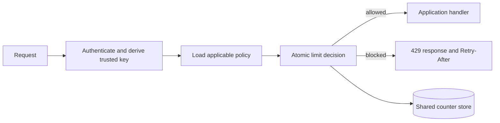

<!-- section: System Design | category: Architecture | tags: concept, rate-limiting, interview | role-priority: important | general-importance: important -->
[](#)
[](#)
[](#)
[](#)
[](../../../docs/topic-importance.md)
[](../../../docs/topic-importance.md)

# Rate Limiter System Design

## Definition

A rate limiter decides whether a request may proceed under a policy, such as a maximum number of requests per account or a burst limit. A distributed service must coordinate that decision across the application instances that handle the same key, or explicitly accept approximate enforcement.

> **Textbook Definition:** A rate limiter is an admission-control component that maintains or approximates request consumption for defined keys and enforces a quota, window, and burst policy before protected work proceeds.

## First Principles

1. **A limit is a product policy.** Define the operation, identity key, time behavior, burst allowance and what counts toward the limit before choosing an algorithm.
2. **Concurrent requests can race.** A shared counter needs one atomic check-and-update operation; separate read and increment commands can admit too many requests.
3. **Accuracy costs coordination.** A central store can enforce a shared limit more closely, while local or regional counters reduce dependency and latency at the cost of possible overshoot.

## Why it matters

Rate limiting protects a service and gives clients a predictable response under excess demand. It does not replace authentication, authorization, concurrency limits or capacity planning.

## Clarify the policy

Ask:

- What is being limited: requests, expensive operations, bytes, or concurrent work?
- Which identity is trusted: authenticated account, API key, tenant, IP address, or a combination?
- Is the policy a steady rate, a burst allowance, a daily quota, or several limits together?
- Do rejected attempts count? Is the limit global, per region, per tenant, or per endpoint?
- What should the API do if the decision store is unavailable?
- Are limits abuse controls, fairness rules, contractual quotas, or capacity protection? Different goals can need different policies.

Use identity established by authentication. Do not trust a caller-supplied user ID. If using a forwarded client IP, accept it only from trusted proxies and define how shared networks and address changes affect fairness.

## Design the request path



The policy configuration can be cached because it changes less often than requests. The live decision state must not be replaced with cached “allowed” responses: replaying one cached allow result bypasses the limit until that result expires.

### Select an algorithm

| Algorithm | Behavior | Useful when | Main limitation |
| ---------------------- | ------------------------------------------------------------------------------- | ----------------------------------------------------------------- | -------------------------------------------------------------------- |
| Fixed window | Counts requests in fixed time buckets. | A simple quota is sufficient. | A caller can send near the limit on both sides of a bucket boundary. |
| Sliding-window counter | Combines current and previous bucket counts using the elapsed fraction. | A smoother approximation is acceptable with bounded state. | It estimates a rolling limit rather than retaining every request. |
| Sliding-window log | Stores request timestamps and removes entries outside the window. | A close rolling-window decision is required at manageable volume. | State and per-request work grow with requests in the window. |
| Token bucket | Refills tokens over time up to a capacity; each allowed request spends a token. | The policy allows bursts while controlling the longer-term rate. | The refill rate and bucket capacity must match the intended policy. |

A leaky-bucket queue can smooth processing by draining work at a fixed rate. That is queueing and shaping; it differs from immediately rejecting excess API requests. See the [rate-limiting theory chapter](../01-theory/30.2.1.08-rate-limiting.md) for the algorithm mechanics.

### Choose the decision store

For a shared limit across stateless application instances, keep counters in a shared store and perform the full read, decision and update atomically. Redis scripts or functions are one option. Use the store's time source inside the operation where practical, so application-host clock differences do not change the decision.

For a quota of two requests, suppose the current count is one. Two handlers separately read one and each decides there is room. If both then increment, the count reaches three and both protected operations have been admitted. An atomic decision checks and increments together: the first changes one to two and is admitted; the second sees two and is rejected. The same identity and policy key must reach this shared decision, or independent counters recreate the overshoot.

A relational database can be adequate for low-volume or coarse quotas. An in-process counter is simple but enforces only a per-process limit. If a client can reach `N` independent instances, each enforcing the full local limit, the aggregate allowance can approach `N` times that limit before coordination.

When several policies apply to one request (for example, account and endpoint limits), define their semantics. If one rule rejects after another has already consumed quota, decide whether that partial consumption is intended. Enforcing multiple keys atomically may require them to share a store partition or a different data model; do not assume a sequence of individually atomic checks is one atomic decision.

## Policy and API behavior

Keep durable policy configuration separate from hot counters. A policy can include:

- Scope and trusted key source.
- Algorithm parameters, such as window, request budget, token refill and burst capacity.
- Effective period and policy version.
- Behavior on store failure and any documented local fallback.

Store administrative changes with actor, time and reason. Cache policy data with a bounded refresh or invalidation mechanism. Do not persist one database row for every allowed request unless the product has a specific audit requirement; aggregate or sample operational events instead.

For a rejected HTTP request, return `429 Too Many Requests`. Include `Retry-After` only when the limiter can provide a meaningful delay, expressed as seconds or an HTTP date per the API contract. A reset timestamp and a retry delay are different values. Rate-limit headers can help clients adapt, but their names and exact semantics should be documented and consistent.

A limiter is normally middleware, a gateway filter or a service library. A separate network call to a rate-limiter API adds another hop and failure mode; use one only when central policy ownership justifies it. Administration endpoints must be authenticated, authorized and audited.

## Capacity and scaling

Estimate the workload from the exercise or deployment inputs:

```text
average checks/second = requests per day ÷ 86,400
active counter state  ≈ active key-policy pairs
log state             ≈ requests retained in each rolling window
```

Peak traffic, hot-key skew, policy count, replicas and store metadata affect actual capacity. Benchmark the chosen atomic operation and failure configuration; byte-per-key and latency estimates without those details are not deployment evidence.

Scale in this order:

1. Keep policy lookups out of the per-request database path.
2. Measure decision latency, hot keys, store contention and memory before changing topology.
3. Partition counters by a stable key if the store supports it. A single global key can remain a hotspot even when the rest of the keys distribute evenly.
4. For multi-region enforcement, choose explicitly between global coordination, independent regional budgets, or bounded overshoot. Each choice changes availability, latency and fairness.

Sharding keys across Redis nodes distributes state; it does not make the decision local or remove contention on one popular key. A local token budget can reduce coordination, but must be accounted for when allocating and replenishing the global quota.

## Failure and security behavior

| Condition | Decision to make |
| ------------------------------------- | ---------------------------------------------------------------------------------------------------------------------------------------------- |
| Counter store unavailable | Fail open to preserve availability, fail closed to preserve the limit, or use a bounded local fallback. Choose per operation and abuse impact. |
| Local fallback used | Expect aggregate overshoot across instances; monitor its duration and effect. |
| One key is unusually hot | Decide whether exact coordination is required or the policy can use sub-budgets, approximate counters or queueing. |
| Policy cache is stale | Define how quickly policy changes must take effect and how the service recovers if invalidation fails. |
| Client identity is missing or spoofed | Apply an explicit anonymous policy; trust forwarded headers only from known proxies. |
| Limiter is overloaded | Protect the limiter itself with bounded queues and capacity controls. Avoid retrying every failed check in a way that increases the overload. |

A rate limiter is part of the request security boundary. Limit creation of attacker-controlled keys, avoid storing raw credentials in key names or logs, and set retention for counters. If store failure should fail open, add other controls for operations where abuse could cause serious cost or data loss.

## Common mistakes

- Reading a counter and incrementing it in separate, race-prone operations.
- Caching an “allowed” decision and reusing it for later requests.
- Assuming per-instance limits equal a global limit.
- Calling an absolute reset timestamp a `Retry-After` duration.
- Treating an IP address as one person, or trusting arbitrary forwarding headers.
- Applying the same fail-open or fail-closed behavior to every route.
- Adding multi-region coordination or a broker before defining the policy and failure contract.

## Summary

Define the protected operation and trusted key first. Choose an algorithm that matches the burst and time-window policy, then make shared state updates atomic. Keep policy configuration separate from request counters, document the response and store-failure behavior, and measure hot keys and overshoot. Exact global enforcement and low-latency regional availability are competing goals; state which one the product requires.

## See Also

- [System Design Revision](REVISION.md) — practice questions for this case-study category
- [Rate Limiting Theory](../01-theory/30.2.1.08-rate-limiting.md) — algorithm behavior and trade-offs
- [REST API rate limiting](../../../20-backend/20.3-rest-apis/04-edge-and-scale/20.3.4.01-rate-limiting.md) — HTTP responses and policy boundaries
- [Distributed caching](../01-theory/30.2.1.05-caching-patterns.md) — distinguish cached configuration from live limit state
- [Backpressure and flow control](../01-theory/30.2.1.13-backpressure-and-flow-control.md) — when to queue, slow or shed work

## References

- [Redis rate-limiter use case](https://redis.io/docs/latest/develop/use-cases/rate-limiter/)
- [Stripe rate limits](https://docs.stripe.com/rate-limits)

---

[← Previous: Twitter Feed](30.2.2.12-twitter-feed.md) · [Back to Index](INDEX.md) · [Next: Web Crawler →](30.2.2.14-web-crawler.md)
