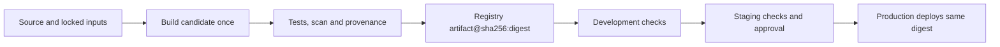


<!-- section: CI/CD | category: DevOps | tags: concept, registries, artifacts, promotion, changelog | role-priority: important | general-importance: important -->
[](#)
[](#)
[](#)
[](#)
[](../../../docs/topic-importance.md)
[](../../../docs/topic-importance.md)

# Artifact Registries & Release Promotion

Staging passes, but production rebuilds the same commit and ships different bytes. A registry and promotion flow prevent that mismatch by giving the tested output one identity that survives each environment change.

## Definition

An **artifact registry** is a versioned, access-controlled store for build outputs: OCI container images, npm packages, language wheels/jars, Terraform modules, Helm charts. A **release promotion flow** takes one artifact version and moves it through environments by *reference* (re-tagging or re-pointing manifests at the same digest), applying human or automated gates along the way — not by re-running the build per environment.

> **Textbook Definition:** An artifact registry stores versioned build outputs and associated metadata. Release promotion advances a validated artifact identity through environments without rebuilding it under different inputs.

Key concepts:

- **Tag**: a human-friendly pointer (`v1.2.3`, `main`, `latest`). It can move unless the registry enforces tag immutability.
- **Digest**: commonly `sha256:<hex>` of a registry manifest or index. It identifies those exact manifest bytes; the registry can still delete the object during cleanup.
- **Promotion**: `dev-current` -> `staging-current` -> `prod-current` all pointing at one digest, or (better) every environment pinning the digest itself.
- **Changelog automation**: tooling that derives versions and release notes from merged changes or explicit changeset files; review generated output before publishing.
- **Pull-through cache**: a read-through proxy repository that stores upstream artifacts on first pull.

---

## First Principles

A deployment name can point to different bytes over time, and a rebuild can change inputs. Store content under an identified artifact reference, record evidence for that content and advance the reference only when required checks pass. A digest binds bytes; trust in the source, builder and approvals needs separate verifiable evidence.

## How It Works

### 1. The registry landscape

| Registry | Best for | Notes |
| ------------------------------------ | ------------------------------- | ----------------------------------------------------------------------------------------------------- |
| **GHCR** (GitHub Container Registry) | GitHub-native teams, OSS images | `ghcr.io/org/app`, GITHUB_TOKEN auth, OCI-compliant |
| **ECR / ECR Public** | AWS shops | IAM auth, lifecycle policies, pull-through cache rules |
| **Google Artifact Registry** | GCP shops | Regional repos, vulnerability scanning |
| **JFrog Artifactory** | Enterprise polyglot | Virtual/federated repos, one URL for npm+Docker+Maven, air-gap support |
| **npm registry + private mirror** | JS packages | Verdaccio/Nexus/Artifactory npm repos for private packages and caching |
| **Harbor** | Self-hosted OCI | CNCF project with policy, scanning and replication features; verify which integrations are configured |

OCI-compatible registries share a distribution protocol, but authentication, referrer/artifact support, replication, retention and policy features differ. Check the required operations and tool compatibility rather than assuming identical behavior.

### 2. Tags lie, digests do not

```text
Tag:    ghcr.io/acme/api:prod       — a registry name that may be reassigned
Digest: ghcr.io/acme/api@sha256:…   — identifies exact manifest bytes

For container releases, deploy a digest or enforce immutable tags. A rebuild
can produce a different digest when inputs or manifest metadata change.
Kubernetes manifests, Helm values and ECS task definitions can reference it.
```

Verify immutability yourself:

```bash
crane digest ghcr.io/acme/api:v1.4.2
# sha256:9a4fb1d0…  <- deploy THIS string, not the tag
```

### 3. Build once, promote everywhere



Each environment can supply different runtime configuration while keeping the candidate digest unchanged. If a browser bundle or another artifact embeds environment settings at build time, build and verify each variant as a separate candidate.

### 4. Changelog automation

| Tool | Model | Best for |
| -------------------- | ----------------------------------------------------------------------------------------------------------------------------------------------------------------- | ----------------------------------------------- |
| **release-please** | Scans conventional commits on main; opens a "Release PR" that bumps the version and writes CHANGELOG; merging it tags + creates a GitHub Release | Apps and libraries on GitHub; low ceremony |
| **changesets** | Every meaningful PR ships a `.changeset/*.md` intent file (patch/minor/major + note); a Version PR accumulates them; configured publication runs after versioning | Monorepos, npm packages, explicit per-PR intent |
| **semantic-release** | Fully automatic publish on conventional commits, no human gate | Fast-moving internal libs |

The publication hook depends on the tool and workflow: semantic-release can publish directly after eligible commits, while release-please and Changesets commonly use release/version PRs. Merging a version PR does not itself publish packages unless configured automation does so. Validate generated versions/notes and record the actual published artifact identity.

### 5. Retention and cleanup

Registries grow forever unless you delete. Policy shape that works:

- **Keep**: every digest currently deployed anywhere, the last 20-30 release digests, release history for a defined rollback window, adjusted to deploy frequency and recovery obligations.
- **Delete**: untagged layers older than N days (build cache), stale `sha-<commit>` tags past their PR lifetime, preview-env images older than 7 days.
- **Never**: bulk-delete by date across release tags while old workloads still run — a pod restart pulls layers that no longer exist and the rollout dies.

ECR has lifecycle policies; other registries require their supported retention/delete APIs or automation. A fixed count cannot prove a currently deployed older digest is protected. Inventory deployed references and test policy previews before deletion.

### 6. Pull-through caches

First pull of an upstream image goes through your registry, which stores it; later pulls are served locally.

```text
Cluster pod ──pull──► YOUR REGISTRY (cache miss? fetch upstream, store, serve)
                                                   │                        ▲
                          └── cache hit ───────────┘
Benefits: cached pulls can reduce upstream requests and egress
Limits: cold misses, revalidation, evictions and credentials can need upstream
```

---

## Code Examples

### Check a Promotion Decision Without Executing Deployment

This executable JavaScript checks a small in-memory promotion policy. Its evidence is assumed to have been collected and authenticated elsewhere; caller-provided booleans are not a production authorization mechanism.

```javascript
// promotion.mjs
import assert from 'node:assert/strict';
const allowed = { staging: ['dev'], production: ['staging'] };
export function checkPromotion({ digest, from, to, testedDigest, desiredDigest }) {
  if (!/^sha256:[0-9a-f]{64}$/.test(digest)) throw new Error('Invalid digest');
  if (!(allowed[to] ?? []).includes(from)) throw new Error('Invalid transition');
  if (testedDigest !== digest) throw new Error('Evidence belongs to another artifact');
  if (desiredDigest !== digest) throw new Error('Candidate was superseded');
  return digest;
}
const digest = 'sha256:' + 'a'.repeat(64);
const input = { digest, from: 'staging', to: 'production',
  testedDigest: digest, desiredDigest: digest };
assert.equal(checkPromotion(input), digest);
assert.throws(() => checkPromotion({ ...input, digest: 'latest' }));
assert.throws(() => checkPromotion({ ...input, from: 'dev' }));
assert.throws(() => checkPromotion({ ...input, testedDigest: 'sha256:' + 'b'.repeat(64) }));
assert.throws(() => checkPromotion({ ...input, desiredDigest: 'sha256:' + 'c'.repeat(64) }));
```

The real promotion service must authenticate requester/evidence, bind approved repository/workflow/builder identity, check policy and desired revision atomically where needed, then invoke tools with separate argument arrays. A shell-interpolated environment name must not become executable command text. Verify signatures for the exact digest with narrowly expected identities; an organization-wide signer regex is broader than one approved release workflow.

### Preview Retention Before Enabling It

An ECR rule selecting `tagPatternList: ["release-*", "staging-*", "prod-*"]` requires matching **all listed patterns across the image's tags**, rather than an OR over independent image families. Use deliberate separate rules or a shared classification tag, then run the lifecycle preview against representative tags and deployed digests. Rules inspect image metadata; they do not query running workloads to protect live references automatically.

Keep cache churn separate from release artifacts and account for multi-platform indexes, child manifests and associated attestations. An untagged digest can still be deployed. Deleting its human tag does not imply its content is unused.

### Publish Version Intent and Capture What Actually Shipped

Changesets records per-package version intent in committed changeset files; release-please commonly derives a release PR from conventional commits. Semantic-release can publish automatically. All require valid package/build scripts, permissions and an actual publishing job. Do not rely on another workflow's event being triggered by a `GITHUB_TOKEN`-created release; GitHub restricts recursive workflow triggers for that token. Wire the publishing/build steps deliberately through outputs or a supported dispatch mechanism.

npm credentials/provenance, container signatures and registry login are separate contracts. Pin/install the actual publishing and signing tools, match current plan/provider support and verify the final version, digest and provenance instead of treating a release note as certification.

## Best Practices

1. **Promote by immutable identity.** Use the same container digest or immutable package version across environments; tags are lookup labels unless the registry enforces immutability.
2. **Bind evidence to the candidate.** Tests, scans and provenance must identify the artifact that will deploy. A valid signature alone does not establish that its signer or workflow was approved.
3. **Make promotion an explicit state transition.** Record which checks authorize each environment and reject superseded candidates before deployment.
4. **Protect deployed references from cleanup.** Retention rules cannot infer which old digest a running workload needs. Inventory active and rollback references, preview lifecycle rules and keep caches separate from release artifacts.
5. **Plan registry availability and cost.** Measure pull latency, storage and authentication failures; replicate required digests deliberately and account for cold-cache misses and cross-region transfer.
6. **Keep release notes distinct from publication.** Changelog automation can propose a version and notes; the configured publish job still needs explicit credentials and should record what actually shipped.

---

## Summary

Registries store identified artifacts; promotion advances a verified reference through explicit gates. Digests bind content, while authenticated evidence binds the source and builder. Version automation needs configured publishing, retention needs live-reference protection, and upstream caches reduce requests while retaining cold-miss and availability boundaries.

## See Also

- [Section revision questions](REVISION.md) — work through the drill after finishing this category

- [Argo CD (GitOps)](../01-ci-platforms/40.3.1.04-argocd.md) — promoted images are what Argo CD syncs — the registry reference is part of the release contract
- [Docker Build & Deploy](40.3.2.01-docker-build-deploy.md) — build pushes here; promotion promotes from here
- [Docker Stack](../../40.1-docker/INDEX.md) — registries store what the docker stack builds
- [GitHub Actions](../01-ci-platforms/40.3.1.01-github-actions.md) — actions push and pull from these registries in the build job
- [Kubernetes Stack](../../40.2-kubernetes/INDEX.md) — imagePullSecrets and node-level pulls are the k8s half
- [Pipeline Patterns](40.3.2.02-pipeline-patterns.md) — promotion gates are the pipeline pattern this chapter implements

---

## References & Learn More

- [OCI Distribution Spec](https://github.com/opencontainers/distribution-spec) — the protocol every container registry speaks
- [GitHub Container Registry docs](https://docs.github.com/en/packages/working-with-a-github-packages-registry/working-with-the-container-registry)
- [Amazon ECR lifecycle policies](https://docs.aws.amazon.com/AmazonECR/latest/userguide/lifecycle_policies.html)
- [Amazon ECR pull-through cache](https://docs.aws.amazon.com/AmazonECR/latest/userguide/pull-through-cache.html)
- [JFrog Artifactory — repository layout concepts](https://docs.jfrog.com/artifactory/docs/repository-layouts)
- [changesets documentation](https://github.com/changesets/changesets)
- [release-please](https://github.com/googleapis/release-please)
- [Sigstore cosign](https://docs.sigstore.dev/cosign/signing/overview/) — signing and verifying images by digest
- [go-containerregistry crane](https://github.com/google/go-containerregistry/blob/main/cmd/crane/doc/crane.md) — digest/tag operations from scripts
- [Conventional Commits](https://www.conventionalcommits.org/) — the commit grammar release tooling parses
---

[← Previous: Pipeline Patterns](40.3.2.02-pipeline-patterns.md) · [ Back to Index](INDEX.md) · [Next: Pipeline Supply-Chain Security & SLSA →](40.3.2.04-pipeline-supply-chain-security-slsa.md)

