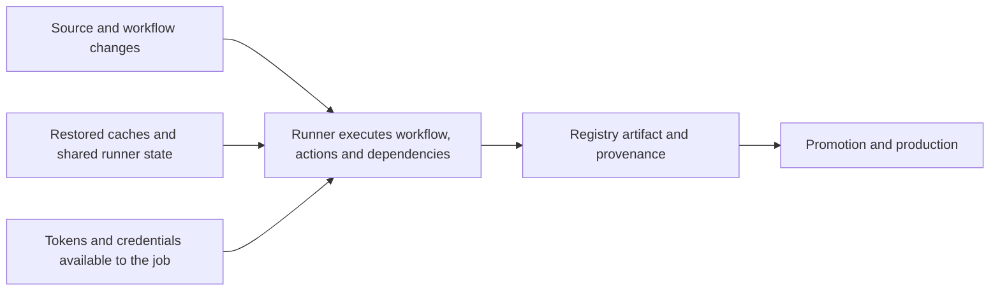


<!-- section: CI/CD | category: DevOps | tags: concept, security, supply-chain, slsa, | role-priority: important | general-importance: important -->
[](#)
[](#)
[](#)
[](#)
[](../../../docs/topic-importance.md)
[](../../../docs/topic-importance.md)

# Pipeline Supply-Chain Security & SLSA

A pull request can pass every test and still produce an unsafe release if a build action changes, a runner leaks credentials, or the deploy job rebuilds from a mutable tag. The release needs a trustworthy chain from reviewed source to the exact bytes deployed.

## Definition

**Software supply-chain security** protects the path from source code to running artifact: source control, dependencies, build tooling, CI infrastructure, and distribution. **SLSA** (Supply-chain Levels for Software Artifacts, pronounced "salsa") is an industry specification for describing and incrementally improving that security through defined tracks and levels. **Provenance** records what was built, from which inputs, and by which builder; its authenticity depends on the builder and how consumers verify it.

> **Textbook Definition:** Software supply-chain security applies controls to the people, systems and artifacts that create and distribute software. SLSA defines progressive requirements for source and build integrity, including provenance; the achieved level determines which claims a consumer can verify.

Key concepts: the **attack surface** is every system that can change code or artifacts without review; a **pinned action reference** (`owner/repo@<full-commit-SHA>`) is immutable, annotated with the version tag for humans; **OIDC federation** lets CI exchange its identity token with a cloud provider's STS for short-lived credentials, so no long-lived cloud key is stored in CI — though issued tokens and temporary credentials are still secrets; an **attestation** is a structured statement about an artifact, such as its provenance, software bill of materials (SBOM), or scan result, where a signature and trust policy determine whether a consumer can rely on the statement; **TUF (The Update Framework)** is a metadata standard that makes software update systems resilient to key compromise and rollback attacks — the pattern behind secure metadata rotation.

## First Principles

The same build instructions that run tests can read accessible credentials and publish outputs. A compromised dependency or runner can therefore influence the release without changing application source. Restrict executable inputs and authority, isolate builds, and verify authenticated evidence at the consumer. A signed statement is only as trustworthy as its issuer and the properties checked by policy.

## How It Works

### 1. Map the Pipeline as an Attack Surface



Review each edge: who can change its input, what authority crosses it, and how the next stage verifies the result.

### 2. Read SLSA Build Levels as Requirements

| Level | Meaning | Typical evidence |
| ------ | ------------------------------------------------------------------------------------------ | ------------------------------------------------------------------------------------------------------------- |
| **L0** | No guarantees | Local laptop builds, `docker push` from dev machines |
| **L1** | Provenance is generated and distributed; authenticity and accuracy are not required | Useful for traceability, but consumers cannot rely on it as authenticated evidence |
| **L2** | Provenance is authentic and produced by a hosted build platform | Consumers can validate its origin; SLSA recommends a digital signature for authenticity |
| **L3** | Provenance is unforgeable to the build tenant and builds are isolated | Build steps cannot access signing secrets or influence another build through shared state or cache |

SLSA v1.2 has distinct **Build** and **Source** tracks. Build levels run from L0 to L3; Source levels run from L1 to L4:

| Source level | Main control |
| ------------ | -------------------------------------------------------------- |
| **L1** | Source is version controlled |
| **L2** | Change history is preserved and source provenance is generated |
| **L3** | Technical controls enforce the organization's source process |
| **L4** | Changes require two-party review |

Report the track and level together, such as **Build L2** or **Source L3**; one does not imply the other. An attestation by itself does not certify a SLSA level. Check the current requirements and the builder's guarantees before making a claim. A hosted runner alone does not meet Build L3's isolation requirements.

### 3. Pin Actions by SHA, Let Dependabot Bump Them

`uses: actions/checkout@v7` follows the v7 major tag, which maintainers can move within that major version. Pinning to a full commit SHA freezes behavior; Dependabot then proposes version bumps as normal, reviewable PRs.

```yaml
# .github/dependabot.yml
version: 2

updates:
  - package-ecosystem: github-actions
    directory: /
    schedule:
      interval: weekly
    groups:
      github-actions-minor:
        update-types: ["minor", "patch"]

  - package-ecosystem: npm
    directory: /
    schedule:
      interval: daily
    groups:
      npm-dev:
        dependency-type: development
```

Each Dependabot PR swaps the old pinned SHA for the new one and updates the `# vX.Y.Z` comment — a reviewable diff instead of silent tag drift.

### 4. Federate Cloud Access with OIDC Instead of Long-Lived Keys

The workflow requests an ID token with repository and job context. The cloud trust policy must match the issuer, audience, and intended subject before issuing short-lived credentials. Configure credential duration and permissions in the provider; a temporary token can still be stolen and abused before expiry.

```text
GitHub job ──OIDC ID token──► Cloud STS (trust policy checks subject)
                │                       │
                │                       ▼
                └────────────► short-lived credentials (duration set by provider/role)
This design does not require a stored AWS_SECRET_ACCESS_KEY in GitHub settings.
Temporary credentials can still leak and be abused before expiry.
Narrow role scope, avoid logging tokens and rehearse trust revocation.
```

The subjects below are alternative authorized contexts; use only the needed context, and enforce production environment protections. GitHub repositories created after July 15, 2026, or opted into immutable subjects, include owner/repository IDs in the subject. Inspect the actual token claim format and configure exact trust accordingly; do not copy a legacy subject blindly.

```json
{
  "Version": "2012-10-17",
  "Statement": [
    {
      "Effect": "Allow",
      "Principal": {
        "Federated": "arn:aws:iam::123456789012:oidc-provider/token.actions.githubusercontent.com"
      },
      "Action": "sts:AssumeRoleWithWebIdentity",
      "Condition": {
        "StringEquals": {
          "token.actions.githubusercontent.com:aud": "sts.amazonaws.com"
        },
        "StringLike": {
          "token.actions.githubusercontent.com:sub": [
            "repo:acme/api:ref:refs/heads/main",
            "repo:acme/api:environment:production"
          ]
        }
      }
    }
  ]
}
```

```yaml
- uses: aws-actions/configure-aws-credentials@e1253824e5c10ff9df46874f81ed3ec929e19cfd # v6.3.0
  with:
    role-to-assume: arn:aws:iam::123456789012:role/ci-deploy-api
    aws-region: eu-central-1
  # No stored secrets.AWS_* needed; issued credentials remain sensitive until expiry.
```

### 5. Generate Provenance Attestations, Verify Them at Deploy Time

An attestation is signed JSON (in-toto format) answering: builder, source commit/ref, build config, and artifact digest. For new GitHub Actions workflows, use the maintained `actions/attest` action; the older `attest-build-provenance` action is a compatibility wrapper. The SLSA GitHub Generator is no longer maintained. Verify the attestation and expected signer before deploying, for example with `gh attestation verify`.

```yaml
# .github/workflows/build.yml
name: build

on:
  push:
    branches: [main]

# Least privilege first; jobs escalate below if needed.
permissions:
  contents: read

jobs:
  build:
    runs-on: ubuntu-latest
    permissions:
      contents: read
      packages: write       # push to GHCR
      id-token: write       # OIDC federation + keyless signing
      attestations: write   # record build attestations
      artifact-metadata: write # publish attestation metadata
    steps:
      # Tag for humans, SHA for machines. Dependabot updates both together.
      - uses: actions/checkout@3d3c42e5aac5ba805825da76410c181273ba90b1 # v7.0.1

      # Placeholder form shown deliberately: ALWAYS resolve the real
      # 40-char SHA (Dependabot does this for you when it opens the PR).
      - uses: actions/setup-node@949feb2413d6458794dcd2491c4babbbce0c15c1 # v7.1.0
        with:
          node-version: '24'

      - run: npm ci
      - run: npm test

      - name: Build and push image
        id: push
        uses: docker/build-push-action@c3c9e263c25d99ce0380d002d59b67737d91b0dc # v7.4.0
        with:
          push: true
          tags: ghcr.io/acme/api:${{ github.sha }}

      - name: Generate build provenance
        uses: actions/attest@1e69f48acb82d1966a394da916b4c1698aa569d6 # v4.2.2
        with:
          subject-name: ghcr.io/acme/api
          subject-digest: ${{ steps.push.outputs.digest }}
          push-to-registry: true
```

This is a policy template, not runnable unchanged: resolve every `<commit-sha>`, configure registry login/tooling, set the Node project runtime, and supply the actual Dockerfile and gates. The `actions/attest` statement alone does not certify a SLSA level. GitHub documents artifact attestations as available for public repositories on Free, Pro, and Team plans; private and internal repositories require GitHub Enterprise Cloud, and GitHub Enterprise Server is not supported. Check plan availability and required permissions before adopting this workflow.

With an installed current GitHub CLI, an authenticated registry/repository context, and an actual approved OCI reference:

```bash
: "${IMAGE_REFERENCE:?required}" # e.g. registry/repository@sha256:<64 hex digits>
gh attestation verify "oci://$IMAGE_REFERENCE" --repo acme/api
```

Review the CLI's current policy flags and enforce the intended signer workflow, source revision/ref, and builder properties in addition to the repository. A repository match alone does not prove the artifact came from main or the intended release workflow. Fail closed on missing attestations, mismatched subjects, and query/verification errors. Attestation list/inspection is not a substitute for verification.

### 6. Protect the Workflows Themselves

- **CODEOWNERS entry for `.github/workflows/**`** plus enforced required code-owner reviews and ruleset/bypass policy. The file alone does not enforce review, and privileged bypass needs its own controls.
- **Branch protection**: required reviews, required status checks, disallow force-pushes on protected branches.
- **Least-privilege token**: default `permissions: contents: read` at workflow level; grant per-job extras explicitly.
- **Avoid `pull_request_target` with checkout of the PR head** — it runs untrusted code with repository secrets. Use plain `pull_request` or isolate the untrusted part in a workflow with no secret access.
- **Identify runner/toolchain versions / use appropriately isolated ephemeral self-hosted runners** for sensitive repos; never reuse stateful runners across PR authors.

```text
# .github/CODEOWNERS
# Request platform-security review; branch rules must require code-owner approval.
/.github/workflows/   @acme/platform-security
/.github/dependabot.yml @acme/platform-security
/Dockerfile           @acme/platform-security @acme/api-team
```

A regex matching unquoted `uses:` lines can miss quoted keys/values, reusable jobs, composite actions, and alternative valid YAML syntax. It also needs a policy for `docker://` digest references and local actions. Use a maintained policy tool or a YAML parser plus explicit coverage fixtures; fail on parse errors and inspect every executable dependency. A green regex scan cannot support "all actions pinned."

## Real-World Use Cases

- **A release trust boundary.** An organization adopts hosted provenance, then evaluates every applicable SLSA requirement and checks the expected workflow/digest at promotion. Attesting an image is evidence, not a shortcut to declaring L2.
- **A credential migration.** Replace inventoried long-lived cloud keys with narrow OIDC roles, then remove old secrets, audit available permissions, and test trust revocation. Temporary tokens still require safe handling, and build dependencies can abuse any role accessible to their job.
- **A source-tied release.** Build tarballs from reviewed source and declared inputs; record hashes and authenticated provenance. A checksum detects differing bytes but does not authenticate a publisher by itself.
- **Ephemeral runners.** Destroying a runner reduces persistence. Separate privileged/untrusted jobs, networks, and credentials too; a new VM with a host socket or broad cloud role can still expose production.
- **A dependency audit.** Scan both runtime and build dependencies according to their threat model. `npm audit --omit=dev` omits tooling that executes during CI and cannot establish that the whole build path is safe.

## Common Mistakes

| Mistake | Fix |
| ------------------------------------------------------- | -------------------------------------------------------------------- |
| Pinning actions by major tag (`@v4`) only | Pin full commit SHAs; Dependabot maintains them |
| Storing cloud keys as repo/org secrets | OIDC federation with strict `sub` conditions |
| Broad OIDC trust (`"sub": "repo:*"`) | Trust exact `repo:path`/`ref`/`environment` subjects |
| `pull_request_target` checking out PR head with secrets | Use `pull_request`; split privileged steps into a separate gated job |
| Default GITHUB_TOKEN with wide write scopes | `permissions: contents: read` globally, escalate per job |
| Generating provenance but never verifying it | Verify in the promotion gate/admission controller |
| Reviewing app code but not workflow diffs | CODEOWNERS on `.github/workflows/**` + required reviews |
| Treating SBOM generation as compliance theater | Diff SBOMs per release; alert on unexpected new packages |

## Best Practices

1. **Default-deny the token.** Start every workflow with `permissions: contents: read`; add write scopes only where a step needs them.
2. **Pin everything you execute**: actions by SHA, base images by digest, toolchains by lockfile. Pinning constrains inputs; timestamps, environment, and undeclared downloads can still prevent reproducibility.
3. **Let bots do the bumping.** Dependabot/Renovate PRs make supply-chain upgrades visible and revertible.
4. **Federate all cloud auth.** If a static credential still exists after migration, treat that as an exception with an owner and expiry date.
5. **Attest, then verify elsewhere.** An attestation nobody verifies is decoration; wire verification into CD.
6. **Guard the guardrails:** required reviews + CODEOWNERS on workflow paths; audit log alerts on workflow file changes outside PRs.
7. **Assume dependency compromise:** limit what CI credentials can do (scoped roles, separate build/deploy identities) so a poisoned build cannot pivot to prod data.
8. **Know your critical few.** Apply xz lessons where they matter: extra reviewer scrutiny on crypto/auth/parsing dependencies and on maintainer-trust changes.
9. **Rehearse revocation:** practice rotating an OIDC trust policy and re-running the gate; recovery speed is the metric auditors actually probe.
10. **Track your level honestly.** Map today's pipeline to SLSA Build L0-L3, check every requirement against evidence, and put the next control in the roadmap.

## Performance Considerations

Measure scan, attestation, and verification latency in the actual pipeline; fixed millisecond claims vary with provider, network, and artifact size. Cache only validated evidence with the digest, policy version, identity/trust state, and suitable expiry. Revocation or policy changes must not be bypassed by an old cached result.

## Summary

Protect source, dependencies, builders, and release authority as one chain. Pin reviewed inputs, isolate untrusted execution, federate narrowly scoped cloud access, and verify authenticated provenance against the intended digest/source/workflow. Temporary credentials remain sensitive; a signature, CODEOWNERS file, or hosted runner alone does not establish the required policy or SLSA level.

## See Also

- [Section revision questions](REVISION.md) — work through the drill after finishing this category
- [Artifact Registries & Release Promotion](40.3.2.03-artifact-registries-release-promotion.md) — provenance attaches to artifacts — the registry is where it lives
- [Docker Build & Deploy](40.3.2.01-docker-build-deploy.md) — buildkit provenance and reproducible builds feed the SLSA levels
- [Git Advanced](../../40.6-git-advanced/INDEX.md) — commit signing and tag verification anchor provenance to source
- [GitHub Actions](../01-ci-platforms/40.3.1.01-github-actions.md) — the reusable workflows and OIDC that implement SLSA in actions
- [Pipeline Patterns](40.3.2.02-pipeline-patterns.md) — the patterns chapter owns the flow; this chapter owns trusting it

## References & Learn More

- [SLSA Build Track Basics, v1.2](https://slsa.dev/spec/v1.2/build-track-basics) — exact L0–L3 requirements and guarantees
- [SLSA tracks, v1.2](https://slsa.dev/spec/v1.2/tracks) — Build and Source address distinct threats
- [SLSA Build requirements, v1.2](https://slsa.dev/spec/v1.2/build-requirements) — provenance integrity and build-platform isolation by level
- [SLSA Source requirements, v1.2](https://slsa.dev/spec/v1.2/source-requirements) — source controls and levels
- [SLSA GitHub Generator](https://github.com/slsa-framework/slsa-github-generator) — archived guidance; no longer maintained, so use only when maintaining an existing integration
- [GitHub Docs — Security hardening for GitHub Actions](https://docs.github.com/en/actions/security-for-github-actions/security-guides/security-hardening-for-github-actions)
- [actions/attest](https://github.com/actions/attest) — maintained GitHub artifact attestations for new workflows
- [GitHub Docs — Artifact attestations](https://docs.github.com/en/actions/security-for-github-actions/using-artifact-attestations/using-artifact-attestations-to-establish-provenance-for-builds)
- [GitHub AWS OIDC subject and trust rules](https://docs.github.com/en/actions/how-tos/secure-your-work/security-harden-deployments/oidc-in-aws)
- [AWS — OIDC federation between GitHub Actions and IAM](https://docs.aws.amazon.com/IAM/latest/UserGuide/id_roles_providers_create_oidc.html)
- [in-toto attestations](https://github.com/in-toto/attestation) — the attestation format SLSA uses
- [The Update Framework (TUF)](https://theupdateframework.io/) — compromise-resilient update metadata
- [OpenSSF Scorecard](https://securityscorecards.dev/) — automated supply-chain posture scoring
- [Sigstore](https://www.sigstore.dev/) — keyless signing infrastructure behind cosign
---

[← Previous: Artifact Registries & Release Promotion](40.3.2.03-artifact-registries-release-promotion.md) · [Back to index](INDEX.md)

