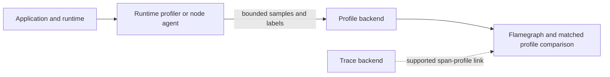

<!-- section: Observability | category: Observability | tags: concept, profiling, pyroscope, performance | role-priority: important | general-importance: important -->
[](#)
[](#)
[](#)
[](#)
[](../../../docs/topic-importance.md)
[](../../../docs/topic-importance.md)

# Continuous Profiling

## Definition

**Continuous profiling** regularly samples what running code is doing in production. It stores those samples with timestamps and labels so you can later ask which functions used CPU time or memory during an incident. Profiles add another observability signal alongside logs, metrics, and traces. You can investigate a past period without waiting to start a profiler after the problem appears.

> **Textbook Definition:** Continuous profiling repeatedly samples runtime execution or allocation behavior and retains time-indexed profiles, enabling analysis of resource use during both normal operation and past incidents.

Key concepts:

- **Sampling profiler**: records stacks at configured time intervals or runtime events. The result is statistical evidence; resolution depends on workload, sampling policy and profiler support.
- **Folded stacks**: compressed representation (`funcA;funcB;funcC count`) that backends aggregate into flamegraphs/icicle charts.
- **Labels**: bounded service, version and environment dimensions that help compare profiles without exposing identities or creating excessive series.
- **Profile diff**: compares profile data from two windows or releases; interpretation depends on matching workload and selection criteria.
- **Span profiles**: where the runtime and backend support them, profile samples can be linked to active trace spans.

---

## First Principles

A latency metric is an aggregate outcome; it does not identify the code consuming resources. A one-off profile started after an incident misses past execution. Retaining periodic samples creates historical evidence, but finite samples are statistical: short operations may have no samples, and unavailable stack symbols can hide the useful frame. Collection itself uses CPU, memory and export bandwidth, so always-on use requires a measured budget.

## Why It Matters

1. Metrics and traces locate the affected service and operation; a profile can show which sampled code paths used CPU, allocated memory or waited on supported locks.
2. Comparing matched releases can reveal a resource-use change before it affects a user-facing threshold. Differences still need a workload and runtime explanation.
3. Allocation profiles show churn; retained-heap or live-object evidence is needed to investigate whether objects remain reachable.

---

## How It Works

### 1. Architecture



### 2. What each profile type answers

| Type | Mechanism | Answers |
| ------------------ | ------------------------------------------------ | ------------------------------------------------------------------------- |
| CPU time | Sample on-CPU stacks at the configured rate | Which functions use CPU time? |
| Wall time | Sample elapsed time, including supported waits | Where does execution wait while CPU is idle? |
| Heap in-use | Inspect sampled objects still live at collection | Which objects remain reachable in the captured heap? |
| Allocations | Sample or instrument allocation events | Which paths create allocation churn? This alone does not prove retention. |
| Mutex/block | Instrument supported contention points | Which locks contribute to waits? |
| Goroutines/threads | Capture runtime task state or counts | How many tasks exist, and is that count growing? |

Start with a supported CPU mode. Add live-heap and allocation modes when memory pressure or garbage collection warrants their distinct evidence.

### 3. Diffing: finding regressions

```text
Illustrative diff: candidate and baseline windows with matched traffic
═══════════════════════════════════════════════════════
net/http.(*Server).serve           ▓▓▓▓▓▓▓  (unchanged)
encoding/json.Marshal              ██████ increased share   <-- investigate
github.com/acme/api.enrichOrder     ████ increased share     <-- calls json
runtime.mallocgc                    ██ increased share      <- possible effect
```

Read the diff as a hypothesis: find the changed frames, trace them to application code, and check the release diff. A larger runtime frame may be a downstream effect; it does not identify the cause by itself.

### 4. Trace integration (span profiles)

Where a runtime and backend support Grafana's Traces-to-Profiles integration, a bridge can associate profile samples with trace spans. The current integration documents CPU profiles only and its supported-language list does not include Node.js. This is sampled evidence, not an exact accounting of every millisecond in a span; do not assume the Node.js profiler example below produces a span-linked profile.

### 5. Match the profiler to the runtime

A runtime hook, timer or kernel mechanism samples stacks; profilers do not all interrupt execution in the same way. CPU, wall-time, live-heap and allocation modes have different units and costs. For example, the Pyroscope Node SDK's `heapSamplingIntervalBytes` controls average bytes between heap samples and defaults to 524,288 bytes in its current documentation; that setting is specific to that SDK and profile type. Native/JIT stack unwinding and symbol/source-map availability affect attribution. An eBPF agent can cover compatible processes without code changes, but unsupported runtimes, missing symbols and dropped samples still limit evidence.

## Code Example: A Complete Local CPU Profile

Node's built-in profiler produces a local artifact without a telemetry backend. Save this as `profile-demo.cjs`:

```javascript
const { createHash } = require('node:crypto');
function hashBatch() {
  let last;
  for (let i = 0; i < 200_000; i++) {
    last = createHash('sha256').update(`demo-${i}`).digest('hex');
  }
  return last;
}
console.log(hashBatch());
```

```bash
mkdir -p profiles
node --cpu-prof --cpu-prof-dir=./profiles profile-demo.cjs
```

Open the resulting `.cpuprofile` in a compatible CPU-profile viewer. Its samples describe this synthetic CPU workload, not a production latency result. Compare it with a second run under the same Node version and workload before attributing a change. Inclusive sample time includes descendants; exclusive time belongs to that frame. Flamegraph width is sampled resource share, not a left-to-right execution timeline.

### Production collection is a deployment integration

Pyroscope, Parca and runtime profilers offer different push and pull integrations. In the current [Pyroscope Node SDK documentation](https://grafana.com/docs/pyroscope/latest/configure-client/language-sdks/nodejs/), initialize the SDK and **call** `start()`; merely importing a module that exports a startup function does not start profiling. CPU collection is configured within wall profiling, and runtime/native-binary support must be checked. Do not copy a generic `samplingIntervalMs` field into an SDK that documents another shape.

For an actual integration, set service/version labels, endpoint authentication, supported profile modes and a bounded shutdown flush. Test native module installation on the deployed OS/architecture, not just a development laptop. Span profiles require the tracing/profiling bridge and compatible backend setup; ordinary profiler startup does not establish that bridge.

A `pprof` endpoint is a sensitive debug interface. Keep it on a private authenticated path with rate limits and a bounded collection duration; heap dumps may contain secrets. Go's `go tool pprof -diff_base=old.pprof new.pprof` compares compatible **actual pprof files**. A UI render/diff HTTP response is not automatically a pprof binary. Obtain artifacts through the backend's documented export interface instead of inventing an endpoint.

## Real-World Use Cases

The following scenarios are illustrative investigations, not measured outcomes from a named deployment.

### 1. Investigate a CPU regression

A matched profile comparison shows more sampled CPU in `json.Marshal` after a release. The team traces the frame to a changed serializer path, then confirms the regression under a repeatable workload before changing code.

### 2. Investigate suspected object retention

Pod restarts increase over time. A retained-heap profile shows objects reachable through `sessionCache`; allocation profiles show where churn occurs. Comparing both across releases narrows the search for a missing eviction path, but a profile alone does not prove the cause.

### 3. Evaluate a resource-cost change

CPU profiles show TLS handshake work as a significant sampled cost. The team measures application-side and mesh-side termination under representative traffic before choosing a change; a profile alone does not establish net fleet savings.

### 4. Investigate cross-tenant contention

Where the runtime supports wall-time and lock profiling, evidence can show whether waits overlap with a shared lock. Confirm the holder and affected request cohort before attributing a tenant's latency to that lock.

---

## Common Mistakes

| Mistake | Fix |
| ------------------------------------------------ | ------------------------------------------------------------------------------------------------------------------- |
| Profiling only staging | Staging can miss production data shapes; assess carefully scoped production sampling when it is needed and approved |
| Applying one sampling frequency to every runtime | Measure the supported profile mode and collection cost for each workload |
| Missing comparison labels or unbounded labels | Choose bounded service, release and environment dimensions; avoid customer identity and cap label combinations |
| Reading flamegraph width as latency | Width = share of samples/resources, not per-request duration |
| Comparing diffs across different traffic mixes | Compare matched workload classes where safe, and record remaining differences |
| Keeping profiles forever | Choose retention from incident history needs, sensitivity and measured storage cost |
| Treating profiles as incident-only tooling | A retained baseline can support comparisons, subject to sampling and retention limits |

---

## Best Practices

1. **Pilot one supported profile mode**, then expand after checking cost, privacy, loss and rollback behavior.
2. **Choose stable comparison labels**, such as service, release and environment. Add route classes only when cardinality and privacy policy permit them; avoid customer identifiers.
3. **Select profile types from the question.** CPU, wall, allocation and retained-heap profiles measure different things and are not supported by every runtime.
4. **Compare equivalent workloads and versions.** Treat a changed stack share as a lead to investigate, not a causal conclusion.
5. **Use private on-demand profiling endpoints only when needed.** Authenticate and bound collection; heap profiles can expose object contents.
6. **Choose SDK, agent or eBPF collection from runtime support, deployment boundaries and operational ownership.** None provides universal coverage.
7. **Link profiles to traces only where the runtime and backend support the integration.** Otherwise correlate through safe service and release metadata.
8. **Set retention from incident needs, sensitivity and measured storage cost.** Apply access control and deletion policy to exported and copied profiles.
9. **Measure overhead** under representative load and after runtime, profiler or configuration changes. Compare CPU, memory, tail latency and export traffic.
---

## Performance Considerations

Do not assume a fixed sub-2% overhead. Sampling frequency, stack depth, allocation rate, runtime and export behavior change cost. Measure a representative control/candidate workload and monitor lost samples, agent CPU/memory and exporter backlog. Higher sampling improves statistical resolution while increasing collection work. A full heap snapshot can pause execution and expose object contents; it has a different operational risk from sampled profiles.

## Summary

Continuous profiling preserves sampled code-level resource evidence across time. Compare equivalent workloads and release identities, distinguish allocation churn from retained memory, and connect profiles to the user-critical trace path. Verify runtime support, sample loss, privacy and overhead before expanding continuous collection.

## See Also

- [Section revision questions](REVISION.md) — work through the drill after finishing this category

- [Distributed Tracing](../01-pillars/40.4.1.03-tracing.md) — traces find the slow request; profiles find the slow function inside it
- [eBPF Observability](40.4.4.03-ebpf-observability.md) — evaluate kernel-assisted sampling, runtime coverage, privileges and overhead
- [Monitoring](../01-pillars/40.4.1.02-monitoring.md) — profiles explain CPU and memory metric movements at function granularity
- [OpenTelemetry (OTel)](40.4.4.01-opentelemetry.md) — the OTel profiles signal is the standardization of this chapter
- [Performance Monitoring](../../../50-quality/50.3-performance-monitoring/INDEX.md) — profiling is the 50.3 stack's deepest tool — same goal, code-level view

---

## References & Learn More

- [Grafana Pyroscope documentation](https://grafana.com/docs/pyroscope/latest/) — architecture, SDKs, span profiles
- [Parca](https://www.parca.dev/) — eBPF-based continuous profiling
- [Go pprof documentation](https://pkg.go.dev/runtime/pprof) — the sampling model most tools inherit
- [Google Cloud — Production profiling at scale (paper)](https://research.google/pubs/pub36575/) — Google-wide always-on profiling experience
- [Brendan Gregg — Flame Graphs](https://www.brendangregg.com/flamegraphs.html) — canonical reading on reading flamegraphs
- [OpenTelemetry — Profiles signal](https://opentelemetry.io/docs/concepts/signals/profiles/) — profiles as the fourth signal
- [Grafana Cloud — Traces to Profiles](https://grafana.com/docs/grafana-cloud/observe-and-act/send-data/profiles/traces-to-profiles/) — span-to-profile correlation setup
---

[← Previous: Opentelemetry](40.4.4.01-opentelemetry.md) · [ Back to Index](INDEX.md) · [Next: eBPF Observability →](40.4.4.03-ebpf-observability.md)
