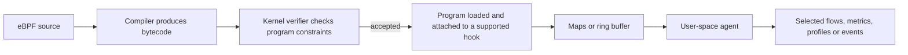
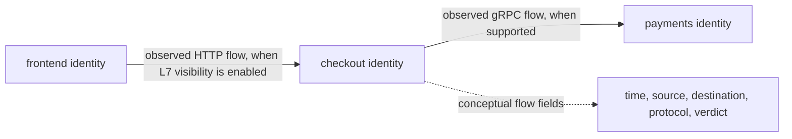

<!-- section: Observability | category: Observability | tags: concept, ebpf, kernel, network-observability | role-priority: important | general-importance: specialized -->
[](#)
[](#)
[](#)
[](#)
[](../../../docs/topic-importance.md)
[](../../../docs/topic-importance.md)

# eBPF Observability

## Definition

**eBPF** (extended Berkeley Packet Filter) is a Linux kernel technology for running sandboxed, event-driven programs in kernel space. Programs are compiled to bytecode, statically analyzed by an in-kernel **verifier** (checks include permitted memory access and provable control-flow constraints), attached to hook points, and communicate with user space through **maps** (hash tables, ring buffers).

> **Textbook Definition:** Extended Berkeley Packet Filter (eBPF) provides verified, event-driven programs attached to supported kernel or application hooks, enabling collection of runtime observations through controlled interfaces such as maps.

Key concepts:

| Concept | What it is |
| ----------- | -------------------------------------------------------------------------------------------------------------- |
| Program | Compiled bytecode executed by the kernel VM on hook triggers |
| Hook | Attachment point: kprobe, tracepoint, XDP, tc, LSM, uprobe, socket ops |
| Verifier | Static checks of permitted memory access and control flow before load; not a security or correctness guarantee |
| Maps | Shared key/value stores between kernel programs and user space |
| CO-RE + BTF | Compile Once, Run Everywhere; relocations use BTF type metadata within supported kernel/feature boundaries |
| Ring buffer | High-throughput map type streaming events to user-space agents |

Observability angle: kernel hooks can expose selected execution and network events without modifying application source. Agent installation, privileges, runtime support and deployment changes are still required. Events may be lost or omitted.

---

## First Principles

Applications use operating-system interfaces for scheduling and I/O. Observing those interfaces can reveal work that application logging does not report. A hook executes on a hot path, so collection must use controlled access, bounded data structures and finite work. Kernel events lack business intent; encrypted traffic, runtime stacks and unsupported protocols can hide higher-level meaning. That is why kernel observations and application spans answer different questions.

## Why It Matters

Use eBPF when a compatible node-level agent can answer a specific network, scheduling or execution question across otherwise uninstrumented workloads. A dropped connection can be visible even if the application never logged it. That evidence complements application tracing, which knows the checkout operation and authorized user context. Node-level collection can reduce per-workload integration work, but it still consumes resources and requires privileged operational ownership.

## How It Works

### 1. From source to telemetry



### 2. Common hook points

| Hook | Fires on | Observability use |
| -------------------- | ---------------------------------------------------------------------------- | ------------------------------------------------------------------------------------------------------------------------ |
| kprobe/fentry | Kernel function entry/exit (`tcp_v4_connect`) | Connection counts, latency |
| tracepoint | Fixed kernel event sites (sched, net, syscalls) | Stable syscall tracing |
| XDP | Early packet ingress; exact mode depends on driver, kernel and configuration | DDoS metrics, fast drops |
| tc (traffic control) | Packet in/out per interface | Per-pod flow accounting |
| LSM | Security decision points | Observation or enforcement under a configured policy |
| uprobe | Entry/return at a selected user-space function | Observe selected arguments or results when supported and authorized; plaintext may be visible at some library boundaries |

### 3. Network observability with Cilium and Hubble

Cilium uses eBPF programs at several networking hooks, including traffic-control, socket/cgroup and XDP paths depending on configuration. It associates datapath observations with Cilium endpoint identity and applies configured policy. Hubble exposes selected flow events from that datapath. The following is a conceptual example, not a literal Hubble API record:



L3/L4 flow records reveal endpoints and verdicts. HTTP/DNS details require supported L7 visibility configuration; Cilium can redirect traffic through an Envoy proxy for that layer. Encryption and unsupported protocols limit what can be decoded. Do not equate default flow telemetry with complete request traces.

### 4. Pixie protocol telemetry

Pixie deploys node agents and uses eBPF probes plus protocol parsers and PxL queries to observe supported Kubernetes workloads. It can reconstruct selected request/response activity when the runtime, protocol and probe are compatible. Compatibility depends on libraries, symbols, privileges and where encryption occurs; this does not establish business spans or universal payload coverage. Treat captured payloads as sensitive data and verify the current project release and support matrix before adoption.

### 5. Security use overlap

| Tool | Mechanism | Posture |
| -------------------- | -------------------------------------------------------------------- | ---------------- |
| Falco | Syscall event sources -> rule engine -> alerts | Detect (default) |
| Tetragon | kprobe/LSM policies with configured detection or enforcement actions | Detect + enforce |
| Cilium NetworkPolicy | Identity-based datapath policy; configured L7 policy may use a proxy | Enforce |

These tools use different hooks, event models and policies. A kernel enforcement action and delivery of its user-space event are separate outcomes. Correlate identity/time fields deliberately; do not assume one identical event stream or complete audit coverage.

### 6. Risks and overhead

- **Kernel coupling**: required kernel features, BTF availability and agent compatibility vary by probe and managed platform.
- **CPU cost**: hook frequency, parsing, stack unwinding and export volume determine overhead. Measure representative and peak workloads.
- **Memory**: ring buffers sized in MiB per node; undersized buffers can drop events — monitor buffer loss.
- **Privilege surface**: loading programs requires root-equivalent capabilities (CAP_BPF, CAP_PERFMON and other capabilities depending on kernel, program and deployment); treat who-can-load-programs as production access.
- **Verifier friction**: legitimate programs get rejected; iteration requires verifier literacy.

---

## Example: Trace a Narrow Kernel Question

On a supported Linux host with bpftrace installed and permission to attach to this tracepoint:

```bash
# Count observed syscall entries by process command name during this run.
sudo bpftrace -e 'tracepoint:raw_syscalls:sys_enter { @[comm] = count(); }'
```

Run a known local workload, then stop tracing with Ctrl-C and inspect the counts. This is a count over the collection period, not automatically a per-second rate. `comm` is a bounded command name, not a globally unique process/service identity. Short-lived work, probe loss and namespace mapping affect interpretation. This command requires Linux; it cannot be validated against a macOS kernel.

For sustained operation, use an agent with a documented kernel/runtime compatibility matrix. Monitor failed attachments and lost-event counters; a quiet graph can mean a broken probe.

### Follow one event from hook to user space

A network connection hook runs when the relevant kernel operation occurs. A program extracts only the allowed metadata and writes an event to a map or ring buffer. A user-space agent drains the buffer, associates the event with workload identity and exports it. Buffer reservation failure must increment/report a loss signal; it must not block the kernel path. A connection attempt observed at function entry is not proof of successful connection or completed HTTP work.

Hand-written probes also need a user-space loader, generated type information, headers, correct CO-RE reads, byte-order conversion and target-kernel verification. A C fragment containing direct `struct sock` dereferences is not a complete portable counter. Avoid deploying it as if compilation alone proved its behavior.

### Network visibility and enforcement have different jobs

Cilium identity-based policy determines permitted traffic; Hubble reports observed flows under the configured collection policy. Not every allowed/denied packet becomes a complete retained audit record. L7 restrictions need protocol parsing and may introduce a proxy path. DNS access also needs a correctly scoped transport/port policy rather than a blanket assumption that selecting a DNS pod resolves all traffic.

A Tetragon tracing policy can observe sensitive behavior or perform enforcement actions. Start with detection, verify the target syscall/hook arguments and policy version, then stage enforcement with a rollback path. A broad kill-on-file-access rule can terminate legitimate processes; a log of an attempted read does not prove it was blocked before data access. Exploratory probes should not silently become production kill rules.

## Real-World Use Cases

These are hypothetical investigations; visibility and outcomes depend on the deployed hooks and policies.

### 1. Map dependencies when application changes are difficult

For a legacy estate where application instrumentation is difficult, a compatible Cilium deployment may expose selected network dependencies. Validate workload support and L7 configuration before treating the view as a complete graph or using it to calculate request latency.

### 2. Diagnosing "network is slow" with kernel evidence

For intermittent checkout timeouts, Hubble may show denied flows from a misidentified workload to a required dependency. Verify the policy, endpoint identity and time window before changing labels or rules; a flow record narrows the investigation but does not establish the application cause.

### 3. Runtime breach containment

A configured Tetragon action may terminate a process at a supported hook. Separately verify whether the event reached the user-space collector and retain the identity and process ancestry required for investigation; enforcement and event delivery are distinct outcomes.

### 4. Sidecar-free mesh economics

A fleet considers moving selected flow telemetry from sidecars to node agents. Compare actual resource cost, protocol visibility and failure isolation. WireGuard/IPsec network encryption is different from application/mesh mutual TLS; eBPF observation alone does not preserve every authentication or L7 policy guarantee.

---

## Common Mistakes

| Mistake | Fix |
| ------------------------------------------------- | ----------------------------------------------------------------------------------- |
| Loading ad-hoc probes on prod kernels casually | Version-controlled programs, staged rollout, verifier-tested against target kernels |
| Undersized ring buffers, silent event loss | Size buffers to peak; alert on buffer-drop counters |
| Ignoring kernel/version matrix (BTF availability) | Document supported nodes; pin distro images where possible |
| Granting broad BPF-loading rights widely | Restrict CAP_BPF/CAP_PERFMON to the platform agents only |
| Replacing OTel entirely with eBPF | Keep app-context spans (queue depth, feature flags); eBPF sees I/O, not intentions |
| Reading Hubble flows as full audit logs | Flow records summarize; enable deep L7 tracing selectively |
| Assuming zero overhead | Measure per-hook CPU; disable debug probes after incidents |

---

## Best Practices

1. **Prefer a maintained agent over an ad-hoc probe when it fits.** Validate its kernel, runtime and protocol compatibility for the nodes you operate.
2. **Pin minimum kernel versions** (according to the chosen agent compatibility matrix) and verify BTF support in your node images before rollout.
3. **Monitor the monitoring**: buffer drops, agent restarts, per-hook CPU belong on dashboards.
4. **Use eBPF for breadth, OTel for depth**: kernel-level flows provide selected lower-level coverage; SDK spans add business context. They compose.
5. **Tie security policy to the same identity model as telemetry** (Cilium labels) while keeping observation loss distinct from policy enforcement.
6. **Stage probe rollouts like code deploys**: canary nodes first, rollback plan ready, verifier output archived.
7. **Keep enforcement separate from exploration**: debugging probes stay read-only; anything with Sigkill lives under change control.
8. **Document the privilege story**: who can load programs, from which registry, signed how — auditors will ask.
9. **Sample smartly for L7 payloads**: capture bodies only for allow-listed routes; default to metadata.
10. **Rehearse kernel-upgrade compatibility**: test new node images against your eBPF stack in preprod every cycle.

---

## Performance Considerations

Measure hook execution frequency, parsing and stack-unwind cost, map/buffer memory, user-space drain capacity and lost events. A verifier-approved program can still add unacceptable latency or expose sensitive data. Node upgrades can change available hooks, BTF metadata and helper support; exercise the deployed agent against candidate kernels and retain a rollback plan. There is no universal percentage overhead or safe buffer size.

## Summary

eBPF attaches verified programs to supported hooks and passes selected observations through maps to user-space agents. Verification constrains programs; it does not guarantee complete telemetry, correct policies or zero overhead. Explain the hook, identity, loss and privilege boundaries of a specific tool, then combine network evidence with application context.

## See Also

- [Section revision questions](REVISION.md) — work through the drill after finishing this category

- [Continuous Profiling](40.4.4.02-continuous-profiling.md) — always-on profilers are eBPF's flagship observability use
- [Health Checks](../02-errors-and-health/40.4.2.02-health-checks.md) — eBPF sees the network reality probes approximate
- [Kubernetes Stack](../../40.2-kubernetes/INDEX.md) — Cilium and Hubble add Kubernetes-aware network policy and flow visibility
- [Monitoring](../01-pillars/40.4.1.02-monitoring.md) — kernel-level events explain what user-space metrics cannot
- [OpenTelemetry (OTel)](40.4.4.01-opentelemetry.md) — eBPF auto-instruments where OTel SDKs cannot reach
- [Security](../../../20-backend/20.5-security/INDEX.md) — eBPF policies and network controls have distinct enforcement boundaries

---

## References & Learn More

- [ebpf.io](https://ebpf.io/) — ecosystem overview and project map
- [Cilium documentation](https://docs.cilium.io/) — kernel networking, identity, policy
- [Hubble documentation](https://docs.cilium.io/en/stable/observability/hubble/) — flow observability
- [Tetragon documentation](https://tetragon.io/docs/) — policy-based tracing and enforcement
- [Falco documentation](https://falco.org/docs/) — runtime threat detection
- [Pixie](https://px.dev/) — auto-telemetry architecture and PxL queries
- [bpftrace reference guide](https://github.com/bpftrace/bpftrace/blob/master/docs/reference_guide.md) — one-liner language
- [Brendan Gregg — eBPF pages](https://www.brendangregg.com/ebpf.html) — performance use cases
- [Linux kernel BPF docs](https://docs.kernel.org/bpf/index.html) — verifier and map semantics from the source
- [Verifier checks](https://docs.kernel.org/bpf/verifier.html) — permitted memory and control-flow analysis
- [Cilium Layer 7 visibility](https://docs.cilium.io/en/stable/observability/visibility/) — protocol configuration and proxy boundaries
---

[← Previous: Continuous Profiling](40.4.4.02-continuous-profiling.md) · [ Back to Index](INDEX.md)
