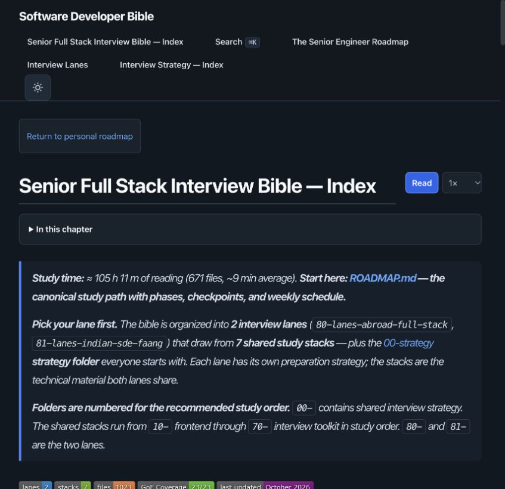
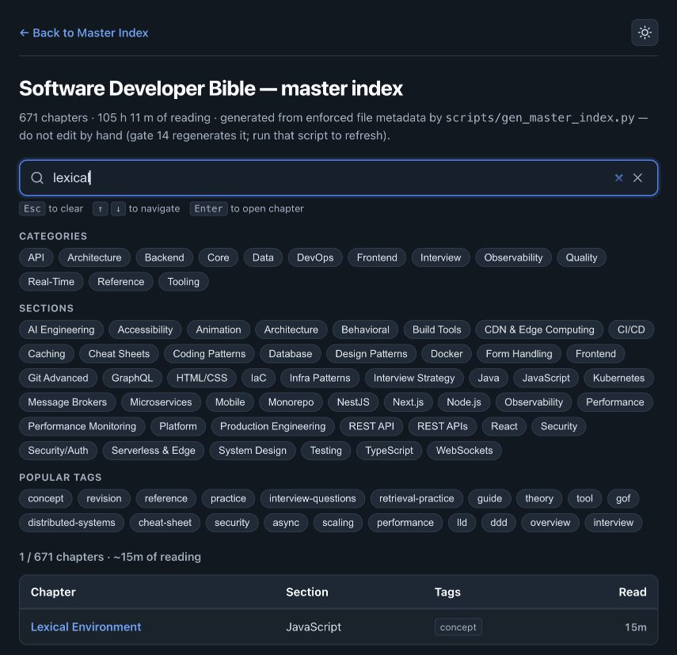
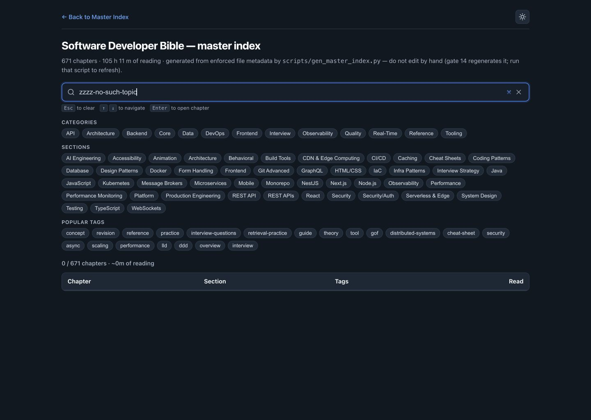
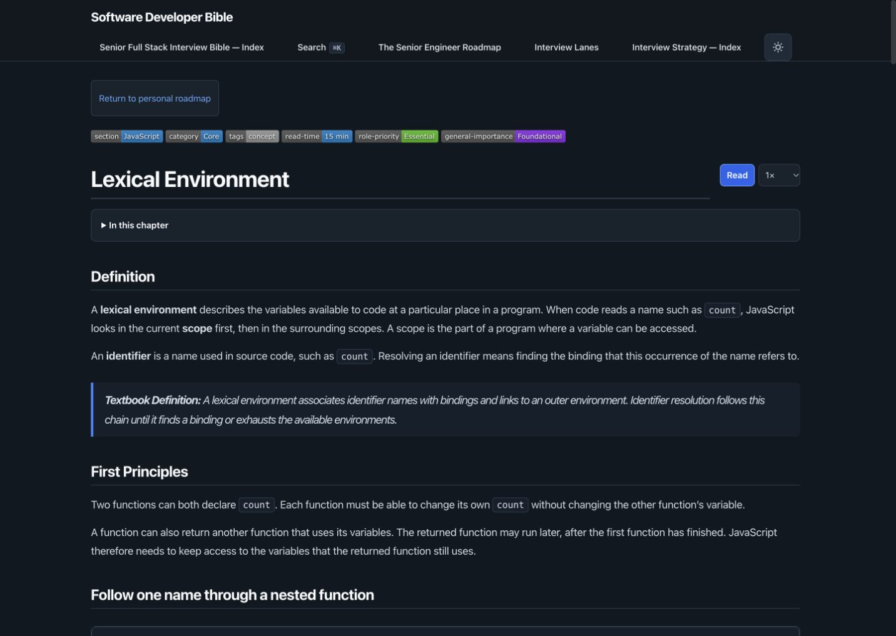
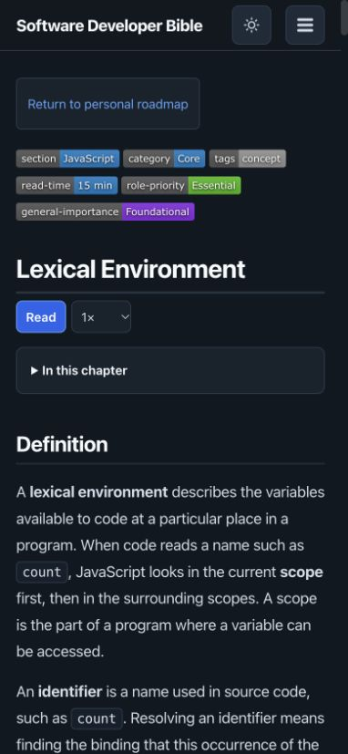
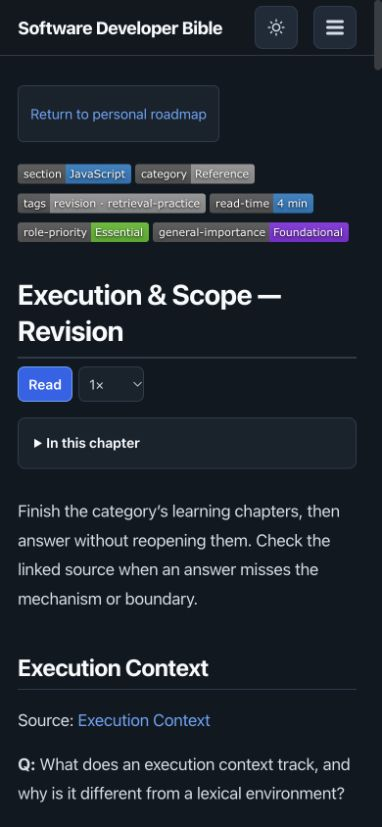
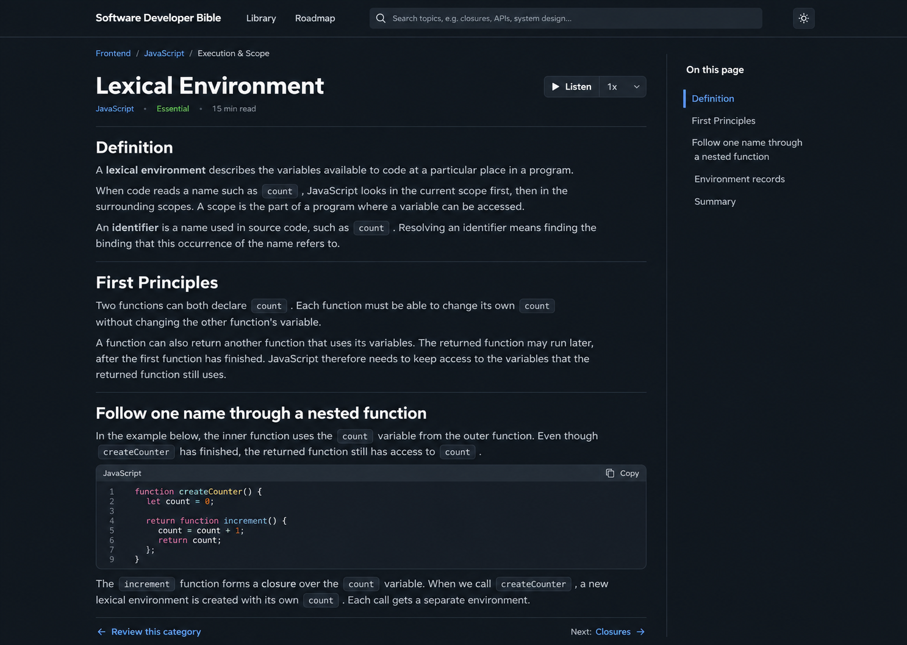
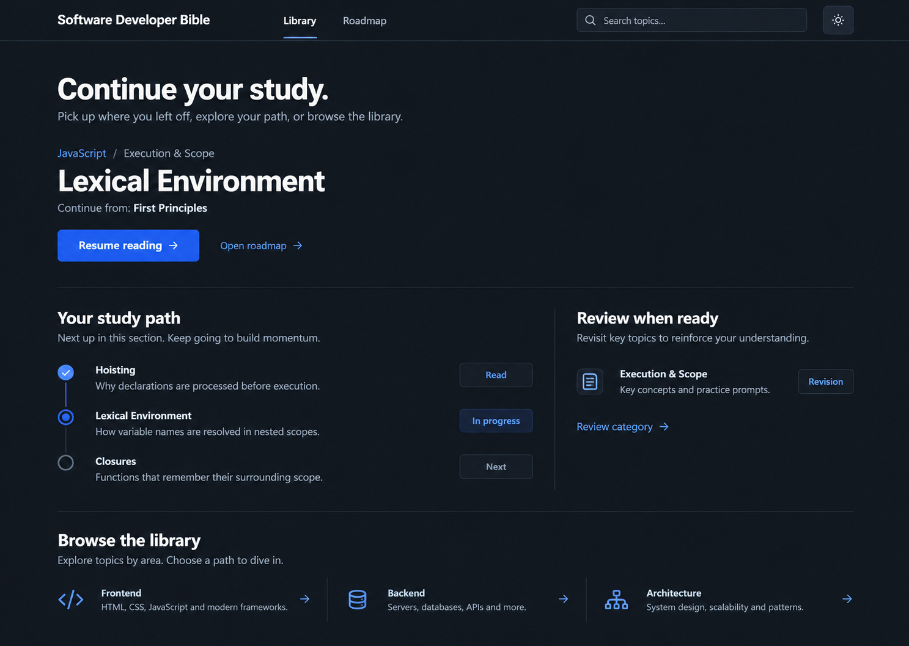
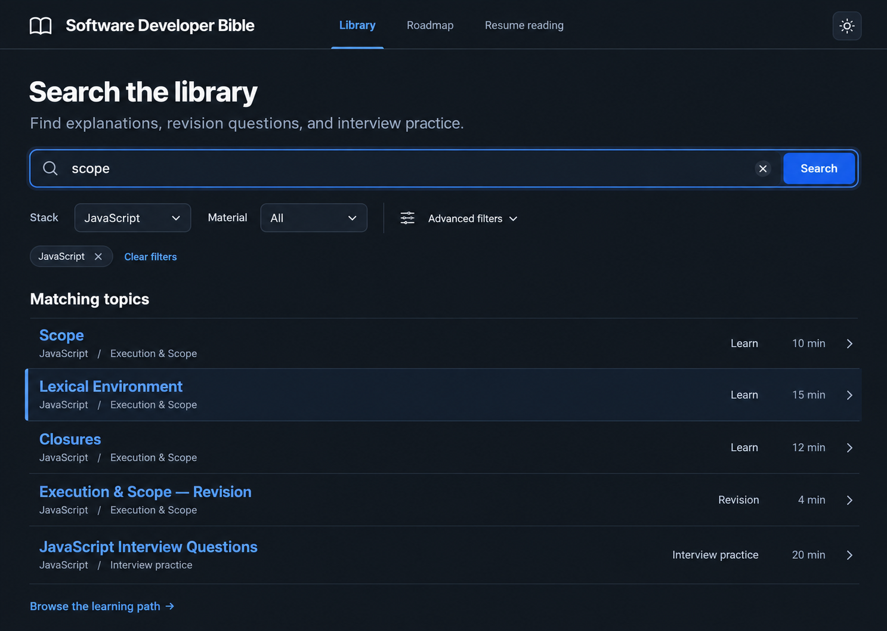

# Study Flow UI/UX Proposal

**Date:** 2026-10-11
**Status:** Refined and implemented locally; verification is recorded in the project-root design QA report.
**User outcome:** Find a topic, read it comfortably, revise the category, and resume later.

## Recommendation

Improve the existing static study site in place. Start with search and the chapter reader, then add revision affordances and local resume state. Keep the slate-and-blue visual language, authored learning flow, existing URLs, browser narration, and generated content metadata.

Use a compact shared header and human-readable chapter context. Show the content and next useful action early. Treat a saved reading position as continuity, not evidence of mastery.

## Evidence and limits

The current checkout was rendered with the pinned Jekyll stack and inspected in the Codex in-app browser. Desktop chapter captures used a 1440 × 1024 viewport; mobile chapter and revision captures used 390 × 844. Other captures used the browser's default viewport. Screenshots below are from this inspection, not historical evidence.

The production site displayed its sign-in screen. The authenticated production journey was not inspected. On the local macOS build, the root displayed the master index rather than the separate authored homepage. `index.html` and the output of `INDEX.md` differ only by case; verify routing on a case-sensitive build before changing the homepage. Findings about the homepage's intended actions come from source review, not a production screenshot.

| Step | Surface and observed health | Main finding |
| ---- | --------------------------------------------------------- | ------------------------------------------------------------------------------------------------------------------------------------ |
| 1 | Master index: useful learning order, dense entry | Long navigation titles and repository terminology compete with study actions. The rendered page also receives chapter-only controls. |
| 2 | Search: functional, visually heavy | A large collection of filters stays above results even after a query narrows the list to one chapter. |
| 3 | Chapter: readable text and useful tools, weak orientation | Metadata badges and a roadmap return link precede the title; wide desktop prose lacks a nearby persistent outline. |
| 4 | Revision companion: intact questions and source links | Answers are visible immediately, despite instructions to answer before checking. |
| 5 | Resume: unavailable in inspected study UI | Source review found persisted theme state but no saved chapter reading position. Cross-session resume could not be exercised. |

Search correctly found **Lexical Environment**. Its URL retained the query. The chapter linked to its category revision, and revision groups retained links to source chapters. These are useful foundations to preserve.

Search with an unmatched query showed a zero count and an empty table, without a recovery message. The screenshot is evidence of the empty state; it is not a claim about every query or filter combination.

### Master-index evidence

### Search evidence

### Reading and revision evidence

Visual captures do not establish screen-reader quality, contrast compliance, narration behavior, zoom resilience, or performance. Those remain implementation acceptance checks. Homepage routing and authenticated return behavior need a production-equivalent build.

## Three approaches

| Approach | Primary screen | Advantage | Trade-off |
| ---------------------------- | ------------------------------------------------------------------ | ------------------------------------------------------------ | --------------------------------------------------------------------- |
| Focused Reader — recommended | Chapter with compact header, contextual outline and onward actions | Improves the long reading sessions the site already supports | Discovery and resume still need supporting changes |
| Study Hub | Home with a dominant resume action and a small study sequence | Makes the next session easy to start | Depends on reliable stored state and needs a useful first-visit state |
| Search Library | Search with immediate results and optional filters | Fastest route for a known weak area | Gives less guidance to someone following a curriculum |

The Study Hub mock shows illustrative read-state markers. Completion tracking is outside this first release; use the authored sequence and the saved reading position rather than infer that a chapter has been mastered.

All three retain the current palette. Visual alternatives change hierarchy and emphasis rather than introduce unrelated branding. Generated screens are conceptual references; their sample prose, code and progress states do not replace authored material or describe real user activity.

## The intended journey

1. **Find:** Enter a topic or browse the existing learning sequence. Results identify the chapter, its stack/category context, content type and estimated reading time.
2. **Read:** Open the existing chapter URL. See its title and context immediately, then the authored content. Move between sections with an outline.
3. **Continue or revise:** Follow the authored next chapter or open the category revision companion. Category revision follows the learning chapters; interview practice remains its own drill.
4. **Resume:** On a later visit, explicitly choose Resume reading. It returns to the saved chapter and section. A direct link with a section fragment keeps its requested destination.

### Home and navigation

Use short labels: **Home**, **Library**, **Roadmap**, **Search**. Keep the theme control in the same position across surfaces. The master index remains available as Library; do not rewrite learning-flow indexes as bare lists.

First visit: show **Find a topic** as the primary action, with **Start the roadmap** and lane guidance below. Returning visit: replace the primary action area with a single saved chapter and **Resume reading**; leave search available. Hide the resume area when there is no valid saved position.

Distinguish the site's study roadmap from the personal roadmap. Promote a personal-roadmap return action when valid roadmap context is present. Without context, provide an ordinary secondary Personal roadmap link rather than presenting it as a return destination. Preserve the existing fixed-origin validation and task/date propagation contract.

### Search and library

Rename the screen **Search the library**. Replace generator instructions in the visible introduction with: **Find explanations, revision questions, and interview practice.** Keep maintenance instructions in repository documentation.

Place results immediately below the query and one compact filter row. Offer **Stack** and **Material** filters, with Material values **Learn**, **Revision**, **Interview practice**, and **Reference**. Put advanced category/tag filtering in an expandable area. Keep selected filters visible and provide **Clear filters**. Derive material type from explicit path/metadata rules, with interview-question paths classified before generic concept tags; do not relabel source metadata to suit the UI.

Each result is a grouped row with title first, readable stack/category context second, then material type and reading time. On mobile, stack the secondary information beneath the title. Avoid a wide multi-column table for ordinary search results. Preserve semantic tables in educational content where comparisons require them.

Maintain existing `q`, `cat`, `sec`, and `tag` query parameters. Add the new material parameter without deleting validated roadmap context. Restore filter state from the URL, and retain it when returning from a chapter using browser Back.

For no matches, show **No topics match your search**, followed by **Clear filters** when filters are active and **Browse the library**. Clearing filters preserves the typed query; clearing the query preserves filters. Do not advertise full-text or semantic search: the initial scope remains metadata search.

### Chapter reader

Use a compact header, breadcrumb, chapter title, and one restrained metadata row. Preserve section, category, tags, priority and importance in an expandable **Chapter details** area. Markdown remains canonical; enhancement changes presentation, not authored facts.

Keep the default wide reading layout. Add an optional **Comfortable width** preference for readers who want prose around 65–75 characters per line. This is deliberate: the current browser test requires paragraphs to fill the article, so the plan must not silently replace that behavior. Wide code, diagrams and tables use a larger reading region with internal horizontal scrolling when necessary.

At desktop widths of at least 1200 px, place an outline beside the article without squeezing the reading column. At smaller widths, keep an expandable **On this page** control. Derive labels and anchors from authored headings. Mark the current section visually and programmatically without moving focus as the reader scrolls. If headings or JavaScript are unavailable, the chapter remains fully readable.

Keep narration near the title as a secondary **Listen** action. Retain speed choices, pause/resume, stop, spoken-block highlighting, error and unsupported-browser behavior. No autoplay. Keep control labels synchronized with playback state.

After the authored Summary, offer a small navigation group with **Next chapter** and **Review this category**, while retaining See Also and References. Use the authored chapter navigation and actual revision companion, not filename guesses or duplicated question content. At category boundaries, revision precedes interview practice. If a target is unavailable in the published catalog, omit the action rather than emit a dead link.

### Revision companion

Enhance each authored Q/A pair with a **Show answer** disclosure while retaining the source-link grouping. Hide the answer only after successful enhancement; without JavaScript all questions and answers remain visible. Include a **Show all answers** control and expose all answers when printing.

Preserve answer paragraphs, code, lists, diagrams and links as a single answer group. Parsing must stop at the next question or heading and leave uncertain structures untouched. Do not collapse interview banks into this feature or move revision questions into learning chapters.

Do not add scoring, mastery claims, spaced repetition scheduling or completion percentages in this phase. The initial goal is to support recall before checking an answer.

### Resume behavior and failures

Store only a canonical same-origin published chapter path, section anchor, bounded display title/section label and save timestamp under a versioned study-resume key. Keep one recent chapter, not a browsing history. Exclude query parameters, personal roadmap task/date context, authentication routes and private source paths from stored state.

Save a position after deliberate reading activity: a content section becomes current after a user scrolls, follows an outline link, or narration reaches it. Opening search, an index or a revision companion does not replace the last learning-chapter position. Use throttled writes and retain an in-memory fallback when storage throws.

Do not automatically jump on page load. Explicit Resume reading applies the saved position; an explicit URL fragment wins. If the saved anchor disappeared, open the chapter start and explain **This chapter changed; opening from the beginning.** If its path is no longer in the published catalog, discard that record and show the first-visit action. Corrupt or incompatible state is ignored. Provide **Clear saved position** with a confirmation-free, reversible UI state change. Label it **Saved on this browser**; do not imply cross-device synchronization.

## Visual and interaction rules

Use the current system sans-serif and existing monospace stack. Base UI text is 14–16 px; article text is 17–18 px with a line height around 1.7. Use a 4/8 px spacing scale and 16 px mobile gutters. Existing token names remain the starting point: `--theme-bg`, `--theme-text`, `--theme-text-muted`, `--theme-heading`, `--theme-link`, `--theme-border`, and action/syntax tokens.

Prefer typography, spacing and simple row dividers. Reserve prominent blue fills for the primary action. Do not add decorative images, rainbow status badges, gradients or a dashboard of metrics. Support light, dark and system modes consistently.

Use visible labels, native links/buttons/disclosures, logical focus order and announced state. Filters expose selected state; result-count updates use a restrained status announcement. Keep arrow navigation scoped to the result-navigation interaction so it does not swallow keys on unrelated controls. Theme, narration and mobile menu controls should offer 44 × 44 px targets as a product design choice.

The accessibility acceptance target is WCAG 2.2 AA, with checks for contrast, reflow, keyboard use, focus visibility and obstruction, labels and status messages. This is a target, not a compliance claim. See the verified [W3C WCAG 2.2 standard](https://www.w3.org/TR/WCAG22/).

## Delivery plan

Each phase can be reviewed and shipped independently after a visual direction is selected. Retain Jekyll, static HTML/CSS, vanilla JavaScript and the existing Cloudflare access boundary.

| Phase | Deliverable | Primary source owners | Acceptance |
| ---------- | ------------------------------------------------------------------------------------------------- | ---------------------------------------------------------------------------------------------------------------------- | ---------------------------------------------------------------------------------------------------------------------------------------------------------------- |
| 1 — Find | Search hierarchy, result rows, filters, empty state, shared short navigation labels | `scripts/gen_master_index.py`, generated `search.html`, `_config.yml`, shared header include introduced only if needed | A known topic is discoverable before opening advanced filters; mobile results reflow; URL filters and browser Back work |
| 2 — Read | Compact context, chapter details, desktop outline, optional comfortable width, continuation links | `_includes/head-custom.html`, `assets/reading-ui.js`, `assets/reading-ui.css`, existing narration assets | Readable at 320/390/768/1440 px in both themes; default wide layout preserved; code and diagrams retain usable width; narration and focus behavior remain intact |
| 3 — Revise | Answer disclosures on revision companions | Proposed focused `assets/revision-ui.js` and companion styling | Questions and source groups unchanged; answers reveal by keyboard; printing and no-JavaScript reading include every answer |
| 4 — Resume | Versioned local saved position and returning home state | Proposed focused `assets/study-resume.js`, `index.html`, reader hook | Explicit resume, fragment precedence, unavailable/corrupt storage, removed anchors and removed paths all behave as specified |

Before phases 2 and 4, establish an explicit published-page catalog from the build's actual outputs. The generated search/API catalog currently includes some paths excluded by `_config.yml`; do not assume every search row is a deployed page. Preserve the API's existing consumers and corpus digest; add a separate published navigation view rather than changing its contract incidentally.

Keep source and generated output synchronized: modify the generator, then regenerate search; never hand-edit generated `search.html`. Keep the chapter enhancement entry point small. Add focused modules only for new stateful responsibilities, rather than moving unrelated styling and scripts wholesale.

### Verification plan

- Search: meaningful browser coverage for query/filter round trips, zero results, selected state, keyboard action scope, query-preserving filter reset and mobile reflow. Confirm catalog paths exist in a case-sensitive production-equivalent build.
- Reader: extend `scripts/test_reading_ui_browser.cjs` and `scripts/test_reading_pages_browser.cjs` around outline location/focus, default wide layout, optional comfortable width, chapter details and continuation. Preserve existing narration tests and `assets/roadmap-return.js` tests.
- Revision: verify a real authored answer containing multiple paragraphs or code, all-answer reveal, source links, print visibility and disabled JavaScript. Do not test only a synthetic single-paragraph pair.
- Resume: cover denied storage, malformed schema, stale path/anchor, explicit fragments, query exclusion and clear-position behavior. Test one actual browser reload and the home-to-chapter resume journey.
- Accessibility: manually check keyboard-only navigation, a screen reader, 200% zoom, reflow at 320 CSS px, reduced motion, contrast in both themes and visibility of focused elements under sticky UI. Screenshot review alone does not pass this gate.
- Before any commit/push: recompute counts with `python3 scripts/check_counts.py --write`; verify any new external citations and update their baseline; run `bash scripts/verify.sh` and `python3 scripts/check_links.py`. Stage only changes belonging to this work; preserve pre-existing edits.

### Success criteria

Compare the same representative tasks before and after: find a known chapter, find a revision companion, move to the next learning chapter, and resume at a saved section. Record task success, navigation steps, mistakes and reader feedback in a short manual study; do not invent conversion gains or add analytics collection.

The release is acceptable when a reader can complete those tasks using keyboard or touch, no authored material is lost, canonical links remain valid, fallback reading works without enhancement, and the relevant browser checks and repository gates pass.

## Visual concepts and generation brief

These are the three independent built-in ImageGen outputs, numbered in the order displayed in the chat. They are static design concepts, not working prototypes. The written requirements govern behavior and authored content.

### Option 1

### Option 2

### Option 3

**Shared generation direction:** Produce one realistic UI screen per call, targeting a 1440 × 1024 desktop viewport. Use the current slate background, offwhite headings, muted body text, blue links/actions, system sans and existing monospace style. Prioritize the study task through typography, whitespace and simple dividers. Avoid dashboards, nested cards, decorative imagery, private information, fabricated mastery metrics and browser/device frames. Anchor any time-sensitive data to 2026-10-11; these concepts show no dates.

**Reader prompt:** Attach the current desktop chapter screenshot. Show compact navigation, breadcrumbs, Lexical Environment, restrained metadata, Listen and speed controls, authored-style text and code, a right-hand section outline, and quiet revision/next-chapter actions.

**Hub prompt:** Attach the same chapter screenshot as a visual-language reference. Show a returning learner's dominant Resume reading action, the saved First Principles section, a small authored sequence, category revision and simple browse links. Treat all read-state markers as illustrative.

**Library prompt:** Attach the current search screenshot. Replace the chip wall with compact Stack and Material filters, optional advanced filters, active-filter removal and immediately visible grouped results. Use Scope, Lexical Environment, Closures, the revision companion and interview practice as illustrative rows. Reading times and match membership in the image are sample data; the implementation uses generated catalog values and actual search behavior.

## Decision needed

Choose the visual emphasis from the three generated concepts, or request a combination. The recommended first investment is the Focused Reader supported by improved search. This draft then becomes the basis for a task-level implementation plan.

## Final refinement approved for implementation

The user requested final refinement followed by implementation on 2026-10-11. Use the Focused Reader structure with the Search Library discovery layout. Preserve the existing wide default; Comfortable is opt-in. The final reference is [Focused Reader](assets/2026-10-11-study-flow/focused-reader-final.png). Its abbreviated lesson text is illustrative: all implemented lesson text remains authored. Desktop outline and compact metadata are the fidelity targets; mobile adapts to a disclosure. Resume labels are bounded chapter/section text, never queries or roadmap context.
